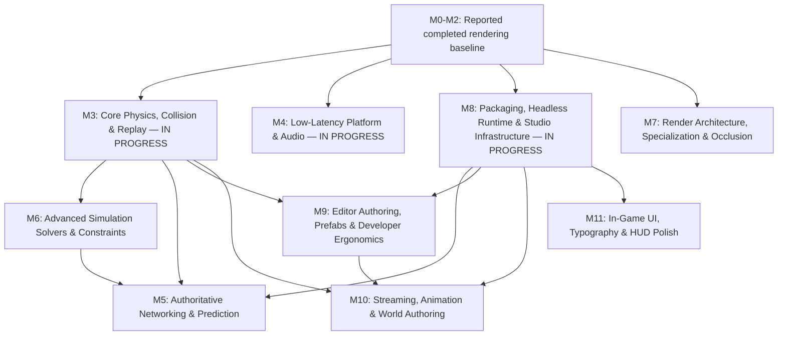

# DarkFire Engine — Improved Engineering Roadmap (Direct3D 11)

**Purpose:** single planning reference for architecture, active work, dependencies, and completion evidence.  
**Status source:** completed statuses are carried over from the previous roadmap and must remain backed by reproducible test and benchmark artifacts.  
**Current implementation focus:** **Milestones 3, 4, and 8 are IN PROGRESS**, not pending-from-scratch.

## 1. Status and Completion Rules

### Status legend

- **COMPLETED:** implementation and required evidence exist.
- **IN PROGRESS:** implementation has started; remaining work is listed explicitly.
- **PLANNED:** implementation has not been accepted as started.
- **BLOCKED:** a named dependency prevents completion.

### Definition of done

A feature is complete only when all applicable gates pass:

1. **Correctness:** unit and integration tests pass in editor and packaged-player configurations.
2. **Regression safety:** existing automated tests and rendering comparisons remain within approved tolerances.
3. **Performance:** measured against a documented scene, resolution, quality preset, build configuration, and hardware target.
4. **Stability:** no unresolved resource-lifetime, thread-safety, serialization, or debug-runtime errors.
5. **Operational evidence:** test output, benchmark capture, and a short completion note are stored with the milestone.
6. **Documentation:** public APIs, defaults, limitations, and project-facing settings are current.

Absolute claims such as “eliminates ghosting,” “zero latency,” or “guaranteed memory savings” require narrowly defined test conditions. Otherwise, describe the measured reduction instead.

## 2. Core Architectural Principles

### 2.1 Game-agnostic engine core

- **Engine layer (`Engine/`)** contains reusable primitives, rendering passes, physics and collision algorithms, deterministic scheduling utilities, audio spatialization, networking, serialization, and resource management.
- **Project layer (`Templates/<GameName>/Source/`)** contains gameplay rules, vehicle tuning, weapon behavior, checkpoints, named input actions, and project-specific audiovisual logic.
- Engine defaults must not hardcode project concepts. For example, audio buses and input maps are data-driven; `Engine`, `Music`, `Jump`, and `Fire` are examples or project data, not mandatory engine rules.

### 2.2 Determinism is a declared contract, not a timestep feature

DarkFire distinguishes four properties:

1. **Fixed-step simulation:** stable simulation dt independent of render rate.
2. **Replayability:** the same build, initial state, inputs, and seed reproduce the same state hashes in the supported runtime environment.
3. **Prediction/reconciliation:** clients simulate immediately and correct against authoritative server states.
4. **Cross-platform bitwise determinism:** a separate, stronger guarantee required only if lockstep or cross-platform replay demands it.

Server-authoritative prediction does not require universal floating-point determinism. Every networked milestone must state which guarantee it uses.

### 2.3 Delivery and profiling are continuous foundations

Packaging, headless execution, crash reporting, profiling, and benchmark capture are not final-polish activities. A minimal form is delivered in Milestone 8 while Milestones 3 and 4 are active, then extended by later milestones.

## 3. Execution Graph and Dependencies

### Parallel execution policy

- Milestones **3, 4, 7, and the infrastructure portions of 8** may proceed in parallel when their owners do not share unstable APIs.
- Milestone 5 requires the **M3 replay contract** and **M8 headless runtime**. Advanced gameplay-solver integration requires the relevant M6 interfaces.
- M7 optimization is profile-driven. No instruction-count or occupancy target justifies a rewrite without measured frame-time benefit.
- M10 streaming must land before large terrain/foliage scenes become the standard development workload.
- Basic debug HUD/text may be delivered in M8; full game-facing UI remains M11.

## 4. Completed Baseline and Reconciliation Work

### M0 — Probe Baking and PBR Foundations — REPORTED COMPLETED

- Split-sum BRDF LUT, prefiltered specular IBL, diffuse irradiance, and color LUT cooking.
- Parallax-corrected box-projected local reflections.
- Directional specular occlusion and multi-bounce diffuse cavity AO.
- Normalized PBR material and environment-lighting conventions.

### M1 — GPU, Temporal, and Advanced Rendering Foundations — REPORTED COMPLETED

- GPU-driven frustum and shadow-cascade culling with indirect draws.
- `16 × 16 × 24` view-space clustered dynamic-light assignment.
- Velocity G-buffer, Halton camera jitter, and YCoCg variance-clipped TAA.
- DDGI probe radiance/visibility atlases and Chebyshev-weighted sampling.
- Hi-Z SSR with temporal reprojection and local-probe fallback.
- Clearcoat, anisotropy, cloth, and separable subsurface-scattering material paths.
- Unified HLSL/C++ register bindings and shader audit fixes.

### M2 — Atmosphere, Volumetrics, Camera VFX, Shadows, Exposure, and Water — REPORTED COMPLETED

- Tile-max motion blur with depth-aware reconstruction.
- `160 × 90 × 64` froxel volumetric fog, temporal filtering, and integrated scattering/transmittance.
- Shared spot/point shadow atlas with static-shadow caching.
- Histogram auto-exposure and filmic tonemapping.
- Dual-cascade ocean spectrum, foam, transmission, and subsurface approximation.

### M2.1 — Baseline evidence correction — REQUIRED, NO FEATURE REWRITE BY DEFAULT

Before using the baseline as a release gate:

- [ ] Reconcile **101/101 tests and 259,741 assertions** versus **95/95 tests and 259,470 assertions**. Record one current test identity and result.
- [ ] Re-run all reported benchmarks and store scene revision, resolution, preset, GPU driver, power mode, build type, and timestamp.
- [ ] Mark Deferred Playground3D as **below target** if the validated result remains 244.2 FPS against a target above 300 FPS; do not label it passing.
- [ ] Replace “eliminates ghosting/feedback” language with measured temporal-quality results and known failure cases.
- [ ] Add temporal test scenes for disocclusion, animated materials, particles, thin geometry, and fast camera rotation.
- [ ] Record DDGI update budgets, shadow-cache invalidation tests, and atlas pressure behavior.
- [ ] Retain all M0-M2 implementations unless a reproducible defect or regression requires reopening them.

## 5. Active Milestones and Fast Rerun Plans

### Milestone 3 — Core Physics, Collision, Interpolation, and Replay — IN PROGRESS

**Goal:** provide a stable, queryable, replayable fixed-step simulation foundation before advanced dynamics or networking is finalized.

#### 3.1 Physics/render decoupling and interpolation

- Maintain previous and current simulation transforms using explicit simulation tick ownership.
- Interpolate with `alpha = accumulator / fixedDeltaTime`; use `lerp` for position and normalized `slerp` for rotation.
- Define behavior for spawn, teleport, scene load, and large corrections so stale previous transforms do not cause interpolation sweeps across the world.
- Keep camera interpolation policy explicit; avoid double interpolation between camera and followed entities.
- Convert interpolated render transforms into velocities for motion vectors where required by TAA and motion blur.

**Acceptance:** frame-rate-independent motion at 60/120/144/240 Hz; no jitter after teleports; repeatable captures at fixed simulation ticks.

#### 3.2 Broadphase, filtering, and query contract — ADDED MISSING FOUNDATION

- Add a dynamic broadphase appropriate for moving AABBs and static world geometry.
- Define collision layers, masks, triggers, query filters, and stable entity/user-data mapping.
- Specify query allocation behavior, hit ordering, maximum-hit policy, and thread-safety rules.
- Separate scene queries from simulation mutation through command buffering or a documented phase contract.

**Acceptance:** broadphase stress tests, deterministic query ordering where required, and no unbounded per-query allocation in steady state.

#### 3.3 TriangleMesh and ConvexMesh collision

- Cook immutable mesh collision data with validated indices, bounds, and BVH acceleration.
- Support ray/triangle, sphere/triangle, OBB/triangle, and required convex queries.
- Define backface policy, initial overlap behavior, degenerate triangles, welding, scale handling, and numerical tolerances.
- Distinguish static triangle meshes from dynamic/convex rigid-body collision; do not permit unsupported dynamic concave behavior implicitly.

**Acceptance:** curved-track and architectural-mesh tests, degenerate-input tests, BVH versus brute-force differential tests, and cooked-data reload tests.

#### 3.4 Contact manifolds and base rigid-body solver — ADDED MISSING FOUNDATION

- Define contact normal convention, penetration tolerance, persistent contact IDs, and manifold point limits.
- Implement stable integration, restitution/friction policy, penetration recovery, sleeping, and constraint islands as required by the engine scope.
- Provide a base contact/constraint solver before vehicle-specific force models rely on it.
- Add substep or iteration controls with documented performance and stability tradeoffs.

**Acceptance:** stacking, resting contact, slope, high-gravity, sleeping/wake, and long-duration stability scenes.

#### 3.5 Sweeps and continuous-collision policy

- Implement sphere and oriented-box casts returning distance, normal, entity, and initial-overlap information.
- Define behavior for zero-length casts, starts inside geometry, backfaces, and multiple hits.
- Add a CCD policy for fast rigid bodies; sweeps alone do not constitute a complete CCD system.

**Acceptance:** high-speed tunneling tests, KCC-style sweep tests, and differential tests against small-dt reference simulations.

#### 3.6 Fixed-step replay and state hashing — ADDED NETWORK PREREQUISITE

- Add seeded RNG ownership and stable simulation iteration/order rules.
- Capture initial state plus tick-indexed inputs for replay.
- Hash canonical simulation state at selected ticks; exclude render-only and unordered padding data.
- Document floating-point compiler flags and supported determinism scope.
- Expose `CaptureState`, `ApplyState`, and `SimulateTick` boundaries suitable for later reconciliation.

**Acceptance:** repeated same-build replays produce matching hashes; save/replay diagnostics identify the first divergent tick.

#### Milestone 3 fast rerun order

1. **P0:** lock transform/tick conventions and teleport handling.
2. **P0:** add filtering, broadphase, stable query semantics, and contact conventions.
3. **P0:** complete replay capture/state hashing before networking depends on physics.
4. **P1:** validate mesh BVH and sweeps with differential tests.
5. **P1:** stabilize base contacts, integration, sleeping, and CCD policy.
6. **P2:** run interpolation plus motion-vector regression tests at all target refresh rates.

### Milestone 4 — Low-Latency Platform and Audio — IN PROGRESS

**Goal:** reduce measured latency and provide robust project-facing audio without promising universal latency figures.

#### 4.1 Waitable swap chain and frame pacing

- Configure the waitable swap chain correctly and set maximum frame latency explicitly.
- Wait at the intended point before sampling fresh input and beginning the next CPU frame.
- Support and document present modes, windowed/fullscreen behavior, resize, device removal, and occlusion.
- Handle timeout/device-lost paths without deadlocking the application.

**Required correction:** replace “slashes input lag from ~33 ms to <8 ms” with measured before/after results under named conditions.

#### 4.2 Latency instrumentation — ADDED MISSING FOUNDATION

- Timestamp input sampling, simulation submission, present, and available frame-completion events.
- Integrate platform/vendor latency markers where supported.
- Report median, 95th percentile, and worst-case frame pacing rather than FPS alone.
- Define separate GPU-bound, CPU-bound, and VSync test scenarios.

**Acceptance:** reproducible latency captures demonstrate improvement or identify a bottleneck; no regression in frame pacing or alt-tab/resize recovery.

#### 4.3 Reflex/Anti-Lag integration boundary

- Keep SDK integration behind an RHI/platform capability interface.
- Expose runtime capability detection and safe no-op fallbacks.
- Do not treat an abstraction hook as completed vendor integration.

#### 4.4 Audio velocity, Doppler, and mix buses

- Use simulation-consistent source and listener velocities in documented units.
- Define behavior for teleports, paused audio, missing rigid bodies, and large transform deltas.
- Make bus graphs data-driven with safe default buses and no cyclic routing.
- Implement click-free pitch/gain smoothing using time-based coefficients and audio-thread-safe parameter updates.

**Acceptance:** velocity/Doppler tests, teleport-noise tests, bus mute/solo/volume tests, and parameter-update stress tests without audio-thread allocation spikes.

#### Milestone 4 fast rerun order

1. **P0:** add timestamps and reproducible latency captures.
2. **P0:** validate waitable-object lifetime, resize, device removal, and present-mode behavior.
3. **P1:** replace fixed latency promises with measured budgets.
4. **P1:** validate velocity units and teleport handling.
5. **P2:** complete bus persistence and audio-thread parameter stress tests.

### Milestone 8 — Packaging, Headless Runtime, and Studio Infrastructure — IN PROGRESS

**Goal:** establish a continuously usable delivery pipeline, then expand studio tooling.

#### 8.1 Project settings, schema, and stable identity — DO FIRST

- Version `.dfproj` and asset serialization schemas with migration tests.
- Assign stable asset/entity GUIDs; paths alone are not persistent identity.
- Separate engine defaults, project settings, user/editor preferences, and platform overrides.
- Add CVar registration, validation, serialization policy, and console autocomplete.

**Acceptance:** rename/move assets without broken references; old supported project versions migrate correctly.

#### 8.2 Minimal packaging path — P0 DELIVERY GATE

- Produce a standalone Windows player package with assets, dependencies, and correct executable naming.
- Verify that the package runs on a clean machine or clean test environment without editor/runtime development paths.
- Keep symbols and build identifiers with crash artifacts.
- Add packaging as a CI smoke test before adding more editor UI.

**Acceptance:** packaged project launches, loads a representative scene, runs smoke tests, and exits cleanly.

#### 8.3 Incremental cooking and content hashes

- Hash source content plus importer/cooker version, relevant dependencies, settings, and target platform.
- Use collision-resistant hashes and an atomic cache manifest; do not rely solely on timestamps or a bare 64-bit source-content hash.
- Handle renamed files, deleted outputs, interrupted cooks, and dependency changes.
- Replace guaranteed “<2 seconds” language with measured cold/warm/no-op cook times for named projects.

**Acceptance:** no-op cook reuses outputs; shader include or importer changes invalidate the correct dependents; interrupted cooks never publish partial assets.

#### 8.4 Headless dedicated server and crash handling

- Ensure no Win32 window, D3D device, swap chain, or audio device is required in server mode.
- Separate engine initialization into explicit platform, rendering, audio, simulation, and networking capabilities.
- Generate minidumps with build ID, log, command line, and symbol location.
- Replace universal “<5% CPU, <50 MB RAM” promises with measurements from a named world/tick/client workload.

**Acceptance:** headless smoke test, representative soak test, clean shutdown, crash-dump test, and memory/CPU baseline.

#### 8.5 Multi-instance PIE and network impairment

- Support single player, server plus client, and server plus two clients with isolated content/user paths.
- Inject latency, jitter, loss, duplication, reordering, and bandwidth constraints at a testable transport boundary.
- Seed impairment randomness for reproducible tests.
- Ensure PIE instances shut down without orphan processes or locked cooked assets.

#### 8.6 Offline mesh optimization and LOD cooking

- Apply vertex-cache, overdraw, and vertex-fetch optimization.
- Generate QEM-based LODs with preservation options for boundaries, UV seams, normals, skinning, and collision-relevant geometry.
- Validate LOD screen-space error and memory/performance benefit rather than assuming 50%/25% is optimal for every mesh.

**Acceptance:** no invalid indices or broken tangent/UV seams; cooked LODs survive reload and produce measured benefits.

#### 8.7 Minimal diagnostics HUD — MOVED FOUNDATION

- Provide basic debug text/counters for frame time, simulation tick, network impairment, memory, and cook/runtime status.
- Full layout, MSDF typography, animation, and game HUD authoring remain in M11.

#### Milestone 8 fast rerun order

1. **P0:** stable GUIDs, schema versioning, minimal standalone package, and clean-machine smoke test.
2. **P0:** headless initialization split and crash artifacts.
3. **P1:** dependency-aware atomic cook cache and invalidation tests.
4. **P1:** isolated multi-instance PIE and seeded impairment controls.
5. **P2:** mesh/LOD validation and expanded settings/console UI.

## 6. Scheduled Milestones

### Milestone 6 — Advanced Simulation Solvers and Multi-Body Constraints — PLANNED

**Depends on:** M3 base solver, contact conventions, replay boundaries.

- Nonlinear spring-damper and anti-roll coupling primitives.
- Semi-empirical longitudinal/lateral slip and combined-friction models.
- Aerodynamic drag, lift/downforce, and center-of-pressure moments.
- Multi-point ground-contact and surface-alignment solvers.
- General multi-body joints and constraint limits required by supported use cases.
- Per-solver stability ranges, units, substep guidance, and replay tests.

**Completion evidence:** solver-specific analytic/differential tests, stress scenes, replay hashes, and documented project-facing examples without embedding vehicle gameplay in the engine.

### Milestone 5 — Authoritative Networking and Client Prediction — PLANNED

**Depends on:** M3 replay contract and M8 headless runtime. M6 integration is required for networked actors using those solvers.

#### 5.1 Transport and session architecture

- Reliable lifecycle transport plus UDP gameplay transport with explicit reliability/ordering channels.
- Bounds-checked versioned serialization, sequence/ack handling, MTU-safe fragmentation, and reassembly limits.
- Measured zero-copy claims; avoid lock-free structures unless profiling and ownership semantics justify them.

#### 5.2 Security and abuse resistance — ADDED RELEASE BLOCKER

- Authenticated key exchange/session establishment and documented key management.
- AEAD protection for gameplay packets, replay protection, and secure identity binding across transports.
- Rate limiting, packet-size/reassembly quotas, malformed-packet tests, and server-side input validation.
- No trust in client-provided physics state, timestamps, or asset identifiers beyond the authority model.

#### 5.3 Clock, prediction, and reconciliation

- Four-timestamp offset/RTT estimation with outlier rejection.
- Client input ring, redundant recent inputs, authoritative acknowledgements, and bounded replay.
- Re-simulate through the M3 `CaptureState`/`ApplyState`/`SimulateTick` contract.
- Dynamic pacing changes accumulator consumption only; fixed simulation dt remains unchanged.

#### 5.4 Replication and remote presentation

- Snapshot quantization, delta compression, interest management, priority, and bandwidth budgets.
- Remote interpolation with jitter/loss handling, bounded extrapolation, and Hermite overshoot protection.
- Visual-error smoothing with teleport/spawn exemptions and correction limits.

**Completion evidence:** automated tests under seeded latency/jitter/loss/duplication/reordering; reconciliation cost bounds; bandwidth reports; server soak/fuzz tests; multi-client packaged-headless test.

### Milestone 7 — Render Architecture, Specialization, and Visibility — PLANNED, PROFILE-DRIVEN

**Depends on:** stable M0-M2 baseline; may run alongside active milestones.

#### 7.1 Transient render scheduler and resource pooling — PULLED FORWARD FROM OLD M11

- DAG pass declaration, dependency discovery, inactive-pass culling, and explicit external-resource boundaries.
- Pool compatible transient D3D11 resources by descriptor and non-overlapping lifetime.
- Track SRV/RTV/UAV binding hazards and debug-runtime validation.
- Do not describe compatible D3D11 texture reuse as arbitrary placed-resource aliasing unless the implementation truly provides it.
- Preserve temporal-history ownership and prevent cross-frame reuse of live histories.

#### 7.2 Shader permutation cooking

- Generate only measured, useful material variants with a defined permutation-key schema.
- Track instruction count, register usage, compile time, cache size, and GPU frame time.
- Remove the unsupported promise that lower instruction count automatically doubles occupancy.

#### 7.3 Two-phase Hi-Z occlusion

- Previous-frame visibility pass followed by Hi-Z testing of remaining instances.
- Handle camera cuts, disocclusion, moving bounds, shadow views, and temporal jitter.
- Validate against CPU reference visibility and stress newly visible objects.

#### 7.4 LOD selection and cross-fade

- Dithered cross-fade with explicit two-LOD rendering cost and TAA/motion-vector behavior.
- Hysteresis and stable selection to prevent rapid LOD oscillation.

**Completion evidence:** representative GPU captures, frame-time distributions, memory measurements, correctness comparisons, and no D3D11 debug errors.

### Milestone 9 — Editor Authoring, Prefabs, and Developer Ergonomics — PLANNED

**Depends on:** M8 identity/schema foundations; M3 gizmo/query behavior where relevant.

- Material editor with isolated preview, live instance updates, undo/redo, and dirty-state tracking.
- Recursive/nested prefabs using stable GUIDs, property paths, override tracking, cycle prevention, and reference repair.
- Universal typed asset drag-and-drop with validation and clear/browse/ping actions.
- Hierarchy visibility, locking, grouping, rename, multi-selection, and transactional undo/redo.
- Viewport framing, speed controls, PIE eject, and collider handles.
- Data-driven input action/axis mapping with gamepad support and project-owned examples.
- Content-browser thumbnails, audio preview, navigation, and save prompts.

**Completion evidence:** nested-prefab round trips, rename/move reference tests, undo/redo stress tests, multi-instance PIE tests, and migration of an existing project.

### Milestone 10 — Streaming, Animation, Characters, VFX, and World Authoring — PLANNED

**Depends on:** M8 packaged asset pipeline; M3 collision/KCC foundations; M9 authoring foundations where applicable.

#### 10.1 Asynchronous asset and texture streaming — FIRST IN THIS MILESTONE

- Background I/O/decode with cancellation, priorities, ownership, and bounded GPU upload queues.
- Texture mip policy based on measured residency needs, with fallback mips and safe lifetime management.
- Frame-budgeted uploads, hitch telemetry, and packaged-build tests.

#### 10.2 Skeletal animation and GPU skinning

- Four-weight skinning with validation, normalization, and fallback for malformed weights.
- Compute skinning writes to UAV/structured buffers; do not describe it as D3D11 Stream Output.
- Animation state machines, blend spaces, cross-fades, additive layers, events, and deterministic simulation-facing time rules.

#### 10.3 Kinematic character controller

- Capsule move-and-slide, slope/step policy, ground adhesion, moving platforms, depenetration, and initial-overlap recovery.
- Explicit behavior for stairs, ceilings, dynamic obstacles, teleports, and high dt/substeps.

#### 10.4 GPU particles and ribbons

- Compute simulation, depth collision, curl noise, emission budgets, and ribbons/trails.
- TAA/reactive-mask and motion-vector policy to limit temporal artifacts.

#### 10.5 Spline and world authoring

- Spline editing, profile extrusion, collision generation, terrain sculpting, and foliage painting.
- Streaming and LOD integration are required before declaring large-world support.

**Completion evidence:** streaming hitch/memory captures, animation/KCC test scenes, particle overdraw measurements, and packaged large-world traversal tests.

### Milestone 11 — In-Game UI, Typography, and HUD Polish — PLANNED

**Depends on:** M8 project/asset foundations; basic diagnostics from M8 may be reused.

- Resolution-independent anchor/pivot/stretch canvas and safe-area policy.
- Batched sprites, nine-slice, clipping, input routing, focus, navigation, and tweening.
- MSDF text with correct font scaling, outlines/shadows, localization-ready layout, glyph fallback, and Unicode text handling.
- Keyboard, mouse, and gamepad navigation; accessibility settings where applicable.
- UI performance measured by CPU time, GPU time, batch count, and memory rather than a universal four-draw-call promise.

**Completion evidence:** 1080p/1440p/4K/ultrawide layout tests, localization/fallback tests, navigation tests, and HUD performance captures.

## 7. Cross-Cutting Engineering Requirements

### 7.1 Testing pyramid

- **Unit:** math, serialization, collision primitives, caches, clocks, and solvers.
- **Differential:** BVH versus brute force, visibility versus reference, cooked versus source assets.
- **Replay:** fixed inputs and periodic canonical state hashes.
- **Integration:** editor, player, packaged player, and headless server.
- **Rendering:** image comparisons plus temporal sequences, not single screenshots alone.
- **Soak/fuzz:** network packets, asset loading, prefab graphs, long-running servers, and device removal.

### 7.2 Benchmark contract

Every reported number must include:

- Commit/build ID and debug/release configuration.
- Scene and content revision.
- Resolution, quality settings, and present mode.
- CPU, GPU, RAM, driver, OS, power mode, and thermal conditions where relevant.
- Warm-up duration, sample count, median, 95th/99th percentile frame time, and peak memory.
- Whether editor instrumentation is active.

Targets remain targets; measured results below target are openly marked **BELOW TARGET**, never folded into a generic completed status.

### 7.3 Initial performance gates

| Area | Initial gate | Notes |
|---|---|---|
| Automated tests | 100% passing, zero unexpected assertions | Reconcile current test count first |
| Shader compilation | Zero errors; zero unapproved warnings | Track shader/permutation count |
| Sponza Deferred | Revalidate original >50 FPS target | Preserve historical result only with evidence |
| Sponza Forward+ | Revalidate original >45 FPS target | Same benchmark contract |
| Playground3D Deferred | Either meet >300 FPS or revise target with profiling rationale | Previous reported 244.2 FPS was below target |
| Latency | Improvement under defined CPU/GPU-bound scenarios | No universal <8 ms claim |
| Cooking | Report cold, warm, and no-op timings | Include cache invalidation correctness |
| Headless server | CPU/RAM/tick stability under named workload | Include soak test |
| Networking | Prediction, bandwidth, and correctness under seeded impairment | Include packet fuzzing |

## 8. Immediate Execution Checklist

### Current sprint: shared P0 work

- [ ] Freeze one reconciled baseline test/benchmark report for M0-M2.
- [ ] Land stable asset/entity GUIDs and schema versioning before expanding prefabs or cooking.
- [ ] Produce one minimal standalone package and one headless server smoke test in CI.
- [ ] Lock M3 tick, interpolation, teleport, query, contact, and replay-state conventions.
- [ ] Add M4 latency timestamps and capture before/after waitable-swap-chain measurements.
- [ ] Store every active milestone’s result as **PASS**, **BELOW TARGET**, or **BLOCKED**, with evidence.

### Next sprint candidates

- [ ] M3: BVH/query differential tests and fixed-input replay hash tests.
- [ ] M3: contact stability, sleeping, and high-speed CCD scenes.
- [ ] M4: resize/device-loss/audio-teleport robustness tests.
- [ ] M8: dependency-aware cook invalidation and interrupted-cook recovery.
- [ ] M8: isolated multi-instance PIE with seeded latency, jitter, loss, duplication, and reordering.
- [ ] M7 planning: capture GPU resource lifetimes before implementing the transient scheduler.

## 9. Documentation Maintenance

- Keep this roadmap focused on status, dependencies, scope, and acceptance gates.
- Store detailed shader derivations and subsystem designs in linked architecture documents.
- Store completed benchmark/test evidence separately and link it from milestone completion notes.
- Replace local absolute `C:/Users/...` links with repository-relative paths.
- Render-check Mermaid and LaTeX; corrupted escapes such as `ext`, `imes`, or control characters are documentation defects.
- Reassess milestone order when measurements expose a new critical dependency; do not preserve sequence merely to keep numbering unchanged.
