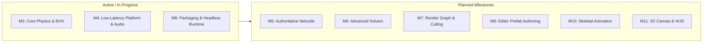

# DarkFire Engine

DarkFire is a modern, high-performance, game-agnostic C++20 3D game engine and standalone desktop editor built for Windows x64 and DirectX 11. Designed with data-driven ECS architecture, reversed-Z floating-point HDR rendering, clustered lighting, and an integrated asset cooking and packaging pipeline.


> _Note: Screenshot placeholder. Place your editor capture at `Docs/images/engine.png`._

---

## Architecture & Feature Highlights

### Core Engine & Systems
- **Entity-Component-System (ECS):** Built upon [EnTT](https://github.com/skypjack/entt) with sparse set component storage and zero runtime virtual dispatch overhead.
- **Memory & Allocation:** Monotonic 16 MB frame scratch allocator (`Core::FrameArena`) for zero-allocation per-frame operations, supplemented by strict ownership semantics.
- **Reflection & Serialization:** Type-erased compile-time and runtime component reflection with automated JSON and binary scene serialization (`SceneSerializer`).
- **Virtual File System (VFS):** Mount-based path resolution (`AssetPathResolver`, `VirtualFileSystem`) abstracting physical storage, project directories, and compressed pak archives.
- **Multithreading:** Work-stealing CPU `ThreadPool` job scheduler for parallel culling, physics updates, and asset preparation.
- **Modular Native Scripting:** Dynamic C-linkage game modules loaded across DLL boundaries (`GameModuleLoader`) allowing hot iteration without rebuilding engine binaries.

### Rendering & RHI Pipeline
- **RHI Abstraction:** Direct3D 11 backend (`D3D11RHI`, feature level 11_1) alongside a headless `NullRHI` for automated testing and CI execution.
- **Precision Depth:** Reversed-Z floating-point depth buffer ($Z_{\text{near}} = 1.0, Z_{\text{far}} = 0.0$) preventing z-fighting across large view distances.
- **Clustered Lighting:** $16 \times 16 \times 24$ view-space logarithmic depth slice cluster grid (`ClusterBuildAABBsCS`, `ClusterLightAssignCS`) supporting hundreds of dynamic point and spot lights in both Forward+ and Deferred passes.
- **Physically Based Shading (PBR):** Split-sum Cook-Torrance BRDF with GGX normal distribution, Smith height-correlated masking-shadowing, Charlie sheen NDF for cloth, and multi-scatter energy compensation.
- **Image-Based Lighting (IBL):** Prefiltered specular environment cubemaps, spherical harmonics (L2 irradiance evaluation), and split-sum BRDF LUT integration.
- **Shadow Mapping:** Directional 4-cascade shadow maps (CSM) with sub-texel stabilization, slope-scaled depth bias, PCF softening, and dynamic spot-light shadow atlas (`ShadowAtlasAllocator`).
- **Post-Processing Pipeline:** 
  - Dual-filter bloom downsampler with Karis average prefiltering.
  - Temporal Anti-Aliasing (TAA) with motion jitter, velocity reconstruction, and color history clamping.
  - Screen-Space Ambient Occlusion (SSAO / GTAO) with bilateral depth-aware blur.
  - Screen-Space Reflections (SSR) with Hi-Z raymarching.
  - Filmic Tonemapping: High-fidelity ACES-fit and AgX tonemapping with vignette and exposure control.
  - Procedural atmosphere and exponential height fog with Henyey-Greenstein phase in-scattering.

### Physics & Audio
- **Physics Simulation:** Deterministic fixed-step `PhysicsWorld` with continuous collision resolution.
- **Narrowphase & Spatial Acceleration:** Oriented Bounding Box (OBB) separating axis test (SAT), sphere/capsule collision detection, and Bounding Volume Hierarchy (`BVH`) broadphase acceleration.
- **Spatial Audio:** Integrated 3D audio playback and spatialization system powered by `miniaudio`.

### Standalone Desktop Editor (`Editor.exe`)
- **Docking Workspace:** Dear ImGui docking multi-window layout with dark theme ergonomics.
- **Dual Viewports:** Interactive Scene Viewport with camera fly/orbit modes and dedicated Game Viewport.
- **Transform Gizmos:** Integrated `ImGuizmo` translation, rotation, and scale manipulators with grid snapping.
- **Editor Tooling Panels:**
  - *Hierarchy Panel:* Scene graph inspection and parent-child entity parenting.
  - *Inspector Panel:* Dynamic reflection-driven field drawers with multi-component editing.
  - *Content Browser:* File system asset navigation with thumbnail previews.
  - *Console Panel:* Live channel-filtered engine log viewer.
  - *Profiler Panel:* Integrated Tracy GPU/CPU frame-time profiling and budget inspection.
  - *Project & World Settings:* Real-time environment lighting, probe parameters, and rendering toggles.
  - *PlaySession:* Non-destructive play-in-editor simulation (Edit / Play / Pause / Simulate) with scene state restoration.

### Asset Cooking & Packaging Pipeline (`dfcook`)
- **CLI Cooker (`dfcook.exe`):** Automated shader bytecode compilation (`fxc.exe` into `.cso`), DirectXTex texture compression into BCn DDS formats (`BC7` albedo, `BC5` tangent-space normals), mesh optimization, and offline BRDF/IBL probe baking.
- **Compressed PAK Files:** Package bundling into compressed archive formats (`Engine.pak`, `Game.pak`) mounted transparently at runtime.

---

## Repository Structure

```
DarkFire/
├── Docs/               # Engineering documentation and roadmaps
│   ├── images/         # Documentation media and editor screenshots
│   ├── Licenses/       # Licenses for all bundled third-party libraries
│   ├── conventions.md  # Engine coding standards, coordinate systems, and style guide
│   └── roadmap.md      # Detailed milestone roadmap and definition of done
├── Editor/             # Standalone desktop editor application (Editor.exe)
├── Engine/             # Core engine shared library (DarkFire.dll)
│   ├── Audio/          # miniaudio spatial audio backend
│   ├── Core/           # Math, ECS, Memory, Jobs, Reflection, VFS, Scene graph
│   ├── Physics/        # PhysicsWorld, BVH, OBB narrowphase collision
│   ├── Platform/       # Win32 Windowing, Input, CrashHandler, DynamicLibrary
│   ├── Renderer/       # SceneRenderer, passes, mesh loaders, shader management
│   ├── RHI/            # Direct3D 11 backend and Null RHI abstraction
│   ├── Runtime/        # Application lifecycle, LayerStack, GameModuleLoader
│   └── Shaders/        # HLSL 5.0 shader sources and shared binding definitions
├── Player/             # Standalone runtime executable host (Player.exe)
├── Projects/           # Designated folder for user-created game projects (.gitkeep)
├── Scripts/            # Developer automation scripts (Setup, Generate, Build, Test, Package)
├── Templates/          # Sample game and testing project templates
│   ├── Empty3D/        # Blank starting template
│   ├── GraphicsTest3D/ # Crytek Sponza Atrium & Tropical Island benchmark scenes
│   └── Playground3D/   # Physics and dynamic lighting sandbox
├── Tests/              # Doctest unit and integration test suite (Tests.exe)
├── ThirdParty/         # Pinned Git submodules and vendored dependencies
│   ├── Build/          # Premake build definitions for third-party libraries
│   └── Premake/        # Vendored Premake 5.0 executable for Windows
└── Tools/              # Standalone engine developer CLI utilities
    ├── dfcook/         # Asset cooker (compiles shaders, textures, and packs PAKs)
    └── dfnew/          # Project creation CLI wizard
```

---

## Building from Source

### Prerequisites
- **Operating System:** Windows 10 or 11 (x64).
- **Compiler:** Visual Studio 2026 (`vs2026`, MSVC v145) or Visual Studio 2022 (`vs2022`, MSVC v143).
  - Workload required: *Desktop development with C++*.
- **Version Control:** Git with [Git LFS](https://git-lfs.com/) installed.

### Quick Start

1. **Clone the repository recursively:**
   ```cmd
   git clone --recursive https://github.com/Omar0Gamal/DarkFire.git
   cd DarkFire
   ```

2. **Run initial setup and project generation:**
   ```cmd
   Scripts\Setup.bat
   ```
   *This compiles DirectXTex/DirectXTK helper shaders and runs Premake5 to generate the solution (`DarkFire.slnx` on VS 2026 or `DarkFire.sln` on VS 2022).*

3. **Re-generate project files at any time:**
   ```cmd
   Scripts\Generate.bat
   ```

4. **Compile the solution:**
   ```cmd
   Scripts\Build.bat Debug
   ```
   *(Or specify `Release` / `Dist`)*

5. **Run the automated test suite:**
   ```cmd
   Scripts\Test.bat Debug
   ```

### Packaging a Standalone Game
DarkFire provides automated project cooking and packaging:
```cmd
Scripts\Package.bat Templates\Playground3D
```
This command:
1. Compiles the engine and game module in `Release` configuration.
2. Invokes `dfcook.exe` to compile shaders to `.cso`, textures to `.dds`, and packs them into `.pak` archives.
3. Assembles the standalone player executable, game DLL, engine core, scenes, and licenses in `Package\Playground3D\`.

---

## Engineering Roadmap

For full milestone specifications, completion evidence, and dependency graphs, refer to [Docs/roadmap.md](Docs/roadmap.md).



### In Progress
- **Milestone 3 — Core Physics, Collision & Replay:** Bounding Volume Hierarchy (`BVH`) acceleration, continuous collision detection, dynamic sweep tests, and deterministic simulation replay contracts.
- **Milestone 4 — Low-Latency Platform & Audio System:** Platform latency instrumentation, high-precision timing, spatialized audio bus hierarchies, and runtime sound parameter control.
- **Milestone 8 — Packaging, Headless Runtime & Studio Infrastructure:** Zero-window `NullRHI` headless execution for CI testing, crash telemetry logging, and standalone packaging pipeline.

### Planned Milestones
- **Milestone 5 — Authoritative Networking & Prediction:** DarkFireNetworking 2.0 dual-channel architecture (reliable TCP control + unreliable sequenced UDP), client-side prediction, and server reconciliation.
- **Milestone 6 — Advanced Simulation Solvers & Constraints:** Character controller kinematic solvers, physical joint constraints, and ragdoll simulation.
- **Milestone 7 — Render Architecture, Specialization & Occlusion:** Transient render graph execution, GPU occlusion culling via Hi-Z buffer, and pipeline state object caching.
- **Milestone 9 — Visual Editor Authoring & Prefabs:** Nested prefab authoring with property overrides, visual curve/spline editing in viewport, and undo/redo serialization.
- **Milestone 10 — Skeletal Animation & World Streaming:** GPU skinning, dual-quaternion animation blending, distance-based world partition streaming, and foliage instancing.
- **Milestone 11 — 2D Canvas HUD & Typography:** Scalable in-game UI system, SDF font rendering, and localized HUD elements.

### Ideas & Future Exploration
- Hardware-assisted raymarched volumetric clouds and atmosphere scattering.
- Physically based Bokeh Depth-of-Field (DOF).
- GPU-driven compute particle simulation with vector fields.
- Cross-platform Vulkan RHI backend.

---

## Documentation Links

- **[Coding Conventions & Architecture Style Guide](Docs/conventions.md)**
- **[Master Engineering Roadmap & Milestones](Docs/roadmap.md)**
- **[Third-Party Dependencies & Libraries](ThirdParty/README.md)**

---

## License

DarkFire is licensed under the [MIT License](LICENSE).  
Third-party libraries and code bundled or linked with this project retain their respective open-source licenses, documented in [Docs/Licenses/](Docs/Licenses/).
