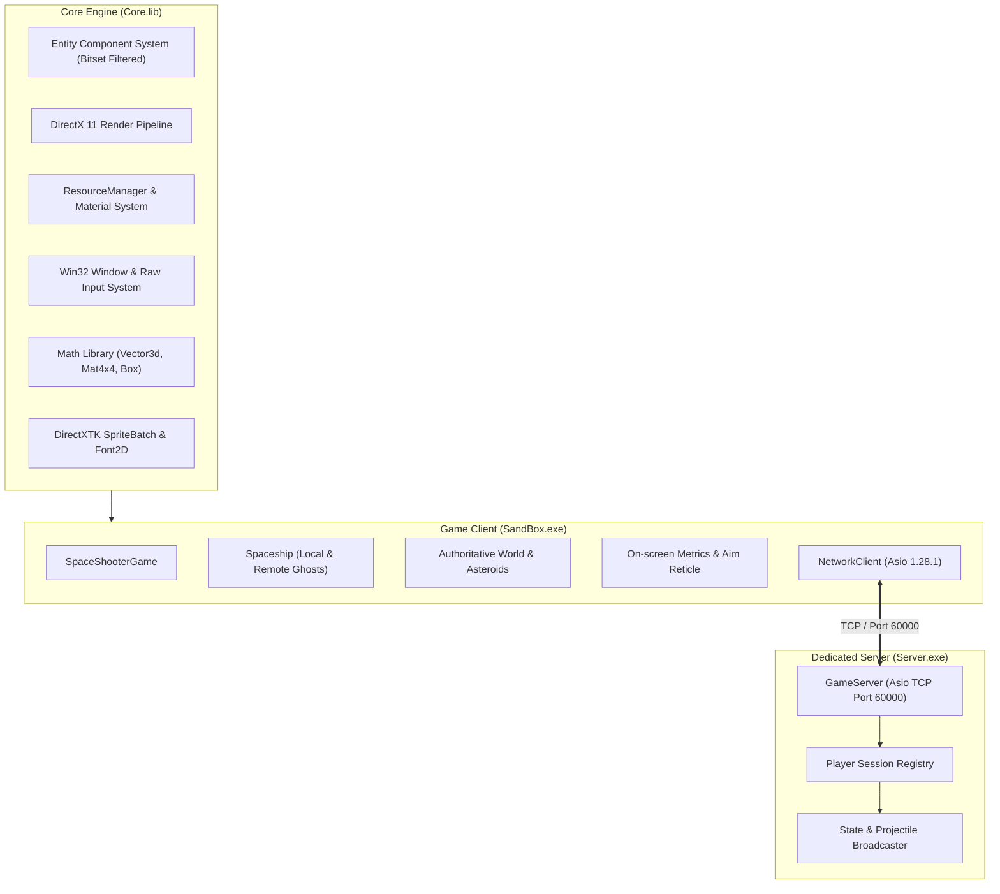

<p align="center">
  
</p>

# DarkFire Game Engine

<p align="center">
  
  
  
  
  
  
</p>

---

## Overview

**DarkFire** is a modern, high-performance 3D game engine built from the ground up in **C++20** and **DirectX 11**. Designed around a cache-friendly **Entity-Component-System (ECS)** architecture, a multi-pass **RenderPipeline**, and an asynchronous **client-server networking system**, DarkFire serves as a robust platform for 3D simulation and multiplayer game development.

Included in the repository is **SpaceShooter**, a full-featured 3D space combat demonstration showcasing procedural asteroid fields, spaceship 6-DOF controls, collision resolution, particle projectile firing, DirectXTK-driven UI HUD, and real-time multiplayer network synchronization.

---

## Architecture & Subsystems



### 1. Entity Component System (ECS)
- **Fast Bitset Filtering**: Components are registered with atomic `TypeID` hashing and bitmask signatures (`std::bitset<MAX_COMPONENTS>`) for O(1) archetype queries.
- **Iteration-Safe Mutations**: Entity destruction and component additions/removals are safely queued or synchronized during active gameplay ticks.
- **Modular Components**: Includes `TransformComponent`, `MeshComponent`, `LightComponent`, `CameraComponent`, `TextComponent`, and `ImageComponent`.

### 2. DirectX 11 Rendering Pipeline
- **ComPtr Resource Management**: Clean COM lifetime management across devices, swap chains, buffers, shader bytecodes, and texture views.
- **Flexible Render Passes**: Multi-pass rendering via `RenderPipeline`, `MeshRenderPass`, and `UIRenderPass`.
- **Procedural Primitives**: Built-in vertex and index generators for `Cube`, `Sphere`, `Cylinder`, and `Plane` meshes.
- **Shader Reflection & Constant Buffers**: Hardware-enforced 16-byte aligned constant buffers with clean update semantics.
- **Direct3D Debug Layer**: Automatic `D3D11_CREATE_DEVICE_DEBUG` device creation in Debug builds with graceful fallback if the Windows Graphics Tools optional feature is absent.

### 3. Multiplayer Networking Framework
- **Powered by Asio**: Standalone header-only Asio (1.28.1) provides non-blocking, asynchronous socket I/O without Boost dependencies.
- **Packet Serialization**: Streaming `operator<<` and `operator>>` operators for POD structures and variable-length network packets.
- **Dedicated Headless Server**: Lightweight console server that manages player lifecycles, validates connections, and broadcasts player positions, orientations, weapon shots, and asteroid hits.
- **Graceful Offline Fallback**: If the server is unreachable, the client transitions cleanly to Single-Player mode without interruptions or crash popups.

---

## SpaceShooter Gameplay Controls

| Key / Input | Action |
| :--- | :--- |
| `W` / `S` | Pitch Up / Pitch Down (Throttle) |
| `A` / `D` | Roll Left / Roll Right (Strafe) |
| `Mouse Movement` | Flight Steering (Pitch & Yaw) |
| `Left Mouse Button` | Fire Laser Projectile |
| `Left Shift` | Turbo Boost Mode |
| `Space` | Toggle Fullscreen Mode |
| `Escape` | Toggle Play Mode (Lock / Unlock Mouse Cursor) |

---

## Directory Structure

```
DarkFire/
├── Core/                      # Core Game Engine Static Library
│   ├── Source/Core/
│   │   ├── Game/              # ECS, World, WorldManager, Physics, Display
│   │   ├── Graphics/          # Direct3D 11 Device, SwapChain, Buffers, Shaders, UI
│   │   ├── Math/              # Vectors, Matrices, Bounding Boxes, Vertex Formats
│   │   ├── Resource/          # Mesh, Material, Texture, Font, Primitives
│   │   ├── Window/            # Win32 Windowing, Message Pump, Input Manager
│   │   └── log/               # Logging and Diagnostics
│   └── Build-Core.lua         # Premake configuration for Core
├── SandBox/                   # SpaceShooter Game Client Application
│   ├── Assets/                # Shaders (HLSL), Meshes (OBJ), Textures, Fonts
│   ├── Source/                # Game, Spaceship, Asteroids, Projectiles, HUD
│   └── Build-App.lua          # Premake configuration for SandBox
├── Server/                    # Dedicated Headless Multiplayer Server
│   ├── Source/Main.cpp        # Server entry point, packet dispatch, state broadcast
│   └── Build-Server.lua       # Premake configuration for Server
├── Libs/                      # External Libraries & Dependencies
│   ├── asio-1.28.1/           # Standalone Asio C++ networking library
│   ├── DarkFireNetworking/    # Message protocols, connection wrappers, thread-safe queues
│   ├── DirectXTex/            # Microsoft DirectX Texture processing library
│   ├── DirectXTK/             # Microsoft DirectX Tool Kit (SpriteBatch, SpriteFont)
│   ├── StackTrace/            # Stack trace diagnostics
│   └── tinyobjloader/         # OBJ mesh loader
├── Vendor/                    # Build tool binaries (Premake 5.0.0 for Windows)
├── Build.lua                  # Root Premake 5 workspace configuration
└── README.md                  # Engine documentation & guide
```

---

## Getting Started

### Prerequisites
- **Operating System**: Windows 10 or Windows 11 (x64)
- **Compiler / IDE**: Visual Studio 2026 (or Visual Studio 2022) with the **Desktop Development with C++** workload installed (MSVC v145 / v143, C++20 standard).
- **Windows SDK**: Version 10.0.22621.0 or newer (includes DirectX 11 headers and libraries).

### 1. Clone the Repository
```bash
git clone https://github.com/Omar0Gamal/DarkFire.git
cd DarkFire
```

### 2. Generate Visual Studio Project Files
DarkFire includes a pre-configured Premake 5.0.0 binary supporting Visual Studio 2026:
```powershell
.\Vendor\Binaries\Premake\Windows\premake5.exe --file=Build.lua vs2026
```
*(For Visual Studio 2022, replace `vs2026` with `vs2022`)*.

### 3. Build the Solution
Open `DarkFire.slnx` (or `DarkFire.sln`) in Visual Studio and select **Build Solution** (`Ctrl + Shift + B`), or build from PowerShell using MSBuild:
```powershell
& "C:\Program Files\Microsoft Visual Studio\18\Community\MSBuild\Current\Bin\MSBuild.exe" DarkFire.slnx /p:Configuration=Debug /p:Platform=x64
```

---

## Running the Engine

### Launching the Multiplayer Dedicated Server
```powershell
.\Binaries\windows-x86_64\Debug\Server\Server.exe 60000
```
The server will initialize its socket acceptor with `SO_REUSEADDR` on port `60000` and wait for incoming connections. Press `Ctrl+C` at any time to shut down gracefully.

### Launching the Game Client
```powershell
.\Binaries\windows-x86_64\Debug\SandBox\SandBox.exe
```
- If the server is running locally or over LAN, the client connects automatically and replicates other connected spaceships in real time.
- If no server is running, the client seamlessly continues in **Single-Player Offline Mode**.

---

## License

This project is licensed under the MIT License - see the [LICENSE](LICENSE) file for details.

---

## Author & Acknowledgments

**Omar Gamal**
- GitHub: [@Omar0Gamal](https://github.com/Omar0Gamal)
- Email: omargamal.dev@outlook.com
- Networking Framework: [Omar0Gamal/CPP-Networking-Framework](https://github.com/Omar0Gamal/CPP-Networking-Framework)
