# DarkFire Engine — Master Rendering, VFX & High-Performance Infrastructure Roadmap

This document serves as the **master engineering roadmap** for the DarkFire Engine (Direct3D 11 backend, feature levels 11_0 / 11_1). It tracks completed architectural foundations, recently verified shader audit resolutions, active milestones, and scheduled infrastructure across rendering, visual effects, high-performance physics, low-latency platform integration, and game-agnostic networking.

---

## Core Architectural Principle: Game-Agnostic Engine Infrastructure

DarkFire is a **general-purpose, game-agnostic 3D engine**:
- **Engine Layer (`Engine/`)**: Primitives, rendering passes, compute shaders, collision narrowphase, audio spatialization, deterministic timestep loops, and network synchronization. **Contains zero game-specific logic, hardcoded vehicle presets, or gameplay rules**.
- **Game / Project Layer (`Templates/<GameName>/Source/`)**: Specific gameplay mechanics (e.g., arcade vehicle controllers, skidmark triggers, engine sound pitch crossfaders, weapon arcs, track checkpoints) are authored entirely inside project scripts and game module DLLs using the underlying engine APIs.

---

## Architectural Progression Overview

```mermaid
flowchart TD
    subgraph CompletedFoundations["Completed Foundations (Verified & Tested)"]
        Tier0["Tier 0: Probe Baking & PBR Normalization\n(dfcook HDR baking, Box-Projected IBL, Specular Occlusion, 3D LUT)"]
        Tier1["Tier 1: GPU Compute & Temporal Foundations\n(GPU-driven culling & indirect draw, 16x16x24 light clustering, TAA)"]
        Milestone1["Milestone 1: Bundled Tier 2/3 Rendering Infrastructure\n(DDGI Probe Volumes, Hi-Z SSR, Dual-Lobe Clearcoat, Anisotropy, SSS)"]
        AuditMilestone["Comprehensive Shader Audit & PBR Optimization\n(Fixed L1-L18, A1-A7, X1-X4; Invariant hoisting; Zero compiler warnings)"]
    end

    subgraph ActiveAndUpcoming["Upcoming High-Performance Infrastructure Milestones"]
        Milestone2["Milestone 2: High-Performance Universal Visual VFX & Volumetrics\n(Tile-Max Motion Blur, 3D Froxel Fog, Spot Shadow Atlas, Auto-Exposure)"]
        Milestone3["Milestone 3: Core Physics & Collision Infrastructure\n(Transform interpolation for 240Hz, TriangleMesh/ConvexMesh BVH, Sweeps)"]
        Milestone4["Milestone 4: Low-Latency Platform & Audio Infrastructure\n(DXGI waitable swapchain <8ms, Doppler velocity tracking, Mix buses)"]
        Milestone5["Milestone 5: Deterministic Multiplayer & Network Infrastructure\n(UDP transport, Client prediction, Snapshot interpolation, Delta compression)"]
        Milestone6["Milestone 6: Vehicle Dynamics & Raycast Suspension Physics Math\n(Raycast spring-damper suspension, Pacejka slip friction, Downforce/Drag)"]
        Milestone7["Milestone 7: Advanced GPU Pipeline Specialization & Occlusion\n(Shader permutations, Two-phase Hi-Z GPU occlusion, Dithered LOD cross-fade)"]
    end

    Tier0 --> Tier1
    Tier1 --> Milestone1
    Milestone1 --> AuditMilestone
    AuditMilestone --> Milestone2
    Milestone2 --> Milestone3
    Milestone3 --> Milestone4
    Milestone4 --> Milestone5
    Milestone5 --> Milestone6
    Milestone6 --> Milestone7
```

---

## Completed Milestones (Verified in Test Suite & Release Builds)

### Tier 0: High-Quality Probe Baking & Foundations (COMPLETED)
1. **High-Quality IBL & Irradiance Baking Pipeline (`dfcook`)**:
   - Split-Sum BRDF 2D LUT generator and 3D Color LUT baking.
   - 6-mip GGX prefiltered reflection cubemap convolution and diffuse irradiance convolution.
2. **Decoupled Texture Slots & PBR Cleanliness**:
   - Slot 12 (`DF_SLOT_TEX_SKY_EQUIRECT`), Slot 17 (`DF_SLOT_TEX_SPECULAR_IBL`), Slot 18 (`DF_SLOT_TEX_IRRADIANCE_IBL`).
   - Parallax-corrected box projection with inner/outer boundary edge falloff.
   - Lagarde directional specular occlusion and Jimenez multi-bounce diffuse cavity AO.
3. **PBR Material Fidelity & Lighting Normalization**:
   - Removed artificial floor roughness scaling; preserved authentic authored stone paver roughness.
   - Upgraded marble basin with dedicated normal mapping and physical dielectric specular.
   - Eliminated unshadowed arcade colonnade fill lights; standardized on physically based sun and baked IBL.

### Tier 1: High-Performance GPU Compute & Temporal Foundations (COMPLETED)
1. **GPU-Driven Frustum & Shadow Cascade Culling (`cs_5_0` + `DrawIndexedInstancedIndirect`)**:
   - `CullInstancesCS.hlsl` evaluates camera frustum and 4 directional shadow cascades in parallel with atomic indirect argument compaction.
2. **Clustered / Tiled Dynamic Light Culling (`16x16x24` Clusters)**:
   - 6,144 view-space AABB clusters generated by `ClusterBuildAABBsCS.hlsl` using logarithmic depth distribution.
   - `ClusterLightAssignCS.hlsl` assigns lights to clusters, feeding `DF_SLOT_BUF_CLUSTER_GRID` (`t22`) and `DF_SLOT_BUF_CLUSTER_INDICES` (`t23`) in `Lighting.hlsli`.
3. **Velocity G-Buffer + Temporal Anti-Aliasing (TAA)**:
   - `R16G16_FLOAT` screen-space velocity buffer (`SV_Target4` in G-Buffer).
   - Halton(2, 3) 8-phase low-discrepancy subpixel camera jitter.
   - Velocity-reprojected TAA pass (`TAAPS.hlsl`) with $3 \times 3$ YCoCg neighborhood variance clamping and contrast-adaptive sharpening.

### Milestone 1: Bundled Tier 2 & Tier 3 Rendering Infrastructure (COMPLETED)
1. **Real-Time DDGI Dynamic Probe Volumes**:
   - Octahedral radiance atlas ($8 \times 8$ texels per probe) via [`DDGIRadianceGatherCS.hlsl`](file:///C:/Users/omarg/dev/DarkFire/Engine/Shaders/DDGIRadianceGatherCS.hlsl).
   - Chebyshev visibility depth moments atlas ($16 \times 16$ texels per probe) via [`DDGIDepthGatherCS.hlsl`](file:///C:/Users/omarg/dev/DarkFire/Engine/Shaders/DDGIDepthGatherCS.hlsl).
   - Trilinear probe interpolation with Chebyshev shadow testing and continuous border edge fading (`edgeFade`) in [`Lighting.hlsli`](file:///C:/Users/omarg/dev/DarkFire/Engine/Shaders/Lighting.hlsli).
2. **Hierarchical-Z Screen-Space Reflections (Hi-Z SSR)**:
   - Conservative Reversed-Z depth downsampling via [`HiZBuildCS.hlsl`](file:///C:/Users/omarg/dev/DarkFire/Engine/Shaders/HiZBuildCS.hlsl).
   - Screen-space raymarching pass via [`SSRPS.hlsl`](file:///C:/Users/omarg/dev/DarkFire/Engine/Shaders/SSRPS.hlsl) with distance attenuation, roughness fade, and smooth fallback to local reflection probes.
   - Motion-reprojected temporal history buffer (`m_prevHdrTexture`) eliminating feedback hazards and camera motion ghosting.
3. **Dual-Lobe Clearcoat & Brushed Anisotropy**:
   - `clearcoatFactor`, `clearcoatRoughness`, `anisotropyFactor`, and `anisotropyRotation` exposed in [`Material.h`](file:///C:/Users/omarg/dev/DarkFire/Engine/Renderer/Material.h) and packed into constant buffer `CBPerMaterial`.
   - Strict $(1.0 - F_{\text{clearcoat}})$ energy conservation for base diffuse and specular lobes.
   - Tangent-stretched anisotropic GGX NDF and Smith masking-shadowing in [`BRDF.hlsli`](file:///C:/Users/omarg/dev/DarkFire/Engine/Shaders/BRDF.hlsli).
4. **Separable Subsurface Scattering (SSS)**:
   - 7-tap separable bilateral Gaussian blur with exponential depth difference weighting in [`SubsurfacePS.hlsl`](file:///C:/Users/omarg/dev/DarkFire/Engine/Shaders/SubsurfacePS.hlsl).

### Milestone 1.5: Comprehensive Shader Audit & Mathematical Verification (COMPLETED)
1. **Ground Rule 1 Conventions Header & Register Macro Glue**:
   - Verified conventions documented in [`Common.hlsli`](file:///C:/Users/omarg/dev/DarkFire/Engine/Shaders/Common.hlsli): Left-Handed, Reversed-Z Floating Point ($Z_{\text{near}}=1.0, Z_{\text{far}}=0.0$), row-major packing (`/Zpr`), metric world units, and perceptual roughness.
   - Unified register binding macros (`HLSL_REG_B/T/S/U`) unified with C++ [`Shared/Bindings.h`](file:///C:/Users/omarg/dev/DarkFire/Engine/Shaders/Shared/Bindings.h).
   - Extracted [`NormalMapping.hlsli`](file:///C:/Users/omarg/dev/DarkFire/Engine/Shaders/NormalMapping.hlsli) and decoupled [`Surface.hlsli`](file:///C:/Users/omarg/dev/DarkFire/Engine/Shaders/Surface.hlsli) from `Lighting.hlsli`, eliminating heavy lighting graphs from GBuffer passes.
2. **Defect Resolutions (Category B)**:
   - **L1 (Truncation Fix):** Fixed `directLightAtten` float3-to-scalar truncation; eliminated FXC `warning X3206` and restored colored lights.
   - **L2 (Frostbite Specular Occlusion):** Integrated Lagarde & de Rousiers 2014 directional specular occlusion; eliminated grazing reflection drop.
   - **L3 (DDGI Normal & Depth Direction):** Fixed probe direction vector (`probePos - biasedPos`), corrected Chebyshev depth sampling to `octEncode(-dirToProbe)`, added McGuire weight crush, and hoisted `GetDimensions` queries.
   - **L4 (Empty Cluster Fix):** Capped iterations to `min(activeLightCount, 64u)`, eliminating the fallback performance cliff in empty clusters.
   - **L5 (Cloth Energy Conservation):** Normalized cloth diffuse with `INV_PI` and corrected Charlie NDF alpha without clamp.
   - **A1–A6 (Atmospheric Fog):** Soft-compressed Henyey-Greenstein phase function peak; scaled in-scattering by sun intensity; added temporal IGN jitter; supported negative terrain heights.
   - **X1 (Water Double-Fogging):** Prevented double-fogging on transmitted seabed color.
3. **Loop Invariant Hoisting & Optimization (Category C)**:
   - Hoisted geometric invariants (`NoV`), clear coat parameters, cloth Charlie constants, and anisotropic TBN basis rotation outside the clustered light loop.
   - Added early-out backface culling (`!isThinSurface && NdotL_raw <= 0.0f`).
   - Annotated clustered light loop with `[loop]`, reducing bytecode by **12% to 15%** and instruction slots by **440 to 475 slots** per shader.

---

## Active & Upcoming Milestones

```mermaid
flowchart TD
    subgraph M2["Milestone 2: High-Performance Universal Visual VFX & Volumetrics"]
        M2_1["2.1 Tile-Max Velocity Motion Blur\n(Reusing R16G16 velocity buffer with tile-variance early out)"]
        M2_2["2.2 Universal Ribbon & Trail Primitive (RibbonTrailComponent)\n(Continuous quad-strip procedural mesh generator)"]
        M2_3["2.3 Enhanced Particle Primitives\n(Velocity-aligned billboards + Reversed-Z linear view-space soft depth fade)"]
        M2_4["2.4 3D Froxel Volumetric Fog Compute Pass\n(160x90x64 Frustum Grid with integrated in-scattering & single 3D tap)"]
        M2_5["2.5 Spot & Point Light Dynamic Shadow Atlas\n(Multi-tile shadow allocation for local spot/point lights)"]
        M2_6["2.6 Compute Auto-Exposure & Eye Adaptation\n(64-bin luminance histogram compute pass + ACES Film tonemapping)"]
    end

    subgraph M3["Milestone 3: Core Physics & Collision Infrastructure"]
        M3_1["3.1 Render Transform & Camera Interpolation\n(Wire 60Hz alpha to render & camera state for 144Hz/240Hz displays)"]
        M3_2["3.2 TriangleMesh & ConvexMesh Colliders\n(BVH narrowphase for curved tracks, terrain & complex meshes)"]
        M3_3["3.3 Sweep Query Primitives\n(sphereCast and boxCast in IPhysicsWorld)"]
    end

    subgraph M4["Milestone 4: Low-Latency Platform & Audio Infrastructure"]
        M4_1["4.1 DXGI 1.3 Waitable SwapChain & Low Latency\n(SetMaximumFrameLatency 1 for sub-8ms input response + Reflex hook)"]
        M4_2["4.2 Audio Doppler Shift & Velocity Tracking\n(Physical ma_sound_set_velocity & listener velocity)"]
        M4_3["4.3 Audio Mix Buses & Smoothing API\n(Master, SFX, Ambient, Music channels + fluent lerp API)"]
    end

    subgraph M5["Milestone 5: Deterministic Multiplayer & Network Infrastructure"]
        M5_1["5.1 Low-Latency UDP / Reliable Transport Layer\n(Packet fragmentation, sequence ACKs, loss/jitter simulation)"]
        M5_2["5.2 Client-Side Prediction & Server Reconciliation\n(Command buffers, input prediction, server state replay)"]
        M5_3["5.3 Snapshot Interpolation & Lag Compensation\n(Interpolation buffer, proxy smoothing, historical hitbox rewind)"]
        M5_4["5.4 Entity Delta Compression & Bitpacking\n(Quantized vectors, 'Smallest Three' quaternion compression, bitwriter)"]
    end

    subgraph M6["Milestone 6: Vehicle Dynamics & Raycast Suspension Math Library"]
        M6_1["6.1 Multi-Point Raycast Wheel Suspension Solver\n(Spring-damper compression, sway bar anti-roll stiffness)"]
        M6_2["6.2 Pacejka 'Magic Formula' Tire Slip & Friction Model\n(Lateral/longitudinal slip curves, progressive drift loss of grip)"]
        M6_3["6.3 Aerodynamic Drag, Downforce & Surface Math\n(Speed-squared downforce, air drag, terrain normal alignment)"]
    end

    subgraph M7["Milestone 7: Advanced GPU Pipeline Specialization & Occlusion"]
        M7_1["7.1 Shader Permutations & Material Specialization\n(Specialized passes in dfcook cutting instructions by >50%)"]
        M7_2["7.2 Two-Phase GPU-Driven Hi-Z Occlusion Culling\n(Hi-Z depth pyramid testing + DrawIndexedInstancedIndirect)"]
        M7_3["7.3 Dithered Mesh LOD Cross-Fade\n(Screen-door temporal dither blending between LOD levels)"]
    end

    M2 --> M3
    M3 --> M4
    M4 --> M5
    M5 --> M6
    M6 --> M7
```

---

### Milestone 2: Universal High-Impact Rendering VFX & Volumetrics

#### 2.1 Tile-Max Velocity Motion Blur
* **Zero-Copy Velocity Buffer Reuse**:
  - Reuses the high-precision `R16G16_FLOAT` screen-space velocity buffer (`m_velocityTexture`) already rendered for TAA in both Forward+ and Deferred pipelines.
* **Two-Pass Tile-Max Reconstruction with Early-Out**:
  - **Pass 1 (`TileMaxCS.hlsl`)**: Downsamples full-screen velocity into a coarse tile-max buffer (e.g., $20 \times 20$ pixel tiles) using compute reduction to find the maximum motion vector in each screen region.
  - **Early-Out**: Tiles with maximum velocity magnitude $< 0.5$ pixels (skybox, static interior walls) skip blur sampling completely.
  - **Pass 2 (`MotionBlurPS.hlsl`)**: 12-tap directionally aligned reconstruction filter with depth-weighted background preservation (McGuire et al.). Eliminates foreground/background bleeding and silhouette ghosting while conveying authentic high-speed sensation.
* **Configurable Post-Processing Parameters**:
  - `enableMotionBlur`, `motionBlurShutterAngle` ($0.0 - 1.0$), `motionBlurMaxRadius` (pixels), and `motionBlurSampleCount` exposed in `PostProcessingComponent`.

#### 2.2 Universal Ribbon & Trail Primitive (`RibbonTrailComponent`)
* **General-Purpose Quad-Strip Mesh Generator**:
  - Generates continuous, camera-oriented connected quad-strip ribbons from historical point trajectories.
  - Features:
    - Width curve evaluation over normalized trail lifetime (e.g., wide at origin, tapering to point).
    - Alpha / Color gradient over lifetime (fade out).
    - Texture UV scrolling (stretched along length or tiled per meter).
    - Support for additive (sparks, weapon slashes, slipstreams) or alpha-blended materials (tire rubber skidmarks on track pavement).
* **Game-Agnostic Component**:
  - Clean C++ API (`addTrailPoint(position, width, color)`) allowing any gameplay script or particle system to spawn continuous visual ribbons.

#### 2.3 Enhanced Particle Primitives
* **Velocity-Aligned Stretched Billboards**:
  - Extend `ParticleEmitterComponent` and `SkyAndTransparentPass.cpp` to support particle quads stretched along their world velocity vector:
    $$\vec{\text{axis}} = \frac{\vec{v}}{\|\vec{v}\|}, \quad \text{length} = \|\vec{v}\| \times \text{stretchFactor}$$
  - Essential for sparks, rain streaks, sparks grinding against barriers, and high-speed motion debris.
* **Reversed-Z Linear View-Space Soft Depth Fading**:
  - In `Common.hlsli` / `SkyAndTransparentPass.cpp`: Reconstruct linear view-space depth for both scene and particle fragments:
    $$\text{depthDelta} = \max(z_{\text{sceneLinear}} - z_{\text{particleLinear}}, 0.0f)$$
    $$\text{fade} = \text{saturate}\left(\frac{\text{depthDelta}}{\text{softness}}\right)$$
  - Completely eliminates harsh intersecting edges where smoke, dust, water spray, or fire clip into floors or walls.

#### 2.4 3D Froxel Volumetric Fog Compute Pass (`VolumetricFogCS.hlsl`)
* **Frustum-Aligned 3D Grid Architecture**:
  - Allocate a 3D texture ($160 \times 90 \times 64$ froxels) matching view-space logarithmic depth clustering.
  - Compute in-scattering and transmittance per froxel cell; sample shadow cascades and directional lights once per froxel.
  - Temporal 3D history filtering ($88\%$ history blend) using previous frame's 3D froxel volume.
  - 3D integration pass pre-integrates accumulated radiance and transmittance along view-depth slices.
* **Shader Integration**:
  - Forward opaque (`StandardPS`), deferred lighting (`DeferredLightingPS`), terrain, and water shaders evaluate atmospheric fog via a **single 3D trilinear sample**:
    `g_TextureVolumetricFog.SampleLevel(g_SamplerLinearClamp, froxelUVW, 0)`.
  - **Performance Delta**: Replaces 8 hardware shadow taps per pixel with 1 trilinear volume sample, saving **1.5 ms – 2.5 ms** on GPU frametime in foggy scenes.

#### 2.5 Spot & Point Light Dynamic Shadow Atlas
* **Multi-Tile Shadow Atlas Allocation**:
  - Expand `CBShadow` to support dynamic shadow sub-rectangles for local lights.
  - Spot lights: Standard projective perspective shadow matrices.
  - Point lights: Dual-paraboloid shadow projection mapping into atlas sub-tiles.
  - Shared PCF filter kernels matching directional CSM filtering.

#### 2.6 Compute Luminance Histogram & Auto-Exposure (Eye Adaptation)
* **64-Bin Luminance Histogram (`LuminanceHistogramCS.hlsl`)**:
  - Parallel compute reduction bins HDR scene luminance values into a 64-bin histogram buffer.
  - Discard extreme outliers (top and bottom 5% specular/black pixels) to compute weighted geometric mean luminance.
* **Temporal Eye Adaptation & Tonemapping Upgrade**:
  - Smooth exponential adaptation over time:
    $$L_{\text{adapted}} = L_{\text{prev}} + (L_{\text{target}} - L_{\text{prev}}) \times (1.0 - e^{-\Delta t \times \text{speed}})$$
  - Upgrade `TonemapPS.hlsl` to modern **ACES Film** or **Tony McMapface** tonemapping to eliminate hue shifting in over-exposed highlights.

---

### Milestone 3: Core Physics & Collision Infrastructure

#### 3.1 Render Transform & Camera Interpolation
* **Eliminate High-Refresh Stutter (60Hz Physics on 144Hz/240Hz Monitors)**:
  - In [`Application.cpp`](file:///C:/Users/omarg/dev/DarkFire/Engine/Runtime/Application.cpp#L195), the 60 Hz fixed timestep accumulator already computes:
    $$\alpha = \frac{\text{accumulator}}{\text{fixedDeltaTime}}$$
  - Maintain `prevPosition` and `prevRotation` in `TransformComponent` / `RigidbodyComponent` and camera controllers.
  - In [`SceneRendererBridge.cpp`](file:///C:/Users/omarg/dev/DarkFire/Engine/Core/Scene/SceneRendererBridge.cpp), evaluate interpolated render transforms during scene extraction:
    $$\vec{p}_{\text{render}} = \text{lerp}(\vec{p}_{\text{prev}}, \vec{p}_{\text{curr}}, \alpha), \quad q_{\text{render}} = \text{slerp}(q_{\text{prev}}, q_{\text{curr}}, \alpha)$$
  - Physics simulations running at a deterministic 60 Hz tick rate render butter-smooth on 120Hz, 144Hz, 165Hz, and 240Hz gaming displays without jitter.

#### 3.2 Arbitrary TriangleMesh & ConvexMesh Colliders
* **Narrowphase Collision for Complex Track & Architecture Geometry**:
  - Add `ColliderShape::TriangleMesh` and `ColliderShape::ConvexMesh` to `ColliderComponent`.
  - Implement AABB BVH (Bounding Volume Hierarchy) tree acceleration in `PhysicsCollisionNarrowphase.cpp`:
    - Fast ray-triangle Möller–Trumbore intersection tests.
    - OBB-triangle SAT (Separating Axis Theorem) and Sphere-triangle contact manifold generation.
  - Unlocks collision and raycast testing against curved race tracks, banked turns, uneven terrain meshes, ramps, and non-primitive architectural props.

#### 3.3 Sweep Query Primitives (`sphereCast`, `boxCast`)
* **Expanded `IPhysicsWorld` Query Primitives**:
  - Add `sphereCast` and `boxCast` alongside `raycast` in [`IPhysicsWorld.h`](file:///C:/Users/omarg/dev/DarkFire/Engine/Physics/IPhysicsWorld.h).
  - Sweeps a sphere or oriented box along a directional vector, returning hit distance, surface normal, and hit entity.
  - Crucial for character controllers, volumetric wheel suspension ground detection, and high-speed moving volumes without tunneling through thin track geometry.

---

### Milestone 4: Low-Latency Platform & Audio Infrastructure

#### 4.1 DXGI 1.3 Waitable SwapChain & Low Latency Mode
* **Ultra-Low Input & Steering Latency**:
  - In [`D3D11Device.cpp`](file:///C:/Users/omarg/dev/DarkFire/Engine/RHI/D3D11/D3D11Device.cpp#L740), configure swap chain with `DXGI_SWAP_CHAIN_FLAG_FRAME_LATENCY_WAITABLE_OBJECT`.
  - Expose `setFrameLatency(1)` and `waitForGpuReady()` on `ISwapChain`.
  - Blocks the game thread immediately prior to rendering until the GPU back buffer is actually ready, slashing input lag from **~33 ms to < 8 ms** for instant controller response.
  - Provide an abstraction hook for **NVIDIA Reflex / AMD Anti-Lag** integration.

#### 4.2 Physical Audio Doppler Shift & Velocity Tracking
* **Velocity-Aware 3D Sound**:
  - Update `miniaudio` spatialization in [`AudioSystem.cpp`](file:///C:/Users/omarg/dev/DarkFire/Engine/Audio/AudioSystem.cpp):
    - Listener velocity: Extracted from camera transform delta.
    - Source velocity: Extracted from `RigidbodyComponent::linearVelocity` or transform position delta.
    - Call `ma_sound_set_velocity()` and `ma_engine_listener_set_velocity()`.
  - Generates authentic physical pitch shifts as high-speed sound sources (vehicles, rockets, environmental objects) whip past the listener.

#### 4.3 Audio Mix Buses & Pitch/Volume Smoothing API
* **Hierarchical Audio Submixes**:
  - Create audio submix buses: `Master`, `SFX`, `Ambient`, `Engine`, `Music`.
  - Fluent smoothing API on sound components:
    - `setPitchSmooth(targetPitch, slewRateHz)`
    - `setVolumeSmooth(targetVolume, slewRateHz)`
  - Prevents audio pop/crack artifacts when gameplay scripts rapidly modulate engine RPM pitch or tire squeal volumes.

---

### Milestone 5: Core Deterministic Multiplayer & Network Synchronization Infrastructure

#### 5.1 Low-Latency UDP / Reliable Transport Layer
* **Game-Agnostic Transport (`INetworkTransport`)**:
  - Raw UDP socket transport with lightweight reliability header (packet ID, ACK bitfield, channel ID).
  - Unreliable sequenced channel for frequent entity transform streams (position, orientation, velocity).
  - Reliable ordered channel for game events (round start, lap completion, item pickup, player connect/disconnect).
  - Integrated network simulator (artificial ping, packet loss %, jitter) for testing in Debug and Editor.

#### 5.2 Client-Side Prediction & Server Reconciliation
* **Authoritative Server / Responsive Client Loop**:
  - `NetworkIdentityComponent` managing entity ownership (`isLocalPlayer`, `isServer`).
  - Client buffers local inputs with sequence numbers and ticks physics immediately (zero local input latency).
  - Server receives client input commands, validates them against physical limits, ticks authoritative simulation, and broadcasts snapshot states.
  - On receiving server state, client detects discrepancies: if error exceeds threshold ($> 0.05\text{ m}$), replay buffered inputs from authoritative timestamp (Server Reconciliation).

#### 5.3 Snapshot Interpolation & Lag Compensation
* **Smooth Remote Entity Visuals**:
  - Remote proxies maintain an interpolation circular buffer (typically $50 - 100\text{ ms}$ history).
  - Evaluate Hermite cubic spline position interpolation and quaternion spherical linear interpolation (`slerp`) between past snapshots, completely masking network jitter.
* **Lag Compensation for Hit / Raycast Verification**:
  - Server maintains historical ring buffer of entity bounding boxes.
  - When a client sends a target interaction event timestamped at frame $T$, the server rewinds entity colliders to timestamp $T$, verifies line-of-sight/intersection, and restores current state.

#### 5.4 Entity Delta Compression & Bitpacking
* **Bandwidth Optimization**:
  - Custom `BitWriter` / `BitReader` stream implementation.
  - Quantization primitives:
    - Position: 16-bit fixed-point per axis within active world bounds.
    - Quaternions: "Smallest Three" compression (saves 128-bit float4 into 48-bit representation: 2-bit largest index + 3 $\times$ 15-bit components with sign reconstruction).
    - Velocities: Half-float (`FP16`).
  - Baseline delta compression: Server transmits only fields that changed relative to the client's last acknowledged snapshot ID.

---

### Milestone 6: Vehicle Dynamics & Raycast Suspension Physics Math Library

#### 6.1 Multi-Point Raycast Wheel Suspension Solver
* **Game-Agnostic Vehicle Math Primitive**:
  - Evaluates independent suspension spring-damper equations along wheel raycast vectors:
    $$F_{\text{suspension}} = k_{\text{spring}} \times (L_{\text{rest}} - L_{\text{curr}}) - c_{\text{damper}} \times v_{\text{suspension}}$$
  - Sway bar / anti-roll bar stiffness coupling opposite wheels to prevent vehicle rollovers during high-speed cornering.

#### 6.2 Pacejka 'Magic Formula' Tire Slip & Friction Model
* **Realistic Tire Grip & Drifting Math**:
  - Longitudinal slip ratio:
    $$\sigma = \frac{R \omega - v_x}{|v_x|}$$
  - Lateral slip angle:
    $$\alpha = \arctan\left(\frac{v_y}{|v_x|}\right)$$
  - Pure & combined slip force evaluation using Pacejka curve approximation:
    $$F_y = D \sin\left(C \arctan\left(B \alpha - E (B \alpha - \arctan(B \alpha))\right)\right)$$
  - Delivers crisp, responsive grip under normal steering that smoothly transitions into controllable lateral drift sliding as tire friction limits are exceeded.

#### 6.3 Aerodynamic Drag, Downforce & Ground Alignment Math
* **High-Speed Stability**:
  - Speed-squared aerodynamic drag: $\vec{F}_{\text{drag}} = -\frac{1}{2} \rho C_d A \|\vec{v}\| \vec{v}$.
  - Aerodynamic downforce pushing vehicle chassis toward track surface: $F_{\text{downforce}} = \frac{1}{2} \rho C_l A v^2$.
  - Adaptive chassis orientation torque aligning the vehicle's up-vector with the average terrain/track normal beneath the wheels for banked corners, ramps, and loops.

---

### Milestone 7: Advanced GPU Pipeline Specialization & Occlusion Culling

#### 7.1 Shader Permutations & Pipeline Specialization (`dfcook`)
* **Material Keyword Permutations**:
  - Extend `dfcook` to compile specialized pixel shader permutations instead of monolithic uber-shaders:
    - `Standard_Default.cso` (Base PBR + Normal + ORM)
    - `Standard_Cloth.cso` (Charlie Sheen NDF + wrap diffuse)
    - `Standard_ClearCoat.cso` (Dual-layer dielectric clear coat)
    - `Standard_Anisotropic.cso` (Brushed metal GGX)
    - `Standard_Transmissive.cso` (Foliage thin transmission)
* **Warp Occupancy Jump**:
  - Reduces forward opaque instruction count from ~2,887 instructions to **< 1,200 instructions** for 90% of scene geometry, doubling GPU warp occupancy.

#### 7.2 Two-Phase GPU-Driven Hi-Z Occlusion Culling
* **Zero-CPU-Cost Occlusion Culling**:
  - **Phase 1**: Dispatch `DrawIndexedInstancedIndirect` for instances visible in previous frame; downsample depth into Hi-Z pyramid via `HiZBuildCS.hlsl`.
  - **Phase 2**: Compute pass tests bounding boxes of all remaining instances against the Hi-Z depth pyramid; compact newly visible instances and dispatch second indirect draw.
  - Completely eliminates draw call overhead and pixel shader overdraw for occluded meshes in dense cityscapes and forests.

#### 7.3 Dithered Mesh LOD Cross-Fade
* **Popping-Free LOD Transitions**:
  - Compute normalized screen-space dither matrix in pixel shader during LOD boundary transitions.
  - Smoothly cross-fades between LOD levels over a 0.5-meter distance band without visible pop artifacts.

---

## Testing & Performance Benchmarks

Every milestone must maintain **100% pass rate** on the automated test suite and conform to DarkFire's performance standards:

| Benchmark Metric | Target Standard | Current Achieved (Baseline Verified) |
|---|---|---|
| **Test Suite Pass Rate** | **100% (0 failures)** | **95/95 passed (259,470 assertions)** |
| **Crytek Sponza Atrium (Deferred PBR)** | **> 50 FPS** | **53.8 FPS (18.60 ms)** |
| **Crytek Sponza Atrium (Forward+)** | **> 45 FPS** | **48.5 FPS (20.63 ms)** |
| **Playground3D (Forward+)** | **> 350 FPS** | **404.8 FPS (2.47 ms)** |
| **Playground3D (Deferred PBR)** | **> 300 FPS** | **310.9 FPS (3.22 ms)** |
| **Tropical Island (Forward+ Clustered)** | **> 150 FPS** | **169.1 FPS (5.91 ms, P99: 8.70 ms, 19,703 instances)** |
| **Shader Compiler Diagnostics** | **0 Warnings, 0 Errors** | **0 Warnings, 0 Errors across 40 shaders** |
| **GPU Target Hardware** | Discrete GPU | **NVIDIA GeForce RTX 3050 Ti Laptop GPU (FL 11_1)** |

---

## Architectural Rating Progression

| Milestone Status | Projected Score | Architectural Character |
| :--- | :---: | :--- |
| **Current Baseline (Verified)** | **8.5 / 10** | Top 1-2% of custom D3D11 engines. Mathematically clean Reversed-Z, Clustered Forward+, DDGI probe volumes, decoupled GBuffer, comprehensive test coverage. |
| **+ Milestone 2 (VFX & Volumetrics)** | **8.8 / 10** | Cinematic visual fidelity in motion (Tile-Max motion blur, 3D froxel fog, soft particles, auto-exposure eye adaptation, spot shadow atlas). |
| **+ Milestone 3 & 4 (Physics & Platform)** | **9.1 / 10** | Tactile responsiveness and display perfection. 240Hz stutter-free display interpolation, <8ms input latency waitable swapchain, 3D Doppler sound. |
| **+ Milestone 5 & 6 (Multiplayer & Vehicle)** | **9.4 / 10** | Production-grade game-agnostic framework. Deterministic prediction multiplayer, Pacejka drift physics, raycast suspension solver. |
| **+ Milestone 7 (Pipeline Specialization)** | **9.6 / 10** | **Full-Stack Commercial AAA Standard.** Zero-CPU two-phase Hi-Z occlusion culling, specialized permutation passes (<1,200 instructions), dithered LOD fading. |
