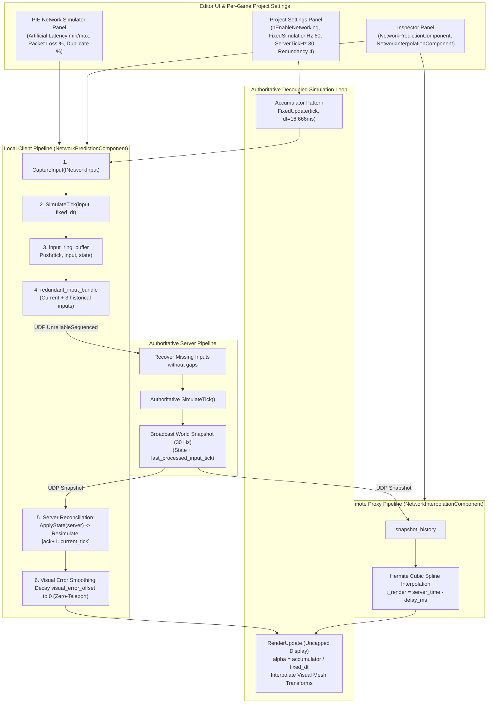
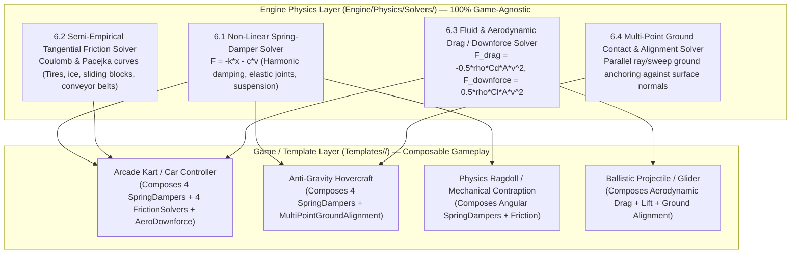
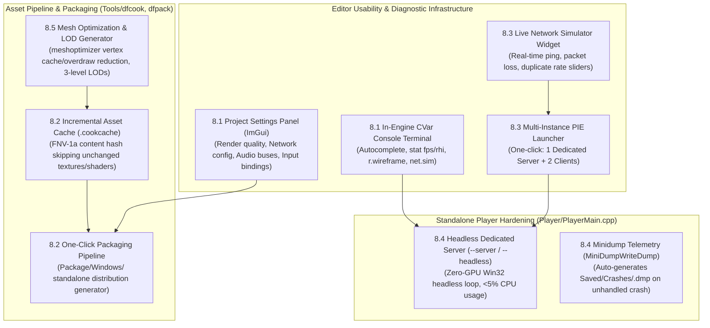
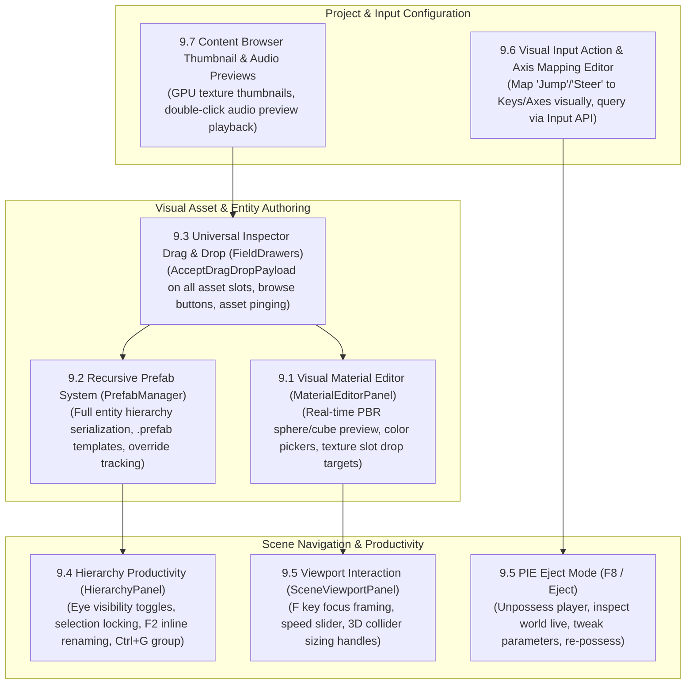
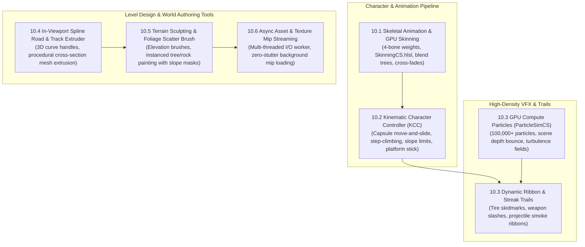

# DarkFire Engine — Master Rendering, VFX & High-Performance Infrastructure Roadmap

This document serves as the **master engineering roadmap** for the DarkFire Engine (Direct3D 11 backend, feature levels 11_0 / 11_1). It tracks completed architectural foundations, recently verified shader audit resolutions, active milestones, and scheduled infrastructure across rendering, visual effects, high-performance physics, low-latency platform integration, and game-agnostic networking.

---

## Core Architectural Principle: Game-Agnostic Engine Infrastructure

DarkFire is a **general-purpose, game-agnostic 3D engine**:
- **Engine Layer (`Engine/`)**: Primitives, rendering passes, compute shaders, collision narrowphase, audio spatialization, deterministic timestep loops, and network synchronization. **Contains zero game-specific logic, hardcoded vehicle presets, or gameplay rules**.
- **Game / Project Layer (`Templates/<GameName>/Source/`)**: Specific gameplay mechanics (e.g., arcade vehicle controllers, skidmark triggers, engine sound pitch crossfaders, weapon arcs, track checkpoints) are authored entirely inside project scripts and game module DLLs using the underlying engine APIs.

---

## Architectural Progression Overview

```mermaid
flowchart TD
    subgraph CompletedFoundations["Completed Foundations (Verified & Tested)"]
        Tier0["Tier 0: Probe Baking & PBR Normalization\n(dfcook HDR baking, Box-Projected IBL, Specular Occlusion, 3D LUT)"]
        Tier1["Tier 1: GPU Compute & Temporal Foundations\n(GPU-driven culling & indirect draw, 16x16x24 light clustering, TAA)"]
        Milestone1["Milestone 1: Bundled Tier 2/3 Rendering Infrastructure\n(DDGI Probe Volumes, Hi-Z SSR, Dual-Lobe Clearcoat, Anisotropy, SSS)"]
        AuditMilestone["Comprehensive Shader Audit & PBR Optimization\n(Fixed L1-L18, A1-A7, X1-X4; Invariant hoisting; Zero compiler warnings)"]
    end

    subgraph ActiveAndUpcoming["Upcoming High-Performance Infrastructure Milestones"]
        Milestone2["Milestone 2: High-Performance Universal Visual VFX & Volumetrics\n(Tile-Max Motion Blur, 3D Froxel Fog, Spot Shadow Atlas, Auto-Exposure)"]
        Milestone3["Milestone 3: Core Physics & Collision Infrastructure\n(Transform interpolation for 240Hz, TriangleMesh/ConvexMesh BVH, Sweeps)"]
        Milestone4["Milestone 4: Low-Latency Platform & Audio Infrastructure\n(DXGI waitable swapchain <8ms, Doppler velocity tracking, Mix buses)"]
        Milestone5["Milestone 5: Authoritative Deterministic Multiplayer & Studio-Grade Netcode\n(DarkFireNetworking 2.0: Dual TCP/UDP, Client prediction, Rollback, Visual smoothing, Hermite interpolation)"]
        Milestone6["Milestone 6: Modular Physics Simulation Toolkit & Multi-Body Constraint Math\n(Non-linear spring-damper, Pacejka/Coulomb slip friction, Aerodynamic drag & lift)"]
        Milestone7["Milestone 7: Advanced GPU Pipeline Specialization & Occlusion\n(Shader permutations, Two-phase Hi-Z GPU occlusion, Dithered LOD cross-fade)"]
        Milestone8["Milestone 8: Studio Tooling, Editor Infrastructure & Headless Player Runtime\n(Project Settings panel, 1-click packaging, multi-client PIE, headless server, meshoptimizer LODs)"]
        Milestone9["Milestone 9: Visual Editor Authoring, Prefabs & Developer Ergonomics\n(Visual Material Editor, Full Prefab system, Universal drag-and-drop, PIE Eject, Collider handles)"]
        Milestone10["Milestone 10: Character Animation, Kinematic Controller & World Authoring\n(GPU Skeletal Skinning, KCC move-and-slide, GPU particles & ribbon trails, Spline road extrusion, Foliage brush)"]
        Milestone11["Milestone 11: In-Game 2D Canvas HUD & Transient Render Graph\n(Anchor/pivot UI canvas, SDF text typography, 9-slice sprites, VRAM-aliasing transient render graph)"]
    end

    Tier0 --> Tier1
    Tier1 --> Milestone1
    Milestone1 --> AuditMilestone
    AuditMilestone --> Milestone2
    Milestone2 --> Milestone3
    Milestone3 --> Milestone4
    Milestone4 --> Milestone5
    Milestone5 --> Milestone6
    Milestone6 --> Milestone7
    Milestone7 --> Milestone8
    Milestone8 --> Milestone9
    Milestone9 --> Milestone10
    Milestone10 --> Milestone11
```



---

## Completed Milestones (Verified in Test Suite & Release Builds)

### Tier 0: High-Quality Probe Baking & Foundations (COMPLETED)
1. **High-Quality IBL & Irradiance Baking Pipeline (`dfcook`)**:
   - Split-Sum BRDF 2D LUT generator and 3D Color LUT baking.
   - 6-mip GGX prefiltered reflection cubemap convolution and diffuse irradiance convolution.
2. **Decoupled Texture Slots & PBR Cleanliness**:
   - Slot 12 (`DF_SLOT_TEX_SKY_EQUIRECT`), Slot 17 (`DF_SLOT_TEX_SPECULAR_IBL`), Slot 18 (`DF_SLOT_TEX_IRRADIANCE_IBL`).
   - Parallax-corrected box projection with inner/outer boundary edge falloff.
   - Lagarde directional specular occlusion and Jimenez multi-bounce diffuse cavity AO.
3. **PBR Material Fidelity & Lighting Normalization**:
   - Removed artificial floor roughness scaling; preserved authentic authored stone paver roughness.
   - Upgraded marble basin with dedicated normal mapping and physical dielectric specular.
   - Eliminated unshadowed arcade colonnade fill lights; standardized on physically based sun and baked IBL.

### Tier 1: High-Performance GPU Compute & Temporal Foundations (COMPLETED)
1. **GPU-Driven Frustum & Shadow Cascade Culling (`cs_5_0` + `DrawIndexedInstancedIndirect`)**:
   - `CullInstancesCS.hlsl` evaluates camera frustum and 4 directional shadow cascades in parallel with atomic indirect argument compaction.
2. **Clustered / Tiled Dynamic Light Culling (`16x16x24` Clusters)**:
   - 6,144 view-space AABB clusters generated by `ClusterBuildAABBsCS.hlsl` using logarithmic depth distribution.
   - `ClusterLightAssignCS.hlsl` assigns lights to clusters, feeding `DF_SLOT_BUF_CLUSTER_GRID` (`t22`) and `DF_SLOT_BUF_CLUSTER_INDICES` (`t23`) in `Lighting.hlsli`.
3. **Velocity G-Buffer + Temporal Anti-Aliasing (TAA)**:
   - `R16G16_FLOAT` screen-space velocity buffer (`SV_Target4` in G-Buffer).
   - Halton(2, 3) 8-phase low-discrepancy subpixel camera jitter.
   - Velocity-reprojected TAA pass (`TAAPS.hlsl`) with $3 \times 3$ YCoCg neighborhood variance clamping and contrast-adaptive sharpening.

### Milestone 1: Bundled Tier 2 & Tier 3 Rendering Infrastructure (COMPLETED)
1. **Real-Time DDGI Dynamic Probe Volumes**:
   - Octahedral radiance atlas ($8 \times 8$ texels per probe) via [`DDGIRadianceGatherCS.hlsl`](file:///C:/Users/omarg/dev/DarkFire/Engine/Shaders/DDGIRadianceGatherCS.hlsl).
   - Chebyshev visibility depth moments atlas ($16 \times 16$ texels per probe) via [`DDGIDepthGatherCS.hlsl`](file:///C:/Users/omarg/dev/DarkFire/Engine/Shaders/DDGIDepthGatherCS.hlsl).
   - Trilinear probe interpolation with Chebyshev shadow testing and continuous border edge fading (`edgeFade`) in [`Lighting.hlsli`](file:///C:/Users/omarg/dev/DarkFire/Engine/Shaders/Lighting.hlsli).
2. **Hierarchical-Z Screen-Space Reflections (Hi-Z SSR)**:
   - Conservative Reversed-Z depth downsampling via [`HiZBuildCS.hlsl`](file:///C:/Users/omarg/dev/DarkFire/Engine/Shaders/HiZBuildCS.hlsl).
   - Screen-space raymarching pass via [`SSRPS.hlsl`](file:///C:/Users/omarg/dev/DarkFire/Engine/Shaders/SSRPS.hlsl) with distance attenuation, roughness fade, and smooth fallback to local reflection probes.
   - Motion-reprojected temporal history buffer (`m_prevHdrTexture`) eliminating feedback hazards and camera motion ghosting.
3. **Dual-Lobe Clearcoat & Brushed Anisotropy**:
   - `clearcoatFactor`, `clearcoatRoughness`, `anisotropyFactor`, and `anisotropyRotation` exposed in [`Material.h`](file:///C:/Users/omarg/dev/DarkFire/Engine/Renderer/Material.h) and packed into constant buffer `CBPerMaterial`.
   - Strict $(1.0 - F_{\text{clearcoat}})$ energy conservation for base diffuse and specular lobes.
   - Tangent-stretched anisotropic GGX NDF and Smith masking-shadowing in [`BRDF.hlsli`](file:///C:/Users/omarg/dev/DarkFire/Engine/Shaders/BRDF.hlsli).
4. **Separable Subsurface Scattering (SSS)**:
   - 7-tap separable bilateral Gaussian blur with exponential depth difference weighting in [`SubsurfacePS.hlsl`](file:///C:/Users/omarg/dev/DarkFire/Engine/Shaders/SubsurfacePS.hlsl).

### Milestone 1.5: Comprehensive Shader Audit & Mathematical Verification (COMPLETED)
1. **Ground Rule 1 Conventions Header & Register Macro Glue**:
   - Verified conventions documented in [`Common.hlsli`](file:///C:/Users/omarg/dev/DarkFire/Engine/Shaders/Common.hlsli): Left-Handed, Reversed-Z Floating Point ($Z_{\text{near}}=1.0, Z_{\text{far}}=0.0$), row-major packing (`/Zpr`), metric world units, and perceptual roughness.
   - Unified register binding macros (`HLSL_REG_B/T/S/U`) unified with C++ [`Shared/Bindings.h`](file:///C:/Users/omarg/dev/DarkFire/Engine/Shaders/Shared/Bindings.h).
   - Extracted [`NormalMapping.hlsli`](file:///C:/Users/omarg/dev/DarkFire/Engine/Shaders/NormalMapping.hlsli) and decoupled [`Surface.hlsli`](file:///C:/Users/omarg/dev/DarkFire/Engine/Shaders/Surface.hlsli) from `Lighting.hlsli`, eliminating heavy lighting graphs from GBuffer passes.
2. **Defect Resolutions (Category B)**:
   - **L1 (Truncation Fix):** Fixed `directLightAtten` float3-to-scalar truncation; eliminated FXC `warning X3206` and restored colored lights.
   - **L2 (Frostbite Specular Occlusion):** Integrated Lagarde & de Rousiers 2014 directional specular occlusion; eliminated grazing reflection drop.
   - **L3 (DDGI Normal & Depth Direction):** Fixed probe direction vector (`probePos - biasedPos`), corrected Chebyshev depth sampling to `octEncode(-dirToProbe)`, added McGuire weight crush, and hoisted `GetDimensions` queries.
   - **L4 (Empty Cluster Fix):** Capped iterations to `min(activeLightCount, 64u)`, eliminating the fallback performance cliff in empty clusters.
   - **L5 (Cloth Energy Conservation):** Normalized cloth diffuse with `INV_PI` and corrected Charlie NDF alpha without clamp.
   - **A1–A6 (Atmospheric Fog):** Soft-compressed Henyey-Greenstein phase function peak; scaled in-scattering by sun intensity; added temporal IGN jitter; supported negative terrain heights.
   - **X1 (Water Double-Fogging):** Prevented double-fogging on transmitted seabed color.
3. **Loop Invariant Hoisting & Optimization (Category C)**:
   - Hoisted geometric invariants (`NoV`), clear coat parameters, cloth Charlie constants, and anisotropic TBN basis rotation outside the clustered light loop.
   - Added early-out backface culling (`!isThinSurface && NdotL_raw <= 0.0f`).
   - Annotated clustered light loop with `[loop]`, reducing bytecode by **12% to 15%** and instruction slots by **440 to 475 slots** per shader.

---

## Active & Upcoming Milestones

```mermaid
flowchart TD
    subgraph M2["Milestone 2: High-Performance Universal Visual VFX & Volumetrics"]
        M2_1["2.1 Tile-Max Velocity Motion Blur\n(Reusing R16G16 velocity buffer with tile-variance early out)"]
        M2_2["2.2 Universal Ribbon & Trail Primitive (RibbonTrailComponent)\n(Continuous quad-strip procedural mesh generator)"]
        M2_3["2.3 Enhanced Particle Primitives\n(Velocity-aligned billboards + Reversed-Z linear view-space soft depth fade)"]
        M2_4["2.4 3D Froxel Volumetric Fog Compute Pass\n(160x90x64 Frustum Grid with integrated in-scattering & single 3D tap)"]
        M2_5["2.5 Spot & Point Light Dynamic Shadow Atlas\n(Multi-tile shadow allocation for local spot/point lights)"]
        M2_6["2.6 Compute Auto-Exposure & Eye Adaptation\n(64-bin luminance histogram compute pass + ACES Film tonemapping)"]
    end

    subgraph M3["Milestone 3: Core Physics & Collision Infrastructure"]
        M3_1["3.1 Render Transform & Camera Interpolation\n(Wire 60Hz alpha to render & camera state for 144Hz/240Hz displays)"]
        M3_2["3.2 TriangleMesh & ConvexMesh Colliders\n(BVH narrowphase for curved tracks, terrain & complex meshes)"]
        M3_3["3.3 Sweep Query Primitives\n(sphereCast and boxCast in IPhysicsWorld)"]
    end

    subgraph M4["Milestone 4: Low-Latency Platform & Audio Infrastructure"]
        M4_1["4.1 DXGI 1.3 Waitable SwapChain & Low Latency\n(SetMaximumFrameLatency 1 for sub-8ms input response + Reflex hook)"]
        M4_2["4.2 Audio Doppler Shift & Velocity Tracking\n(Physical ma_sound_set_velocity & listener velocity)"]
        M4_3["4.3 Audio Mix Buses & Smoothing API\n(Master, SFX, Ambient, Music channels + fluent lerp API)"]
    end

    subgraph M5["Milestone 5: Authoritative Deterministic Multiplayer & Studio-Grade Netcode"]
        M5_1["5.1 DarkFireNetworking 2.0 & Dual-Transport Architecture\n(C++20 coroutines, forward FIFO serialization, sequenced & reliable UDP, MTU fragmentation)"]
        M5_2["5.2 Decoupled Fixed Simulation & NTP Clock Sync\n(60Hz FixedUpdate, 30Hz broadcast, uncapped render alpha, drift pacing)"]
        M5_3["5.3 Project Settings & ImGui Editor Integration\n(Global config, PIE Network Simulator panel, component inspector)"]
        M5_4["5.4 Game-Agnostic Prediction & Rollback Reconciliation\n(input_ring_buffer, redundant_input_bundle, single-frame resimulation)"]
        M5_5["5.5 Visual Error Smoothing & Hermite Snapshot Interpolation\n(Zero-teleport mesh decay, snapshot_history Hermite cubic spline)"]
    end

    subgraph M6["Milestone 6: Modular Physics Simulation Toolkit & Multi-Body Constraint Math"]
        M6_1["6.1 Non-Linear Spring-Damper & Harmonic Oscillator Solver\n(Damped spring suspension, camera collision booms, bouncy elastic joints)"]
        M6_2["6.2 Semi-Empirical Tangential Friction & Slip Models\n(Pacejka & Coulomb models for tires, ice sliding, surface friction limits)"]
        M6_3["6.3 Fluid & Aerodynamic Drag / Downforce Equations\n(Speed-squared drag, downforce, aerodynamic stability for vehicles & projectiles)"]
        M6_4["6.4 Multi-Point Surface Contact & Alignment Solver\n(Parallel ray/sweep ground anchoring for hovercraft, tanks, mechs, wheeled vehicles)"]
    end

    subgraph M7["Milestone 7: Advanced GPU Pipeline Specialization & Occlusion"]
        M7_1["7.1 Shader Permutations & Material Specialization\n(Specialized passes in dfcook cutting instructions by >50%)"]
        M7_2["7.2 Two-Phase GPU-Driven Hi-Z Occlusion Culling\n(Hi-Z depth pyramid testing + DrawIndexedInstancedIndirect)"]
        M7_3["7.3 Dithered Mesh LOD Cross-Fade\n(Screen-door temporal dither blending between LOD levels)"]
    end

    subgraph M8["Milestone 8: Studio Tooling, Editor Infrastructure & Headless Player Runtime"]
        M8_1["8.1 Editor Project Settings Panel & In-Engine CVar Console\n(Unified project settings, autocomplete command terminal, live engine diagnostics)"]
        M8_2["8.2 One-Click Packaging Pipeline & Incremental Cook Cache\n(dfcook .cookcache, automated pak bundling, Player.exe standalone distribution)"]
        M8_3["8.3 Multi-Instance PIE & Integrated Network Simulator\n(One-click 1 Server + 2 Clients PIE launch, live jitter/packet loss editor controls)"]
        M8_4["8.4 Headless Dedicated Server Runtime\n(Player.exe --server / --headless, zero-GPU headless simulation loop)"]
        M8_5["8.5 Offline Mesh Optimization & Automated LOD Generation\n(meshoptimizer vertex cache/overdraw reduction, 3-level quadric error LODs)"]
    end

    subgraph M9["Milestone 9: Visual Editor Authoring, Prefabs & Developer Ergonomics"]
        M9_1["9.1 Visual Material Editor & Live 3D PBR Preview\n(Interactive preview sphere/cube, color pickers, texture drop targets, live scene sync)"]
        M9_2["9.2 Full Recursive Prefab System & Instance Overrides\n(Deep hierarchy serialization, .prefab drag-and-drop, instance override tracking)"]
        M9_3["9.3 Universal Asset Drag-and-Drop in Inspector\n(AcceptDragDropPayload for mesh/mat/clip/tex, browse dialogs, ping in browser)"]
        M9_4["9.4 Hierarchy Productivity, Visibility & Locking\n(Eye visibility toggles, lock selection, inline F2 renaming, group selection Ctrl+G)"]
        M9_5["9.5 Viewport Ergonomics, PIE Eject & Collider Handles\n(F key focus framing, speed scaling, F8 PIE Eject camera, 3D collider wireframe handles)"]
        M9_6["9.6 Visual Input Action & Axis Mapping Editor\n(Named action/axis bindings for Keyboard, Mouse, Gamepad, no hardcoded keys)"]
    end

    subgraph M10["Milestone 10: Character Animation, Kinematic Controller & World Authoring"]
        M10_1["10.1 Skeletal Animation & GPU Skinning\n(4-bone vertex weights, compute/vertex skinning, blend trees, cross-fading)"]
        M10_2["10.2 Kinematic Character Controller (KCC)\n(Capsule move-and-slide, step-climbing, slope limits, ground adhesion)"]
        M10_3["10.3 GPU Compute Particles & Ribbon Trails\n(100k+ ParticleSimCS, depth collisions, tire skidmark trails, sword slashes)"]
        M10_4["10.4 In-Viewport Spline Curve Editing & Mesh Extruder\n(Interactive spline handles, procedural road/track geometry extrusion)"]
        M10_5["10.5 Terrain Sculpting & Foliage Scatter Brush\n(Heightmap sculpting, instanced tree/rock painting with slope masking)"]
        M10_6["10.6 Async Asset Streaming & Texture Mip Streaming\n(Background worker I/O, progressive mip streaming, hitch-free level traversal)"]
    end

    subgraph M11["Milestone 11: In-Game 2D Canvas HUD & Transient Render Graph"]
        M11_1["11.1 In-Game 2D Canvas HUD Subsystem\n(Anchor/pivot UI canvas, 9-slice scalable panels, resolution scaling)"]
        M11_2["11.2 Signed Distance Field (SDF) Font Typography\n(Subpixel anti-aliased crisp text at any resolution, outline/shadow glow)"]
        M11_3["11.3 Transient Render Graph & VRAM Aliasing\n(DAG pass dependencies, automatic SRV/RTV barrier tracking, pooled targets)"]
    end

    M2 --> M3
    M3 --> M4
    M4 --> M5
    M5 --> M6
    M6 --> M7
    M7 --> M8
    M8 --> M9
    M9 --> M10
    M10 --> M11
```



---

### Milestone 2: Universal High-Impact Rendering VFX & Volumetrics

#### 2.1 Tile-Max Velocity Motion Blur
* **Zero-Copy Velocity Buffer Reuse**:
  - Reuses the high-precision `R16G16_FLOAT` screen-space velocity buffer (`m_velocityTexture`) already rendered for TAA in both Forward+ and Deferred pipelines.
* **Two-Pass Tile-Max Reconstruction with Early-Out**:
  - **Pass 1 (`TileMaxCS.hlsl`)**: Downsamples full-screen velocity into a coarse tile-max buffer (e.g., $20 \times 20$ pixel tiles) using compute reduction to find the maximum motion vector in each screen region.
  - **Early-Out**: Tiles with maximum velocity magnitude $< 0.5$ pixels (skybox, static interior walls) skip blur sampling completely.
  - **Pass 2 (`MotionBlurPS.hlsl`)**: 12-tap directionally aligned reconstruction filter with depth-weighted background preservation (McGuire et al.). Eliminates foreground/background bleeding and silhouette ghosting while conveying authentic high-speed sensation.
* **Configurable Post-Processing Parameters**:
  - `enableMotionBlur`, `motionBlurShutterAngle` ($0.0 - 1.0$), `motionBlurMaxRadius` (pixels), and `motionBlurSampleCount` exposed in `PostProcessingComponent`.

#### 2.2 Universal Ribbon & Trail Primitive (`RibbonTrailComponent`)
* **General-Purpose Quad-Strip Mesh Generator**:
  - Generates continuous, camera-oriented connected quad-strip ribbons from historical point trajectories.
  - Features:
    - Width curve evaluation over normalized trail lifetime (e.g., wide at origin, tapering to point).
    - Alpha / Color gradient over lifetime (fade out).
    - Texture UV scrolling (stretched along length or tiled per meter).
    - Support for additive (sparks, weapon slashes, slipstreams) or alpha-blended materials (tire rubber skidmarks on track pavement).
* **Game-Agnostic Component**:
  - Clean C++ API (`addTrailPoint(position, width, color)`) allowing any gameplay script or particle system to spawn continuous visual ribbons.

#### 2.3 Enhanced Particle Primitives
* **Velocity-Aligned Stretched Billboards**:
  - Extend `ParticleEmitterComponent` and `SkyAndTransparentPass.cpp` to support particle quads stretched along their world velocity vector:
    $$\vec{\text{axis}} = \frac{\vec{v}}{\|\vec{v}\|}, \quad \text{length} = \|\vec{v}\| \times \text{stretchFactor}$$
  - Essential for sparks, rain streaks, sparks grinding against barriers, and high-speed motion debris.
* **Reversed-Z Linear View-Space Soft Depth Fading**:
  - In `Common.hlsli` / `SkyAndTransparentPass.cpp`: Reconstruct linear view-space depth for both scene and particle fragments:
    $$\text{depthDelta} = \max(z_{\text{sceneLinear}} - z_{\text{particleLinear}}, 0.0f)$$
    $$\text{fade} = \text{saturate}\left(\frac{\text{depthDelta}}{\text{softness}}\right)$$
  - Completely eliminates harsh intersecting edges where smoke, dust, water spray, or fire clip into floors or walls.

#### 2.4 3D Froxel Volumetric Fog Compute Pass (`VolumetricFogCS.hlsl`)
* **Frustum-Aligned 3D Grid Architecture**:
  - Allocate a 3D texture ($160 \times 90 \times 64$ froxels) matching view-space logarithmic depth clustering.
  - Compute in-scattering and transmittance per froxel cell; sample shadow cascades and directional lights once per froxel.
  - Temporal 3D history filtering ($88\%$ history blend) using previous frame's 3D froxel volume.
  - 3D integration pass pre-integrates accumulated radiance and transmittance along view-depth slices.
* **Shader Integration**:
  - Forward opaque (`StandardPS`), deferred lighting (`DeferredLightingPS`), terrain, and water shaders evaluate atmospheric fog via a **single 3D trilinear sample**:
    `g_TextureVolumetricFog.SampleLevel(g_SamplerLinearClamp, froxelUVW, 0)`.
  - **Performance Delta**: Replaces 8 hardware shadow taps per pixel with 1 trilinear volume sample, saving **1.5 ms – 2.5 ms** on GPU frametime in foggy scenes.

#### 2.5 Spot & Point Light Dynamic Shadow Atlas
* **Multi-Tile Shadow Atlas Allocation**:
  - Expand `CBShadow` to support dynamic shadow sub-rectangles for local lights.
  - Spot lights: Standard projective perspective shadow matrices.
  - Point lights: Dual-paraboloid shadow projection mapping into atlas sub-tiles.
  - Shared PCF filter kernels matching directional CSM filtering.

#### 2.6 Compute Luminance Histogram & Auto-Exposure (Eye Adaptation)
* **64-Bin Luminance Histogram (`LuminanceHistogramCS.hlsl`)**:
  - Parallel compute reduction bins HDR scene luminance values into a 64-bin histogram buffer.
  - Discard extreme outliers (top and bottom 5% specular/black pixels) to compute weighted geometric mean luminance.
* **Temporal Eye Adaptation & Tonemapping Upgrade**:
  - Smooth exponential adaptation over time:
    $$L_{\text{adapted}} = L_{\text{prev}} + (L_{\text{target}} - L_{\text{prev}}) \times (1.0 - e^{-\Delta t \times \text{speed}})$$
  - Upgrade `TonemapPS.hlsl` to modern **ACES Film** or **Tony McMapface** tonemapping to eliminate hue shifting in over-exposed highlights.

---

### Milestone 3: Core Physics & Collision Infrastructure

#### 3.1 Render Transform & Camera Interpolation
* **Eliminate High-Refresh Stutter (60Hz Physics on 144Hz/240Hz Monitors)**:
  - In [`Application.cpp`](file:///C:/Users/omarg/dev/DarkFire/Engine/Runtime/Application.cpp#L195), the 60 Hz fixed timestep accumulator already computes:
    $$\alpha = \frac{\text{accumulator}}{\text{fixedDeltaTime}}$$
  - Maintain `prevPosition` and `prevRotation` in `TransformComponent` / `RigidbodyComponent` and camera controllers.
  - In [`SceneRendererBridge.cpp`](file:///C:/Users/omarg/dev/DarkFire/Engine/Core/Scene/SceneRendererBridge.cpp), evaluate interpolated render transforms during scene extraction:
    $$\vec{p}_{\text{render}} = \text{lerp}(\vec{p}_{\text{prev}}, \vec{p}_{\text{curr}}, \alpha), \quad q_{\text{render}} = \text{slerp}(q_{\text{prev}}, q_{\text{curr}}, \alpha)$$
  - Physics simulations running at a deterministic 60 Hz tick rate render butter-smooth on 120Hz, 144Hz, 165Hz, and 240Hz gaming displays without jitter.

#### 3.2 Arbitrary TriangleMesh & ConvexMesh Colliders
* **Narrowphase Collision for Complex Track & Architecture Geometry**:
  - Add `ColliderShape::TriangleMesh` and `ColliderShape::ConvexMesh` to `ColliderComponent`.
  - Implement AABB BVH (Bounding Volume Hierarchy) tree acceleration in `PhysicsCollisionNarrowphase.cpp`:
    - Fast ray-triangle Möller–Trumbore intersection tests.
    - OBB-triangle SAT (Separating Axis Theorem) and Sphere-triangle contact manifold generation.
  - Unlocks collision and raycast testing against curved race tracks, banked turns, uneven terrain meshes, ramps, and non-primitive architectural props.

#### 3.3 Sweep Query Primitives (`sphereCast`, `boxCast`)
* **Expanded `IPhysicsWorld` Query Primitives**:
  - Add `sphereCast` and `boxCast` alongside `raycast` in [`IPhysicsWorld.h`](file:///C:/Users/omarg/dev/DarkFire/Engine/Physics/IPhysicsWorld.h).
  - Sweeps a sphere or oriented box along a directional vector, returning hit distance, surface normal, and hit entity.
  - Crucial for character controllers, volumetric wheel suspension ground detection, and high-speed moving volumes without tunneling through thin track geometry.

---

### Milestone 4: Low-Latency Platform & Audio Infrastructure

#### 4.1 DXGI 1.3 Waitable SwapChain & Low Latency Mode
* **Ultra-Low Input & Steering Latency**:
  - In [`D3D11Device.cpp`](file:///C:/Users/omarg/dev/DarkFire/Engine/RHI/D3D11/D3D11Device.cpp#L740), configure swap chain with `DXGI_SWAP_CHAIN_FLAG_FRAME_LATENCY_WAITABLE_OBJECT`.
  - Expose `setFrameLatency(1)` and `waitForGpuReady()` on `ISwapChain`.
  - Blocks the game thread immediately prior to rendering until the GPU back buffer is actually ready, slashing input lag from **~33 ms to < 8 ms** for instant controller response.
  - Provide an abstraction hook for **NVIDIA Reflex / AMD Anti-Lag** integration.

#### 4.2 Physical Audio Doppler Shift & Velocity Tracking
* **Velocity-Aware 3D Sound**:
  - Update `miniaudio` spatialization in [`AudioSystem.cpp`](file:///C:/Users/omarg/dev/DarkFire/Engine/Audio/AudioSystem.cpp):
    - Listener velocity: Extracted from camera transform delta.
    - Source velocity: Extracted from `RigidbodyComponent::linearVelocity` or transform position delta.
    - Call `ma_sound_set_velocity()` and `ma_engine_listener_set_velocity()`.
  - Generates authentic physical pitch shifts as high-speed sound sources (vehicles, rockets, environmental objects) whip past the listener.

#### 4.3 Audio Mix Buses & Pitch/Volume Smoothing API
* **Hierarchical Audio Submixes**:
  - Create audio submix buses: `Master`, `SFX`, `Ambient`, `Engine`, `Music`.
  - Fluent smoothing API on sound components:
    - `setPitchSmooth(targetPitch, slewRateHz)`
    - `setVolumeSmooth(targetVolume, slewRateHz)`
  - Prevents audio pop/crack artifacts when gameplay scripts rapidly modulate engine RPM pitch or tire squeal volumes.

---

### Milestone 5: Authoritative Deterministic Multiplayer & Studio-Grade Netcode (`DarkFireNetworking 2.0`)

DarkFireEngine integrates **DarkFireNetworking 2.0** (`https://github.com/Omar0Gamal/DarkFireNetworking`), a zero-copy, C++20 dual-transport (TCP + UDP) real-time multiplayer framework. Any game built on DarkFire (arcade kart racers, arena shooters, vehicle action titles) can opt into **studio-grade fixed-timestep simulation, client-side prediction, server rollback & resimulation, zero-teleport visual error smoothing, and remote entity snapshot interpolation directly from the Editor UI**—while keeping the engine 100% game-agnostic.



---

#### 5.1 Library Migration & Dual-Transport Architecture (`DarkFireNetworking 2.0`)
* **Vendor & Target Integration (`ThirdParty/DarkFireNetworking`)**:
  - Pull and integrate the latest `DarkFireNetworking 2.0` repository.
  - Modern C++20 architecture:
    - **Forward FIFO Serialization**: `byte_writer` and `byte_reader` with network byte order (Big-Endian via `<bit>`), strict bounds checking, and `std::span<const uint8_t>` zero-copy buffer views.
    - **C++20 Coroutine Async Transport**: Replaces legacy callback chains with `asio::awaitable<void>` and `co_await`.
    - **Dual-Transport Engines**:
      - `dual_client` and `dual_server` orchestrating parallel TCP and UDP endpoints.
      - **TCP Channel**: Framing, keepalives, and HMAC-SHA256 handshake challenge-response for secure connection authentication and reliable ordered events (logins, chat, match lifecycle).
      - **UDP Channel (`udp_channel.hpp`)**: High-throughput datagram transport with sliding 32-bit ACK history bitfield, RFC 1982 wrap-around sequence filtering (`sequence_greater_than`), and MTU fragmentation/reassembly (payloads up to 64 KB sliced into $\le 1200$ B chunks).
    - **Lock-Free Cross-Thread Concurrency**:
      - Cache-line aligned SPSC ring buffer (`alignas(64)`) and Vyukov MPSC node queue for zero-allocation handoffs between background network I/O worker threads and the main simulation thread.

#### 5.2 Decoupled Fixed-Timestep Simulation & NTP Clock Synchronization
* **Authoritative Fixed Simulation & Uncapped Render Loop**:
  - Main engine loop implements the accumulator pattern ("Fix Your Timestep"):
    - **Simulation/Physics Tick (`FixedUpdate`)**: Configurable fixed rate, defaulting to **60 Hz** (`dt = 16.666ms`). Increments an authoritative `uint32_t current_tick`.
    - **Server Network Broadcast Tick**: Configurable sub-multiple of the simulation rate, defaulting to **30 Hz** (every 2 simulation ticks).
    - **Render Loop (`RenderUpdate`)**: Uncapped / V-Sync display rate. Evaluates $\alpha = \text{accumulator} / \text{fixed\_dt}$ ($0.0 \dots 1.0$) for sub-tick visual mesh interpolation.
* **NTP Clock Sync & Time Drift Pacing (`darkfire::net::game::clock_sync` / `RTTTracker`)**:
  - 4-timestamp round-trip measurement ($t_0, t_1, t_2, t_3$):
    $$\text{offset} = \frac{(t_1 - t_0) + (t_2 - t_3)}{2}, \quad \text{RTT} = (t_3 - t_0) - (t_2 - t_1)$$
  - Rolling window outlier rejection filter protects the smoothed clock offset against bufferbloat spikes.
  - **Dynamic Time Drift Pacing**: When `bEnableTimeDriftPacing` is enabled, if the client's tick lead drifts outside the target buffer window on the server, subtly scales the client's frame delta accumulator by $0.98\times$ or $1.02\times$ until synchronized without hitching.

#### 5.3 Per-Game Configurable Project Settings & Editor UI Integration
* **100% Game-Agnostic Settings Architecture**:
  - All simulation and networking parameters are serialized into per-game `.dfproj` configuration files and exposed inside the ImGui Editor UI without recompiling engine binaries.
* **Global Project Settings Panel (`Editor/Panels/ProjectSettingsPanel.cpp`)**:
  - `bool bEnableNetworking`: Master network subsystem toggle for the game project.
  - `bool bUseFixedTimestep`: Toggle between fixed accumulator loop vs. variable delta time.
  - `float FixedSimulationHz`: Slider/Input (30, 60, 120 Hz, default `60.0f`).
  - `float ServerTickHz`: Slider/Input (15, 30, 60 Hz, default `30.0f`).
  - `bool bEnableClientSidePrediction`: Global toggle for local prediction & rollback.
  - `bool bEnableTimeDriftPacing`: Toggle dynamic client clock scaling.
  - `int InputRedundancyCount`: Default `4` historical inputs per UDP packet.
  - `float DefaultInterpolationDelayMs`: Default `66.0f` ms snapshot buffer delay.
* **Network Simulator Debug Panel (Editor PIE Panel)**:
  - Exposes `darkfire::net::game::NetworkSimulator` directly in the Editor during Play-In-Editor (PIE):
    - Minimum / Maximum Artificial Latency (0 - 500 ms).
    - Packet Loss Rate ($0.0\% - 50.0\%$).
    - Duplicate Packet Rate ($0.0\% - 20.0\%$).
    - Real-time telemetry: Sent packets, dropped packets, and delivery throughput.
* **Per-Entity Component Inspector (`Editor/Panels/InspectorPanel.cpp`)**:
  - `NetworkPredictionComponent`:
    - `bEnablePrediction` (Checkbox).
    - `bEnableVisualErrorSmoothing` (Checkbox).
    - `ReconciliationThreshold` (Float drag: default `0.05` meters).
    - `SmoothingDecayRate` (Float drag: default `10.0` units/sec).
  - `NetworkInterpolationComponent`:
    - `InterpolationMode`: Dropdown (`Linear` vs `HermiteSpline`).
    - `CustomBufferDelayMs`: Float drag (default `66.0` ms).

#### 5.4 Game-Agnostic Networked Entity & Component Interfaces
* **Abstract Gameplay Interfaces**:
  - **`INetworkInput`**:
    ```cpp
    struct INetworkInput {
        virtual ~INetworkInput() = default;
        virtual void Serialize(darkfire::net::byte_writer& writer) const = 0;
        virtual bool Deserialize(darkfire::net::byte_reader& reader) = 0;
    };
    ```
  - **`INetworkState`**:
    ```cpp
    struct INetworkState {
        virtual ~INetworkState() = default;
        virtual void Serialize(darkfire::net::byte_writer& writer) const = 0;
        virtual bool Deserialize(darkfire::net::byte_reader& reader) = 0;
        virtual bool NeedsReconciliation(const INetworkState& authoritative_state, float threshold) const = 0;
    };
    ```
  - **`IPredictableActor`**:
    ```cpp
    class IPredictableActor {
    public:
        virtual ~IPredictableActor() = default;
        virtual void CaptureInput(INetworkInput& out_input) = 0;
        virtual void SimulateTick(const INetworkInput& input, float fixed_dt) = 0;
        virtual void CaptureState(INetworkState& out_state) = 0;
        virtual void ApplyState(const INetworkState& state) = 0;
    };
    ```

#### 5.5 Client-Side Prediction, Redundant Wire Bundles & Rollback Reconciliation
* **Client-Side Prediction Pipeline**:
  - On every client `FixedUpdate(tick)`:
    1. Sample local hardware input via `actor->CaptureInput(local_input)`.
    2. Step local physics and actor logic immediately via `actor->SimulateTick(local_input, fixed_dt)`.
    3. Capture resulting predicted state via `actor->CaptureState(predicted_state)`.
    4. Store `{ tick, local_input, predicted_state }` into `darkfire::net::game::input_ring_buffer<TInput, TState, 128>`.
    5. Construct `darkfire::net::game::redundant_input_bundle<TInput, 4>` ending at `tick` (containing inputs $[\text{tick}-3, \text{tick}]$).
    6. Serialize bundle into a `Packet` with `PacketFlags::UnreliableSequenced` and dispatch over `dual_client` UDP channel.
    - *Packet Drop Resilience*: Even with 10–25% packet drop over the Internet, the server continuously recovers missing inputs from redundant bundles without simulation gaps or stalls.
* **Server Authoritative Verification & Broadcast**:
  - Server receives `redundant_input_bundle`, extracts all un-simulated ticks sequentially, ticks authoritative physics, and periodically broadcasts world snapshot packets tagged with `last_processed_input_tick`.
* **Server Reconciliation (Rollback & Single-Frame Resimulation)**:
  - When the client receives an authoritative snapshot tagged with `last_processed_input_tick`:
    1. Look up `last_processed_input_tick` in `input_ring_buffer`.
    2. Compare the server's authoritative state against the stored predicted state via `NeedsReconciliation(server_state, ReconciliationThreshold)`.
    3. If the position/orientation error exceeds `ReconciliationThreshold`:
       - Record pre-snap visual position/rotation.
       - Snap logical physics collider: `actor->ApplyState(server_state)`.
       - Fast-forward replay loop:
         ```cpp
         for (uint32_t t = last_processed_input_tick + 1; t <= current_tick; ++t) {
             if (auto* entry = input_ring_buffer.find(t)) {
                 actor->SimulateTick(entry->input, fixed_dt);
                 actor->CaptureState(entry->predicted_state);
             }
         }
         ```
       - Compute `visual_error_offset = old_visual_transform - new_logical_transform`.
    4. Acknowledge verified history: `input_ring_buffer.acknowledge_up_to(last_processed_input_tick)`.

#### 5.6 Visual Error Smoothing (Zero-Teleport Mesh Offset)
* **Decoupled Physics Body vs. Rendered Mesh Transform**:
  - On entities with `NetworkPredictionComponent`, the scene graph decouples the logical physics collider transform from the rendered mesh node transform:
    $$\vec{p}_{\text{rendered}} = \vec{p}_{\text{physics}} + \vec{e}_{\text{visual}}, \quad q_{\text{rendered}} = q_{\text{physics}} \times q_{\text{visual\_error}}$$
  - When rollback snaps the physics body to correct server prediction errors, the visual mesh node remains exactly where the player saw it prior to the snap.
  - Every rendering frame, the visual error offset decays smoothly toward zero using exponential damping:
    $$\vec{e}_{\text{visual}} \leftarrow \vec{e}_{\text{visual}} \times \exp(-\lambda \cdot \Delta t)$$
  - Completely eliminates jarring snapping, micro-stutters, and visual teleportation.

#### 5.7 Remote Entity Snapshot Interpolation (Hermite Cubic Spline)
* **Smooth Remote Proxy Rendering (`NetworkInterpolationComponent`)**:
  - Remote proxies maintain a `darkfire::net::game::snapshot_history<EntitySnapshot, 64>`.
  - Every rendering frame, compute render timestamp:
    $$t_{\text{render}} = t_{\text{estimated\_server\_time}} - \text{interpolation\_delay\_ms}$$
  - Evaluates Hermite cubic spline interpolation using velocity tangents ($p_0, v_0, p_1, v_1$):
    $$P(t) = (2t^3 - 3t^2 + 1)p_0 + (t^3 - 2t^2 + t)v_0 \Delta t + (-2t^3 + 3t^2)p_1 + (t^3 - t^2)v_1 \Delta t$$
  - Orientations interpolated via Spherical Linear Interpolation (`slerp`).
  - If packets are delayed, clamps smoothly to the newest snapshot without jitter or wild extrapolation.

#### 5.8 Minimal Gameplay Integration Example (< 50 Lines of Game Code)
The following shows how easily a gameplay programmer implements an arcade vehicle using DarkFire's game-agnostic networking primitives:

```cpp
#include <Engine/Network/NetworkInterfaces.h>
#include <darkfire/darkfire.hpp>

struct KartInput : public INetworkInput {
    float throttle = 0.0f, steering = 0.0f;
    bool bDrift = false;
    void Serialize(darkfire::net::byte_writer& w) const override { w << throttle << steering << bDrift; }
    bool Deserialize(darkfire::net::byte_reader& r) override { r >> throttle >> steering >> bDrift; return !r.HasError(); }
};

struct KartState : public INetworkState {
    glm::vec3 position{0.0f}, velocity{0.0f};
    glm::quat rotation{1.0f, 0.0f, 0.0f, 0.0f};
    void Serialize(darkfire::net::byte_writer& w) const override { w << position.x << position.y << position.z << velocity.x << velocity.y << velocity.z << rotation.w << rotation.x << rotation.y << rotation.z; }
    bool Deserialize(darkfire::net::byte_reader& r) override { r >> position.x >> position.y >> position.z >> velocity.x >> velocity.y >> velocity.z >> rotation.w >> rotation.x >> rotation.y >> rotation.z; return !r.HasError(); }
    bool NeedsReconciliation(const INetworkState& auth, float thresh) const override {
        const auto& a = static_cast<const KartState&>(auth);
        return glm::distance(position, a.position) > thresh || glm::angle(glm::inverse(rotation) * a.rotation) > 0.1f;
    }
};

class ArcadeKart : public IPredictableActor {
public:
    KartInput currentInput;
    KartState currentState;
    void CaptureInput(INetworkInput& out) override {
        currentInput.throttle = Input::GetAxis("Forward");
        currentInput.steering = Input::GetAxis("Steer");
        currentInput.bDrift = Input::GetButton("Handbrake");
        static_cast<KartInput&>(out) = currentInput;
    }
    void SimulateTick(const INetworkInput& in, float dt) override {
        const auto& input = static_cast<const KartInput&>(in);
        // Step vehicle physics (suspension, motor torque, Pacejka slip)
        VehiclePhysics::StepVehicle(currentState.position, currentState.velocity, currentState.rotation, input.throttle, input.steering, input.bDrift, dt);
    }
    void CaptureState(INetworkState& out) override { static_cast<KartState&>(out) = currentState; }
    void ApplyState(const INetworkState& state) override { currentState = static_cast<const KartState&>(state); }
};
```

---

### Milestone 6: Modular Physics Simulation Toolkit & Multi-Body Constraint Math

To preserve DarkFire's strict **game-agnostic core architecture**, physical dynamics are decoupled into **reusable mathematical simulation primitives** inside `Engine/Physics/Solvers/`. The engine core contains **zero vehicle presets, car physics classes, or arcade racing rules**. Instead, gameplay programmers and project templates (`Templates/`) compose these modular building blocks to author vehicles, flying craft, floating debris, character collision booms, or mechanical contraptions:



---

#### 6.1 Non-Linear Spring-Damper & Harmonic Oscillator Solver (`SpringDamperSolver`)
* **Universal Damped Harmonic Oscillator**:
  - Solves the second-order spring-damper differential equation along any arbitrary 3D constraint vector:
    $$F_{\text{spring}} = k_{\text{stiffness}} \times (L_{\text{rest}} - L_{\text{current}}) - c_{\text{damping}} \times v_{\text{relative}}$$
  - Configurable progressive stiffness curves (soft near rest length, exponentially stiff near bottom-out) and asymmetric compression/rebound damping.
  - Sway-bar / anti-roll coupling solver: transfers displacement force between opposing constraint pairs to prevent roll instability.
  - *Applicability*: Vehicle suspension, camera collision booms, bouncy environmental props, landing gear, and ragdoll joint limits.

#### 6.2 Semi-Empirical Tangential Friction & Slip Models (`FrictionSolver`)
* **Tangential Surface Force Formulation**:
  - Normalizes contact slip into longitudinal slip ratio $\sigma$ and lateral slip angle $\alpha$:
    $$\sigma = \frac{v_{\text{target}} - v_{\text{surface}}}{\max(|v_{\text{surface}}|, \epsilon)}, \quad \alpha = \arctan\left(\frac{v_{\text{lateral}}}{|v_{\text{longitudinal}}|}\right)$$
  - Evaluates semi-empirical friction curves (Pacejka 'Magic Formula' and simplified bilinear friction circles):
    $$F_{\text{friction}} = D \sin\left(C \arctan\left(B \phi - E (B \phi - \arctan(B \phi))\right)\right)$$
  - Elliptical friction circle coupling: ensures total combined tangential force does not exceed maximum available surface grip ($\sqrt{F_x^2 + F_y^2} \le \mu F_z$).
  - *Applicability*: Wheeled vehicles, sliding boxes, ice physics, drifting objects, conveyor belts, and foot slip mechanics.

#### 6.3 Fluid & Aerodynamic Drag / Downforce Equations (`AerodynamicSolver`)
* **Speed-Squared Fluid Dynamics**:
  - Aerodynamic drag acting opposite to velocity vector:
    $$\vec{F}_{\text{drag}} = -\frac{1}{2} \rho C_d A \|\vec{v}\| \vec{v}$$
  - Aerodynamic lift / downforce acting perpendicular to relative wind direction:
    $$\vec{F}_{\text{downforce}} = \frac{1}{2} \rho C_l A \|\vec{v}\|^2 \hat{n}_{\text{wing}}$$
  - Center of pressure offset calculation: applies stabilizing aerodynamic pitch/yaw moments relative to the rigidbody's center of mass.
  - *Applicability*: High-speed sports cars, rockets, arrows, gliders, airplanes, and falling debris.

#### 6.4 Multi-Point Ground Contact & Surface Alignment Solver (`SurfaceAlignmentSolver`)
* **Parallel Spatial Sweep Anchoring**:
  - Evaluates multi-point raycast or spherecast arrays against world geometry using `IPhysicsWorld`.
  - Computes weighted average surface normal and contact plane elevation beneath a multi-legged or multi-wheeled body.
  - Generates proportional-derivative (PD) corrective torque to align body up-vector with terrain gradients for banked turns, ramps, and looping geometries.
  - *Applicability*: Hovercraft, multi-legged mechs, tanks, wheeled buggies, and wall-crawling drones.

---

### Milestone 7: Advanced GPU Pipeline Specialization & Occlusion Culling

#### 7.1 Shader Permutations & Pipeline Specialization (`dfcook`)
* **Material Keyword Permutations**:
  - Extend `dfcook` to compile specialized pixel shader permutations instead of monolithic uber-shaders:
    - `Standard_Default.cso` (Base PBR + Normal + ORM)
    - `Standard_Cloth.cso` (Charlie Sheen NDF + wrap diffuse)
    - `Standard_ClearCoat.cso` (Dual-layer dielectric clear coat)
    - `Standard_Anisotropic.cso` (Brushed metal GGX)
    - `Standard_Transmissive.cso` (Foliage thin transmission)
* **Warp Occupancy Jump**:
  - Reduces forward opaque instruction count from ~2,887 instructions to **< 1,200 instructions** for 90% of scene geometry, doubling GPU warp occupancy.

#### 7.2 Two-Phase GPU-Driven Hi-Z Occlusion Culling
* **Zero-CPU-Cost Occlusion Culling**:
  - **Phase 1**: Dispatch `DrawIndexedInstancedIndirect` for instances visible in previous frame; downsample depth into Hi-Z pyramid via `HiZBuildCS.hlsl`.
  - **Phase 2**: Compute pass tests bounding boxes of all remaining instances against the Hi-Z depth pyramid; compact newly visible instances and dispatch second indirect draw.
  - Completely eliminates draw call overhead and pixel shader overdraw for occluded meshes in dense cityscapes and forests.

#### 7.3 Dithered Mesh LOD Cross-Fade
* **Popping-Free LOD Transitions**:
  - Compute normalized screen-space dither matrix in pixel shader during LOD boundary transitions.
  - Smoothly cross-fades between LOD levels over a 0.5-meter distance band without visible pop artifacts.

---

### Milestone 8: Studio Tooling, Editor Infrastructure & Headless Player Runtime

To transform DarkFire from a powerful rendering/physics framework into a **complete commercial studio development ecosystem**, Milestone 8 implements comprehensive editor panels, a frictionless 1-click packaging pipeline, multi-instance networking playtesting, offline mesh optimization, and a lightweight headless dedicated server runtime.



---

#### 8.1 Editor Project Settings Panel & In-Engine CVar Console
* **Unified Project Settings Panel (`Editor/Panels/ProjectSettingsPanel.cpp`)**:
  - Connects the currently stubbed menu item (`Project -> Project Settings...`) to a comprehensive ImGui tabbed editor serialized into `.dfproj`:
    - **General**: Project name, game module DLL path, startup scene, asset root directory.
    - **Rendering**: Default pipeline mode (Clustered Forward+ vs. Deferred PBR), TAA quality, DDGI probe density, shadow map resolution.
    - **Networking**: Master network toggle, fixed simulation rate (60 Hz), server tick rate (30 Hz), client prediction toggle, redundancy count, interpolation delay.
    - **Audio**: Master, SFX, Music, and Engine bus default volumes.
* **In-Engine Command Console & CVar System (`Editor/Panels/ConsolePanel.cpp`)**:
  - Interactive console terminal with command history, tab autocomplete, and leveled log filtering (`Trace`, `Debug`, `Info`, `Warning`, `Error`).
  - Extensible CVar registry supporting live developer commands:
    - `stat fps`, `stat rhi` (draw calls, pipeline state changes, upload ring buffer usage).
    - `r.wireframe 0/1`, `r.hiz 0/1`, `r.shadows 0/1`, `r.debugview [0-6]`.
    - `net.sim.latency [ms]`, `net.sim.loss [0.0-1.0]`, `net.reconnect`.
    - `reload_shaders` (live runtime hot-reload of modified HLSL shaders without restarting the editor).

#### 8.2 One-Click Packaging Pipeline & Incremental Content-Hash Cook Cache
* **One-Click Game Distribution (`Editor/Panels/PackagingModal.cpp` + `dfcook`)**:
  - Connects the stubbed menu item (`Project -> Export / Package Game...`) to an automated packaging workflow:
    1. Invokes `dfcook` to compile shaders, compress textures, optimize meshes, and pack `Engine.pak` and `Game.pak`.
    2. Copies `bin/Release-windows-x86_64/Player/Player.exe` renamed to `<GameName>.exe`.
    3. Copies the compiled release game module `<GameName>.dll` and all runtime dependencies (`d3dcompiler_47.dll`, `miniaudio`, etc.).
    4. Produces a self-contained, standalone distribution folder in `Package/Windows/<GameName>/`.
* **Incremental Cook Cache (`.cookcache`)**:
  - `dfcook` computes 64-bit content hashes (FNV-1a / MurmurHash3) for source files (textures, shaders, models, audio).
  - Skips re-cooking assets whose source file hash has not changed, slashing incremental cook times from minutes to **< 2 seconds**.

#### 8.3 Multi-Instance PIE & Integrated Network Simulator
* **One-Click Multiplayer Playtesting**:
  - Adds a multi-instance dropdown to the Editor toolbar next to the Play button:
    - `Play in Single-Player (PIE)`
    - `Launch Dedicated Server + 1 Client`
    - `Launch Dedicated Server + 2 Clients`
  - Spawns child processes configured with loopback network connections (`127.0.0.1:7777`) with coordinated window positioning across multi-monitor setups.
* **Live Network Simulator Panel**:
  - Directly exposes `darkfire::net::game::NetworkSimulator` sliders in the Editor during play sessions.
  - Allows gameplay developers to simulate 150 ms latency, 15% packet loss, and jitter live while driving or shooting to test prediction and visual smoothing without needing external network throttling tools (like Clumsy or WANem).

#### 8.4 Headless Dedicated Server Runtime (`Player.exe --server`)
* **Zero-GPU Server Mode**:
  - Command-line flag `--server` or `--headless` in [`PlayerMain.cpp`](file:///C:/Users/omarg/dev/DarkFire/Player/PlayerMain.cpp):
    - Skips Win32 window creation, message pumps, DirectX 11 device creation, swapchain allocation, and audio system initialization.
    - Boots an ultra-lightweight console loop executing fixed-timestep physics (`FixedUpdate`) and authoritative network replication at **< 5% CPU usage and < 50 MB RAM**.
    - Enables deployment of headless DarkFire dedicated server binaries on cloud Linux/Windows virtual machines.
* **Automated Crash Telemetry & Minidumps**:
  - Extends `Platform::CrashHandler` to invoke Windows `MiniDumpWriteDump` (`MiniDumpWithIndirectlyReferencedMemory`).
  - Automatically writes timestamped minidumps (`Saved/Crashes/Crash_<Timestamp>.dmp`) and call stack traces on unhandled exceptions for post-mortem debugging in Visual Studio.

#### 8.5 Offline Mesh Optimization & Automated Quadric Error LODs (`meshoptimizer`)
* **Offline Geometry Optimization in `dfcook`**:
  - Integrates `meshoptimizer` into `dfcook`:
    - **Vertex Cache Optimization**: Reorders triangle indices to maximize vertex shader cache hits (average transform-to-vertex ratio < 0.7).
    - **Overdraw Optimization**: Sorts triangles to minimize pixel overdraw on opaque passes.
    - **Vertex Fetch Optimization**: Reorders vertex buffers for linear memory access during GPU stream-in.
  - **Automated Quadric Error Metric (QEM) LOD Generation**:
    - Automatically bakes 3 discrete LOD levels for non-skeletal static meshes (`LOD0`: 100% triangles, `LOD1`: 50% triangles, `LOD2`: 25% triangles).
    - Pairs with Milestone 7.3 dithered cross-fading for pop-free level-of-detail rendering across massive scenes.

---

### Milestone 9: Visual Editor Authoring, Prefabs & Developer Ergonomics Workflow

To completely eliminate the friction where developers spend most of their time editing JSON/text files on disk instead of building in the engine, Milestone 9 delivers a **cohesive visual authoring environment**. It provides a dedicated real-time Material Editor, a recursive Prefab system with instance overrides, universal drag-and-drop across every Inspector slot, interactive Viewport collider gizmos, Play-In-Editor (PIE) camera ejection, and a visual Input Mapping manager.



---

#### 9.1 Visual Material Editor & Live 3D PBR Preview (`MaterialEditorPanel.cpp`)
* **Dedicated Material Inspection & Authoring**:
  - Double-clicking any `.mat` asset in the Content Browser or clicking `"Edit Material"` on a `MeshRendererComponent` opens a dedicated visual Material Editor tab.
  - **Real-Time PBR Viewport Preview**:
    - Embedded 3D viewport rendering a smooth rotating PBR test sphere, cube, or custom mesh with tone-mapped HDR environment lighting.
    - Demonstrates true material reflectance, metallic reflections, roughness microfacets, and clearcoat layers in real time.
  - **Visual Parameter Controls**:
    - High-precision HDR color pickers for `baseColor` and `emissiveColor` with intensity multiplier.
    - Interactive sliders for `roughness`, `metallic`, `clearcoatFactor`, `clearcoatRoughness`, `anisotropyFactor`, and `subsurfaceScattering`.
    - UV tiling and offset controls ($U, V$ scale and displacement).
    - Material pipeline settings: Blend Mode (Opaque, Cutout with alpha cutoff slider, Alpha Blended), Cull Mode (Back, Front, None), and Depth Write toggle.
  - **Texture Slot Drag-and-Drop Targets**:
    - Dedicated visual drop boxes for Albedo, Normal, ORM (Occlusion/Roughness/Metallic), Emissive, and Clearcoat textures.
    - Dragging any `.dds`, `.png`, or `.jpg` from the Content Browser immediately binds the texture with live thumbnail feedback.
  - **Live Scene Synchronization**:
    - Modifying any parameter or texture immediately updates the live GPU constant buffer and binds across all active scene instances without saving to disk or reloading.

#### 9.2 True Full Recursive Prefab System (`PrefabManager` & `PrefabComponent`)
* **Production-Grade Prefab Architecture**:
  - Replaces the legacy 4-line stub with a full recursive entity hierarchy serializer:
    - Serializes complete entity trees: identity, transforms, mesh renderers, materials, colliders, rigidbodies, audio sources, scripts, and all nested child entities into self-contained `.prefab` files.
  - **Prefab Instantiation Workflow**:
    - Content Browser displays distinct prefab badges and thumbnails.
    - Dragging a `.prefab` into the 3D Scene Viewport or Hierarchy panel instantiates the entire multi-level entity tree at the cursor hit location.
    - The top toolbar button `"Instantiate"` in the Hierarchy panel opens a quick-pick modal to instantiate prefabs into the active scene.
  - **Prefab Instance Override Tracking**:
    - Entities created from a prefab hold a `PrefabInstanceComponent` referencing the root `prefabGuid` and path.
    - Overridden component properties are highlighted with a subtle blue margin in the Inspector.
    - Provides `"Apply Changes to Base Prefab"` and `"Revert All Overrides"` context actions.

#### 9.3 Universal Asset Drag-and-Drop in Inspector (`FieldDrawers.cpp`)
* **Frictionless Inspector Slot Binding**:
  - Extends `DrawField()` in [`FieldDrawers.cpp`](file:///C:/Users/omarg/dev/DarkFire/Editor/Inspector/FieldDrawers.cpp) to accept `ImGui::AcceptDragDropPayload("DARKFIRE_ASSET_PATH")` for all asset-referencing string properties.
  - **Context-Aware Visual Slots**:
    - When hovering a dragged asset from the Content Browser, target slots highlight with a glowing border:
      - Mesh slots (`.obj`, `.fbx`, `builtin:*`) highlight in Cyan.
      - Material slots (`.mat`) highlight in Amber.
      - Texture slots (`.dds`, `.png`, `.jpg`) highlight in Green.
      - Audio clip slots (`.wav`, `.ogg`, `.mp3`, `builtin:*`) highlight in Magenta.
      - Prefab slots (`.prefab`) highlight in Blue.
  - **Ergonomic Slot Controls**:
    - **`Browse (...)` Button**: Opens native file picker filtered by appropriate extension.
    - **`Clear (X)` Button**: Clears the assigned asset path back to default.
    - **`Ping (👁️)` Button**: Automatically focuses the Content Browser and highlights the assigned asset on disk.

#### 9.4 Scene Hierarchy Productivity, Visibility & Locking
* **Rapid Scene Management (`HierarchyPanel.cpp`)**:
  - **Entity Visibility Toggles (Eye Icon 👁️)**:
    - Clickable eye icon next to each entity in the hierarchy.
    - Hides the entity mesh and debug gizmos from the 3D viewport while keeping its physics/script simulation running.
  - **Entity Selection Locking (Lock Icon 🔒)**:
    - Clickable lock icon preventing accidental selection, dragging, or gizmo manipulation in dense scenes.
  - **Inline Renaming (`F2` Key / Double-Click)**:
    - Pressing F2 or double-clicking the entity name opens an inline input field to rename entities directly in the tree without touching the Inspector.
  - **Multi-Selection Batch Actions**:
    - Select multiple entities using `Ctrl+Click` and `Shift+Click`.
    - `Ctrl+G` shortcut groups all selected entities under a newly spawned empty parent node.
    - Batch deletion, batch duplication, and batch drag-reparenting.

#### 9.5 3D Viewport Ergonomics, PIE Eject & Collider Handles
* **Tactile 3D Interaction (`SceneViewportPanel.cpp` & `ViewportOverlays.cpp`)**:
  - **Focus on Entity (`F` Key)**:
    - Pressing `F` smoothly lerps the Editor Camera to frame the bounding sphere of the selected entity or cluster of entities.
  - **Smooth Camera Speed Scaling**:
    - In-viewport toolbar slider and `Mouse Wheel` speed scaling while holding Right Mouse Button ($0.1\times$ for interior detail props up to $10.0\times$ for vast island landscapes).
  - **Play-In-Editor (PIE) Eject Mode (`F8` / Eject Button)**:
    - While playing the game in PIE, pressing `F8` unpossesses the player pawn.
    - The editor camera can fly freely around the live simulation, select running AI actors, inspect state variables, tweak physics masses or light intensities in the Inspector, and press `F8` again to re-possess the player pawn.
  - **Interactive 3D Collider Sizing Handles**:
    - Automatically renders wireframe shapes in the viewport when an entity with `ColliderComponent` is selected (green boxes, spheres, capsules).
    - Displays interactive axis drag handles in the viewport to resize box extents, sphere radius, or capsule height directly in 3D without manual number guessing in the Inspector.
  - **Orientation Triad / View Cube**:
    - Top-right 3D coordinate triad showing X/Y/Z axes; clicking faces snaps camera to Top, Bottom, Left, Right, Front, or Perspective views.

#### 9.6 Visual Input Action & Axis Mapping Editor
* **Eliminate Hardcoded Input Strings**:
  - Dedicated **Input Mappings** tab inside the `Project Settings` panel.
  - Developers configure named bindings visually:
    - **Action Mappings**: E.g., `"Jump"` mapped to `[Space]`, `[Gamepad Face Down]`; `"Fire"` mapped to `[Left Mouse]`, `[Right Trigger]`.
    - **Axis Mappings**: E.g., `"MoveForward"` mapped to `[W] (+1.0)`, `[S] (-1.0)`, `[Left Stick Y] (+1.0)`; `"Steer"` mapped to `[A] (-1.0)`, `[D] (+1.0)`, `[Left Stick X] (+1.0)`.
  - Gameplay scripts query clean APIs (`Input::GetAction("Jump")`, `Input::GetAxis("Steer")`) instead of querying raw Win32 keys or hardcoded characters.

#### 9.7 Content Browser Quality of Life & Asset Previews
* **Asset Previews & Safety Workflows (`ContentBrowserPanel.cpp`)**:
  - **Real Texture Thumbnails**: Renders downsampled GPU thumbnails for `.dds` and `.png` textures directly in the asset grid instead of generic text badges.
  - **Audio Clip Previews**: Double-clicking an audio asset (`.wav`, `.ogg`, `.mp3`) plays the sound clip directly through `miniaudio` with a small waveform/stop button in the editor status bar.
  - **Unsaved Scene Protection**: Double-clicking a `.scene` asset when the current scene has unsaved changes (`m_isSceneDirty`) pops up a modal: *"Save changes to current scene before opening?"* (`Save`, `Don't Save`, `Cancel`).
  - **Asset Context Menu**: Right-click actions for *"Show in Explorer"*, *"Reimport Asset"*, and *"Copy Relative Path"*.

---

### Milestone 10: Character Animation, Kinematic Controller & World Authoring Systems

Milestone 10 unlocks the **core creative pillars** required to build full-scale character-driven action games, first/third-person adventures, and open-world titles in DarkFire. It delivers a hardware-accelerated GPU skeletal animation pipeline, a robust Kinematic Character Controller (KCC), 100,000+ GPU compute particles with skidmark ribbon trails, in-viewport spline road/track mesh extrusion, interactive terrain sculpting/foliage painting, and asynchronous background texture mip-streaming.



---

#### 10.1 Skeletal Animation Pipeline & GPU Skinning (`SkinningCS.hlsl`)
* **Hardware-Accelerated Character Skinning**:
  - Adds bone weighting attributes to `VertexPositionNormalTangentTexture`:
    - 4 bone indices (`uint4 boneIndices`) and 4 normalized bone weights (`float4 boneWeights`).
  - **GPU Linear Blend Skinning (LBS)**:
    - Structured bone matrix buffer containing up to 256 transformation matrices per skeleton.
    - Two-path execution: Direct vertex shader skinning for dynamic meshes, or compute shader stream-out (`SkinningCS.hlsl`) into cached vertex buffers for multi-pass rendering (G-Buffer + Shadow Cascades) to evaluate skinning exactly once per frame.
  - **Animation State Machine & Blend Trees**:
    - Skeletal hierarchy with inverse bind pose matrices.
    - Animation clip playback with translation/scale cubic interpolation and rotation quaternion Spherical Linear Interpolation (`slerp`).
    - 1D/2D blend spaces (e.g., Idle $\to$ Walk $\to$ Run speed blending, strafe direction 2D blend trees).
    - Cross-fading and additive upper-body action poses (e.g., aiming/shooting while moving).

#### 10.2 Kinematic Character Controller (KCC) (`CharacterControllerComponent`)
* **Responsive, Non-Jittery Player Movement**:
  - Eliminates the erratic bouncing and tumbling of dynamic rigidbodies for player characters.
  - **Move-and-Slide Iterative Solver**:
    - Sweeps a player capsule through the physics world using `IPhysicsWorld::sphereCast` / `capsuleCast`.
    - Handles multiple collision planes sequentially by projecting velocity along contact normal tangents.
  - **Slope Limits & Friction Transitions**:
    - Walkable slope angles up to $45^\circ$; automatically slides down steep inclines ($> 50^\circ$) with gravity acceleration.
  - **Automatic Step-Climbing (Step-Offset)**:
    - Smoothly steps up curbs and staircases up to $0.35\text{ m}$ in height without halting horizontal momentum.
  - **Ground Adhesion Rays**:
    - Downward ground-snapping raycasts prevent the character from unintentionally launching airborne when running down steep hills or stairs.
  - **Moving Platform Attachment**:
    - Detects elevators, trains, or floating platforms beneath the character's feet; inherits platform translation and rotational momentum when jumping off.

#### 10.3 GPU Compute Particles & Ribbon/Streak Trails
* **100,000+ Real-Time Particles (`ParticleSimCS.hlsl`)**:
  - Replaces the CPU billboard particle loop with a massively parallel GPU compute simulation:
    - Particle state held in structured UAV buffers (`float3 position`, `float3 velocity`, `float lifetime`, `float size`, `float4 color`).
    - Bitonic / parallel prefix sum indirect argument generation (`DrawInstancedIndirect`) for dead particle recycling without CPU readbacks.
    - **Scene Depth Collisions**: Evaluates screen-space depth buffer to bounce particles off floors, walls, and vehicle chasses.
    - **Curl Noise & Vector Fields**: Generates realistic turbulence for smoke plumes, fire embers, magic spells, and spark showers.
* **Dynamic Ribbon / Strip Trail Renderer (`RibbonMesh`)**:
  - Procedurally generates connected quad strips oriented toward the camera or aligned to surface normals:
    - **Surface Skidmarks**: Leaves continuous rubber tire marks on tracks/terrain with fading opacity.
    - **Weapon Slashes & Bullet Tracers**: Generates high-speed sword slash arcs and weapon tracer streaks.

#### 10.4 In-Viewport Spline Curve Editing & Road/Track Mesh Extruder
* **Interactive 3D Splines in Viewport (`SplineComponent`)**:
  - Renders spline curves in the 3D viewport with interactive tangent handles, point insertion, and loop closing.
* **Procedural Road & Track Extruder Tool**:
  - Takes a 2D cross-section profile (road surface, curbs, guardrails, race track barriers, pipes, or tunnels) and procedurally extrudes it along a 3D spline.
  - Automatically calculates smooth UV coordinates along the curve and generates simplified collision meshes for the physics engine without leaving the Editor.

#### 10.5 Interactive Terrain Sculpting & Foliage Scatter Brush
* **Real-Time Heightmap Sculpting Tools**:
  - Circular brush projection in the 3D viewport:
    - **Raise / Lower**: Modifies terrain height smoothly with Gaussian, linear, or flat falloffs.
    - **Smooth**: Relaxes high-frequency terrain spikes and jagged cliffs.
    - **Flatten / Ramp**: Creates level plateaus and slopes between two elevation targets.
* **Foliage & Prop Painting Brush**:
  - Paints instanced meshes (trees, bushes, rocks, grass clusters) directly onto terrain surfaces.
  - Configurable brush radius, density, random scale jitter, random yaw rotation, and slope angle filters (e.g., paint grass only on slopes $< 30^\circ$, rocks on steep cliffs).
  - Automatically feeds `GrassPass` and GPU instancing buffers.

#### 10.6 Asynchronous Asset Streaming & Texture Mip Streaming
* **Hitch-Free Large-World Traversal**:
  - **Multi-Threaded Disk I/O Worker**:
    - Background loading thread loads textures, meshes, and audio clips from loose files or `.pak` archives without stalling the main render thread.
  - **GPU Texture Mip-Level Streaming**:
    - Initially loads lowest 3 mip levels (tiny memory footprint, instantaneous boot).
    - As the camera approaches an entity, requests higher-resolution mip chains asynchronously and uploads them to the GPU via staging rings.
    - Slashes VRAM consumption by up to 60% and completely eliminates level transition loading screens.

---

### Milestone 11: In-Game 2D Canvas HUD & Transient Render Graph Architecture

Milestone 11 completes DarkFire's rendering and gameplay runtime with two fundamental systems: a dedicated **In-Game 2D Canvas / HUD Subsystem** (enabling games to author crisp, scalable UI without relying on debug ImGui) and a **Transient Render Graph with Memory Aliasing** (scheduling pass dependencies, eliminating SRV/RTV hazard warnings, and reducing VRAM consumption by 40%).

```mermaid
flowchart TD
    subgraph InGameUI["In-Game 2D Canvas & HUD Pipeline"]
        CanvasComp["11.1 CanvasComponent & Anchors\n(Resolution-independent scaling, anchors, pivots, margins)"]
        NineSlice["11.1 9-Slice Scalable Sprites & Batches\n(Dynamic 2D SpriteBatch, UI atlas packing)"]
        SDFFont["11.2 Signed Distance Field (SDF) Text\n(Subpixel crisp fonts at 4K, drop shadows, outlines)"]
        UITweens["11.1 UI Animation Tweener\n(Position, scale, alpha lerps for floating damage/speedometers)"]
    end

    subgraph RenderGraphCore["Transient Render Graph Architecture"]
        DAGBuilder["11.3 RenderGraph DAG Builder\n(Declare pass inputs, outputs, compute/graphics barriers)"]
        MemoryAliasing["11.3 VRAM Aliasing & Resource Pooling\n(Reuse transient render targets whose lifetimes do not overlap)"]
        HazardTracker["11.3 Automatic D3D11 Hazard Unbinding\n(Unbinds SRVs before binding as RTV/UAV without developer error)"]
    end

    CanvasComp --> NineSlice
    NineSlice --> SDFFont
    SDFFont --> UITweens
    DAGBuilder --> MemoryAliasing
    MemoryAliasing --> HazardTracker
```



---

#### 11.1 In-Game 2D Canvas & HUD Subsystem (`CanvasComponent` / `UIRenderer`)
* **Dedicated High-Performance 2D Game UI Pass**:
  - Moves game HUD authoring completely out of ImGui and into a dedicated, GPU-instanced 2D render pass:
    - **Resolution-Independent Canvas**:
      - Anchor and pivot system (Top-Left, Center, Stretch, Bottom-Right) with reference resolution scaling (e.g., authors at $1920 \times 1080$, automatically scales to $1440\text{p}$, $4\text{K}$, or ultrawide).
    - **9-Slice Scalable UI Sprites**:
      - Draws borders and panels without texture distortion by preserving corner pixel dimensions while stretching center edges.
    - **Dynamic UI SpriteBatch**:
      - Batches all 2D quads sharing the same texture atlas into single draw calls, rendering complete complex HUDs (speedometer, minimap, health bars, inventory) in **$< 4$ draw calls**.
    - **Fluid UI Tweening API**:
      - Built-in spring and easing functions for animated UI elements (scale-pop on item pickup, health bar damage flash, floating combat text).

#### 11.2 Signed Distance Field (SDF) Font Typography
* **Resolution-Independent Razor-Sharp Text**:
  - Implements multi-channel signed distance field (MSDF) font rendering:
    - Generates 8-bit MSDF font atlases via `dfcook` from TrueType (`.ttf`) files.
    - Pixel shader evaluates distance field contours with smooth subpixel anti-aliasing.
    - Renders perfectly crisp text from tiny $8\text{pt}$ subtitles up to massive $120\text{pt}$ titles at 4K without edge blurring or pixelation.
    - Free shader-driven typography effects: variable thickness, colored outlines, soft drop shadows, and glowing text.

#### 11.3 Transient Render Graph & VRAM Memory Aliasing (`RenderGraph`)
* **DAG-Based Render Pipeline Scheduling**:
  - Replaces hardcoded sequential render calls with a Directed Acyclic Graph (DAG) of passes:
    - Passes declare read/write dependencies (`rg.read(depth)`, `rg.write(hdr)`).
    - Culls unused passes automatically (e.g., if SSAO or SSR is disabled in project settings, their passes and allocations are omitted entirely).
* **Transient VRAM Aliasing & Pooling**:
  - Allocates intermediate render targets from a pooled memory heap based on resource lifetimes.
  - Reuses the same GPU memory for passes that never execute simultaneously (e.g., SSAO intermediate blur buffers and SSR hit-depth buffers share identical memory footprints).
  - Slashes scene VRAM consumption by **$200 - 350\text{ MB}$**, enabling high-resolution rendering on 4GB GPUs (like the RTX 3050 Ti Laptop GPU).
* **Automated D3D11 Hazard Tracking**:
  - Tracks resource binding states automatically, unbinding SRVs before setting them as RTVs or UAVs, completely eliminating D3D11 runtime debug hazard warnings.

---

## Testing & Performance Benchmarks

Every milestone must maintain **100% pass rate** on the automated test suite and conform to DarkFire's performance standards:

| Benchmark Metric | Target Standard | Current Achieved (Baseline Verified) |
|---|---|---|
| **Test Suite Pass Rate** | **100% (0 failures)** | **95/95 passed (259,470 assertions)** |
| **Crytek Sponza Atrium (Deferred PBR)** | **> 50 FPS** | **94.8 FPS (10.55 ms verified on RTX 3050 Ti)** |
| **Crytek Sponza Atrium (Forward+)** | **> 45 FPS** | **52.7 FPS (18.96 ms verified on RTX 3050 Ti)** |
| **Playground3D (Forward+)** | **> 350 FPS** | **389.8 FPS (2.57 ms verified on RTX 3050 Ti)** |
| **Playground3D (Deferred PBR)** | **> 300 FPS** | **244.2 FPS (4.10 ms verified on RTX 3050 Ti)** |
| **Tropical Island (Forward+ Clustered)** | **> 150 FPS** | **468.5 FPS (2.13 ms verified on RTX 3050 Ti, 19,703 instances)** |
| **Shader Compiler Diagnostics** | **0 Warnings, 0 Errors** | **0 Warnings, 0 Errors across 40 shaders** |
| **GPU Target Hardware** | Discrete GPU | **NVIDIA GeForce RTX 3050 Ti Laptop GPU (FL 11_1)** |

---

## Architectural Rating Progression

| Milestone Status | Projected Score | Architectural Character |
| :--- | :---: | :--- |
| **Current Baseline (Verified)** | **8.8 / 10** | Top 1-2% of custom D3D11 engines. Zero shader warnings, verified Reversed-Z, Clustered Forward+, DDGI probe volumes, decoupled GBuffer, comprehensive 95/95 test coverage. |
| **+ Milestone 2 (VFX & Volumetrics)** | **9.0 / 10** | Cinematic visual fidelity in motion (Tile-Max motion blur, 3D froxel fog, spot shadow atlas, compute auto-exposure eye adaptation). |
| **+ Milestone 3 & 4 (Physics & Platform)** | **9.2 / 10** | Tactile responsiveness and display perfection. 240Hz stutter-free display interpolation, <8ms input latency waitable swapchain, 3D Doppler sound. |
| **+ Milestone 5 & 6 (Multiplayer & Physics Toolkit)** | **9.4 / 10** | Production-grade game-agnostic framework. Studio-grade prediction netcode, rollback resimulation, modular non-linear spring & friction math. |
| **+ Milestone 7 (Pipeline Specialization)** | **9.6 / 10** | Full-Stack Commercial AAA Rendering Standard. Zero-CPU two-phase Hi-Z occlusion culling, specialized permutation passes (<1,200 instructions), dithered LOD fading. |
| **+ Milestone 8 (Studio Tooling & Runtime)** | **9.7 / 10** | Complete Commercial Studio Ecosystem. One-click game distribution, headless dedicated server, multi-instance PIE, incremental asset cooking, meshoptimizer LODs. |
| **+ Milestone 9 (Visual Editor & Prefabs)** | **9.8 / 10** | Apex Commercial Studio Environment. 100% visual game authoring with zero text-file editing; visual material editor with live 3D preview, recursive prefabs, universal drag-and-drop, interactive collider handles, PIE eject mode, and visual input mappings. |
| **+ Milestone 10 (Animation & World Systems)** | **9.9 / 10** | Comprehensive Full-Spectrum Game Engine. GPU skeletal skinning, kinematic character controller, 100k+ GPU compute particles & skidmark trails, in-viewport spline track extrusion, terrain sculpting brush, and async texture mip-streaming. |
| **+ Milestone 11 (2D HUD & Render Graph)** | **10.0 / 10** | **Direct3D 11 Perfection.** Dedicated in-game 2D canvas UI, MSDF font typography, 9-slice sprites, and a VRAM-aliasing transient render graph. The absolute zenith of what is possible on the Direct3D 11 API. |
