# DarkFire Engine — Master Engineering Roadmap (Direct3D 11)

This document is the **single source of truth** for DarkFire Engine's architecture, completed foundations, active milestones, and implementation specifications across rendering, physics, low-latency platform integration, multiplayer networking, tooling, and editor workflows.

---

## 1. Core Architectural Principle: 100% Game-Agnostic Engine Core

DarkFire is engineered with strict separation of concerns:
- **Engine Layer (`Engine/`)**: Primitives, rendering passes, compute shaders, collision narrowphase, physical math solvers, audio spatialization, deterministic timestep loops, and network synchronization. **Contains zero game-specific logic, hardcoded vehicle presets, or gameplay rules**.
- **Game / Project Layer (`Templates/<GameName>/Source/`)**: Specific gameplay mechanics (arcade vehicle controllers, skidmark triggers, sound crossfaders, weapon arcs, checkpoints) are authored entirely in project scripts and game module DLLs using engine APIs.

---

## 2. Master Architecture Progression Graph

```mermaid
flowchart TD
    subgraph CompletedFoundations["Completed Foundations (Verified & Tested — 95/95 Green)"]
        Tier0["Tier 0: Probe Baking & PBR Normalization\n(dfcook HDR baking, Box-Projected IBL, Specular Occlusion, 3D LUT)"]
        Tier1["Tier 1: GPU Compute & Temporal Foundations\n(GPU-driven culling & indirect draw, 16x16x24 light clustering, TAA)"]
        Milestone1["Milestone 1: Bundled Tier 2/3 Rendering Infrastructure\n(DDGI Probe Volumes, Hi-Z SSR, Dual-Lobe Clearcoat, Anisotropy, SSS)"]
        AuditMilestone["Milestone 1.5: Comprehensive Shader Audit & Verification\n(Fixed L1-L5, A1-A6, X1; Macro bindings; Invariant hoisting; 0 warnings)"]
    end

    subgraph ActiveAndUpcoming["Active & Scheduled Engineering Milestones"]
        Milestone2["Milestone 2: Atmospheric Lighting, Volumetrics & Camera VFX\n(Tile-Max Motion Blur, 3D Froxel Fog, Spot Shadow Atlas, Auto-Exposure)"]
        Milestone3["Milestone 3: Core Physics & Collision Infrastructure\n(Transform interpolation for 240Hz, TriangleMesh/ConvexMesh BVH, Sweeps)"]
        Milestone4["Milestone 4: Low-Latency Platform & Audio Infrastructure\n(DXGI waitable swapchain <8ms, Doppler velocity tracking, Mix buses)"]
        Milestone5["Milestone 5: Authoritative Deterministic Multiplayer & Studio Netcode\n(DarkFireNetworking 2.0: Dual TCP/UDP, Client prediction, Rollback, Hermite interpolation)"]
        Milestone6["Milestone 6: Modular Physics Simulation Toolkit & Multi-Body Constraint Math\n(Non-linear spring-damper, Pacejka/Coulomb slip friction, Aerodynamic drag & lift)"]
        Milestone7["Milestone 7: Advanced GPU Pipeline Specialization & Occlusion Culling\n(Shader permutations, Two-phase Hi-Z GPU occlusion, Dithered LOD cross-fade)"]
        Milestone8["Milestone 8: Studio Tooling, Packaging Pipeline & Headless Player Runtime\n(Project Settings panel, 1-click packaging, multi-client PIE, headless server, meshoptimizer LODs)"]
        Milestone9["Milestone 9: Visual Editor Authoring, Prefabs & Developer Ergonomics\n(Visual Material Editor, Full Prefab system, Universal drag-and-drop, PIE Eject, Collider handles)"]
        Milestone10["Milestone 10: Character Animation, Kinematic Controller & World Authoring\n(GPU Skeletal Skinning, KCC move-and-slide, GPU particles & ribbon trails, Spline road extrusion, Foliage brush)"]
        Milestone11["Milestone 11: In-Game 2D Canvas HUD & Transient Render Graph\n(Anchor/pivot UI canvas, SDF text typography, 9-slice sprites, VRAM-aliasing transient render graph)"]
    end

    Tier0 --> Tier1
    Tier1 --> Milestone1
    Milestone1 --> AuditMilestone
    AuditMilestone --> Milestone2
    Milestone2 --> Milestone3
    Milestone3 --> Milestone4
    Milestone4 --> Milestone5
    Milestone5 --> Milestone6
    Milestone6 --> Milestone7
    Milestone7 --> Milestone8
    Milestone8 --> Milestone9
    Milestone9 --> Milestone10
    Milestone10 --> Milestone11
```



---

## 3. Completed Foundations (Verified in Test Suite & Release Builds)

### Tier 0: High-Quality Probe Baking & Foundations (COMPLETED)
1. **High-Quality IBL & Irradiance Baking Pipeline (`dfcook`)**:
   - Split-Sum BRDF 2D LUT generator and 3D Color LUT baking.
   - 6-mip GGX prefiltered reflection cubemap convolution and diffuse irradiance convolution.
2. **Decoupled Texture Slots & PBR Cleanliness**:
   - Slot 12 (`DF_SLOT_TEX_SKY_EQUIRECT`), Slot 17 (`DF_SLOT_TEX_SPECULAR_IBL`), Slot 18 (`DF_SLOT_TEX_IRRADIANCE_IBL`).
   - Parallax-corrected box projection with inner/outer boundary edge falloff.
   - Lagarde directional specular occlusion and Jimenez multi-bounce diffuse cavity AO.
3. **PBR Material Fidelity & Lighting Normalization**:
   - Standardized authored stone paver roughness and physical dielectric specular reflections.
   - Standardized physically based directional sun and baked IBL environment lighting.

### Tier 1: High-Performance GPU Compute & Temporal Foundations (COMPLETED)
1. **GPU-Driven Frustum & Shadow Cascade Culling (`cs_5_0` + `DrawIndexedInstancedIndirect`)**:
   - `CullInstancesCS.hlsl` evaluates camera frustum and 4 directional shadow cascades in parallel with atomic indirect argument compaction.
2. **Clustered / Tiled Dynamic Light Culling (`16x16x24` Clusters)**:
   - 6,144 view-space AABB clusters generated by `ClusterBuildAABBsCS.hlsl` using logarithmic depth distribution.
   - `ClusterLightAssignCS.hlsl` assigns lights to clusters, feeding `DF_SLOT_BUF_CLUSTER_GRID` (`t22`) and `DF_SLOT_BUF_CLUSTER_INDICES` (`t23`) in `Lighting.hlsli`.
3. **Velocity G-Buffer + Temporal Anti-Aliasing (TAA)**:
   - `R16G16_FLOAT` screen-space velocity buffer (`SV_Target4` in G-Buffer).
   - Halton(2, 3) 8-phase low-discrepancy subpixel camera jitter.
   - Velocity-reprojected TAA pass (`TAAPS.hlsl`) with $3 \times 3$ YCoCg neighborhood variance clamping and contrast-adaptive sharpening.

### Milestone 1: Bundled Tier 2 & Tier 3 Rendering Infrastructure (COMPLETED)
1. **Real-Time DDGI Dynamic Probe Volumes**:
   - Octahedral radiance atlas ($8 \times 8$ texels per probe) via [`DDGIRadianceGatherCS.hlsl`](file:///C:/Users/omarg/dev/DarkFire/Engine/Shaders/DDGIRadianceGatherCS.hlsl).
   - Chebyshev visibility depth moments atlas ($16 \times 16$ texels per probe) via [`DDGIDepthGatherCS.hlsl`](file:///C:/Users/omarg/dev/DarkFire/Engine/Shaders/DDGIDepthGatherCS.hlsl).
   - Trilinear probe interpolation with Chebyshev shadow testing and continuous border edge fading (`edgeFade`) in [`Lighting.hlsli`](file:///C:/Users/omarg/dev/DarkFire/Engine/Shaders/Lighting.hlsli).
2. **Hierarchical-Z Screen-Space Reflections (Hi-Z SSR)**:
   - Conservative Reversed-Z depth downsampling via [`HiZBuildCS.hlsl`](file:///C:/Users/omarg/dev/DarkFire/Engine/Shaders/HiZBuildCS.hlsl).
   - Screen-space raymarching pass via [`SSRPS.hlsl`](file:///C:/Users/omarg/dev/DarkFire/Engine/Shaders/SSRPS.hlsl) with distance attenuation, roughness fade, and smooth fallback to local reflection probes.
   - Motion-reprojected temporal history buffer (`m_prevHdrTexture`) eliminating feedback hazards and camera motion ghosting.
3. **Dual-Lobe Clearcoat & Brushed Anisotropy**:
   - `clearcoatFactor`, `clearcoatRoughness`, `anisotropyFactor`, and `anisotropyRotation` in `CBPerMaterial`.
   - Strict $(1.0 - F_{\text{clearcoat}})$ energy conservation for base diffuse and specular lobes.
   - Tangent-stretched anisotropic GGX NDF and Smith masking-shadowing in [`BRDF.hlsli`](file:///C:/Users/omarg/dev/DarkFire/Engine/Shaders/BRDF.hlsli).
4. **Separable Subsurface Scattering (SSS)**:
   - 7-tap separable bilateral Gaussian blur with exponential depth difference weighting in [`SubsurfacePS.hlsl`](file:///C:/Users/omarg/dev/DarkFire/Engine/Shaders/SubsurfacePS.hlsl).

### Milestone 1.5: Comprehensive Shader Audit & Mathematical Verification (COMPLETED)
1. **Conventions & Unified Macro Bindings**:
   - Documented in [`Common.hlsli`](file:///C:/Users/omarg/dev/DarkFire/Engine/Shaders/Common.hlsli): Left-Handed, Reversed-Z Floating Point ($Z_{\text{near}}=1.0, Z_{\text{far}}=0.0$), row-major packing (`/Zpr`), metric world units, and perceptual roughness.
   - Unified register binding macros (`HLSL_REG_B/T/S/U`) unified with C++ [`Shared/Bindings.h`](file:///C:/Users/omarg/dev/DarkFire/Engine/Shaders/Shared/Bindings.h).
   - Extracted [`NormalMapping.hlsli`](file:///C:/Users/omarg/dev/DarkFire/Engine/Shaders/NormalMapping.hlsli) and decoupled [`Surface.hlsli`](file:///C:/Users/omarg/dev/DarkFire/Engine/Shaders/Surface.hlsli) from `Lighting.hlsli`.
2. **Defect Resolutions (Category B)**:
   - **L1 (Truncation Fix):** Fixed `directLightAtten` float3-to-scalar truncation; restored colored lights.
   - **L2 (Frostbite Specular Occlusion):** Integrated Lagarde & de Rousiers 2014 directional specular occlusion; eliminated grazing reflection drop.
   - **L3 (DDGI Normal & Depth Direction):** Fixed probe direction vector (`probePos - biasedPos`), corrected Chebyshev depth sampling to `octEncode(-dirToProbe)`, added McGuire weight crush, and hoisted `GetDimensions` queries.
   - **L4 (Empty Cluster Fix):** Capped iterations to `min(activeLightCount, 64u)`, eliminating fallback performance cliffs.
   - **L5 (Cloth Energy Conservation):** Normalized cloth diffuse with `INV_PI` and corrected Charlie NDF alpha.
   - **A1–A6 (Atmospheric Fog):** Soft-compressed Henyey-Greenstein peak; scaled in-scattering by sun intensity; added temporal IGN jitter; supported negative terrain heights.
   - **X1 (Water Double-Fogging):** Prevented double-fogging on transmitted seabed color.
3. **Loop Invariant Hoisting & Optimization (Category C)**:
   - Hoisted geometric invariants (`NoV`), clear coat parameters, cloth Charlie constants, and anisotropic TBN basis rotation outside the clustered light loop.
   - Added early-out backface culling (`!isThinSurface && NdotL_raw <= 0.0f`).
   - Annotated clustered light loop with `[loop]`, reducing bytecode by **12% to 15%** and instruction slots by **440 to 475 slots** per shader with zero compiler warnings.

---

## 4. Active & Scheduled Engineering Milestones

```
+--------------------------------------------------------------------------------------------------------------------------------+
| MILESTONE EXECUTION ORDER                                                                                                      |
+--------------------------------------------------------------------------------------------------------------------------------+
| Phase 1: Engine Core & Low-Latency Foundations  -->  Milestones 2, 3, 4                                                        |
| Phase 2: Authoritative Networking & Physics     -->  Milestones 5, 6                                                           |
| Phase 3: GPU Occlusion & Offline Specialization -->  Milestone 7                                                               |
| Phase 4: Studio Tooling & Visual Editor Polish   -->  Milestones 8, 9                                                           |
| Phase 5: Gameplay Systems & Render Graph Apex   -->  Milestones 10, 11                                                         |
+--------------------------------------------------------------------------------------------------------------------------------+
```

---

### Milestone 2: Atmospheric Lighting, Volumetrics & Camera VFX

#### 2.1 Tile-Max Velocity Motion Blur
* **Files**: `Engine/Renderer/Passes/AdvancedRenderingPasses.cpp`, `Engine/Shaders/TileMaxCS.hlsl`, `Engine/Shaders/MotionBlurPS.hlsl`.
* **Technical Design**:
  - Reuses the `R16G16_FLOAT` screen-space velocity buffer (`m_velocityTexture`) already generated in G-Buffer passes.
  - **Pass 1 (`TileMaxCS.hlsl`)**: Downsamples full-screen velocity into a coarse tile-max buffer ($20 \times 20$ pixel tiles) using parallel compute reduction to find the maximum motion vector in each screen region.
  - **Early-Out**: Tiles with maximum velocity magnitude $< 0.5$ pixels skip blur sampling completely.
  - **Pass 2 (`MotionBlurPS.hlsl`)**: 12-tap directionally aligned reconstruction filter with depth-weighted background preservation (McGuire et al.). Eliminates foreground/background bleeding while conveying high-speed motion.
  - **Project Settings / Inspector**: `enableMotionBlur`, `motionBlurShutterAngle` ($0.0 - 1.0$), `motionBlurMaxRadius` (pixels).

#### 2.2 3D Froxel Volumetric Fog Compute Pass (`VolumetricFogCS.hlsl`)
* **Files**: `Engine/Renderer/Passes/ShadowPass.cpp`, `Engine/Shaders/VolumetricFogCS.hlsl`, `Engine/Shaders/Lighting.hlsli`.
* **Technical Design**:
  - Allocates a 3D texture ($160 \times 90 \times 64$ froxels) matching view-space logarithmic depth clustering.
  - Evaluates in-scattering and transmittance per froxel cell; samples shadow cascades and clustered dynamic lights once per froxel.
  - Temporal 3D history filtering ($88\%$ history blend) using previous frame's 3D froxel volume with Halton sub-voxel jitter.
  - Integration pass pre-integrates accumulated radiance and transmittance along view-depth slices.
  - Forward opaque (`StandardPS`), deferred lighting (`DeferredLightingPS`), terrain, and water shaders evaluate atmospheric fog via a **single 3D trilinear sample**:
    `g_TextureVolumetricFog.SampleLevel(g_SamplerLinearClamp, froxelUVW, 0)`.
  - **Performance Delta**: Replaces 8 hardware shadow taps per pixel with 1 trilinear volume sample, saving **1.5 ms – 2.5 ms** GPU frametime in dense scenes.

#### 2.3 Dynamic Spot & Point Light Shadow Atlas
* **Files**: `Engine/Renderer/Passes/ShadowPass.cpp`, `Engine/Shaders/Shadows.hlsli`.
* **Technical Design**:
  - Shared $4096 \times 4096$ D24/R16 depth atlas managed via quadtree sub-allocator.
  - Spot lights: Standard projective perspective shadow matrices.
  - Point lights: Dual-paraboloid shadow projection mapping into atlas sub-tiles.
  - Frustum culling per light tile; cached static shadow maps to avoid re-rendering static geometry every frame.

#### 2.4 Compute Luminance Histogram & Auto-Exposure (Eye Adaptation)
* **Files**: `Engine/Renderer/Passes/PostProcessPass.cpp`, `Engine/Shaders/LuminanceHistogramCS.hlsl`, `Engine/Shaders/TonemapPS.hlsl`.
* **Technical Design**:
  - Parallel compute reduction bins HDR scene luminance into a 64-bin histogram buffer.
  - Discard extreme outliers (top/bottom 5% specular/black pixels) to compute weighted geometric mean luminance.
  - Smooth exponential adaptation over time:
    $$L_{\text{adapted}} = L_{\text{prev}} + (L_{\text{target}} - L_{\text{prev}}) \times (1.0 - e^{-\Delta t \times \text{speed}})$$
  - Reinhard-Jodie / ACES Film tonemapping upgrade in `TonemapPS.hlsl` eliminating highlight hue shifts.

#### 2.5 Dual-Cascade Ocean Simulation & Subsurface Scattering
* **Files**: `Engine/Renderer/Passes/SkyAndTransparentPass.cpp`, `Engine/Shaders/WaterPS.hlsl`.
* **Technical Design**:
  - Dual-cascade directional spectrum with Phillips/Tessendorf waves.
  - Multi-scale subsurface scattering with depth-based transmission and Jacobians for crest foam.

---

### Milestone 3: Core Physics & Collision Infrastructure

#### 3.1 Physics-Render Decoupling & Transform Interpolation
* **Files**: `Engine/Runtime/Application.cpp`, `Engine/Core/Scene/SceneRendererBridge.cpp`, `Engine/Core/Scene/Components.h`.
* **Technical Design**:
  - In `Application.cpp#L195`, the 60 Hz fixed timestep accumulator computes:
    $$\alpha = \frac{\text{accumulator}}{\text{fixedDeltaTime}}$$
  - Maintain `prevPosition` and `prevRotation` in `TransformComponent` and camera controllers.
  - In `SceneRendererBridge.cpp`, evaluate interpolated render transforms during scene extraction:
    $$\vec{p}_{\text{render}} = \text{lerp}(\vec{p}_{\text{prev}}, \vec{p}_{\text{curr}}, \alpha), \quad q_{\text{render}} = \text{slerp}(q_{\text{prev}}, q_{\text{curr}}, \alpha)$$
  - 60 Hz physics simulations render butter-smooth on 120Hz, 144Hz, 165Hz, and 240Hz displays without micro-stutter.

#### 3.2 Arbitrary TriangleMesh & ConvexMesh Colliders
* **Files**: `Engine/Physics/ColliderComponent.h`, `Engine/Physics/PhysicsCollisionNarrowphase.h/.cpp`.
* **Technical Design**:
  - Add `ColliderShape::TriangleMesh` and `ColliderShape::ConvexMesh` to `ColliderComponent`.
  - AABB Bounding Volume Hierarchy (BVH) tree acceleration:
    - Fast ray-triangle Möller–Trumbore intersection tests.
    - OBB-triangle SAT (Separating Axis Theorem) and Sphere-triangle contact manifold generation.
  - Unlocks collision and raycast testing against curved tracks, banked turns, uneven terrain meshes, and architectural props.

#### 3.3 Directional Sweep Query Primitives (`sphereCast`, `boxCast`)
* **Files**: `Engine/Physics/IPhysicsWorld.h`, `Engine/Physics/PhysicsWorld.cpp`.
* **Technical Design**:
  - Sweeps a sphere or oriented box along a directional vector, returning hit distance, surface normal, and hit entity.
  - Essential for kinematic character controllers, volumetric wheel suspension ground detection, and high-speed moving volumes without tunneling.

---

### Milestone 4: Low-Latency Platform & Audio Infrastructure

#### 4.1 DXGI 1.3 Waitable SwapChain (<8 ms Input Lag) & Reflex
* **Files**: `Engine/RHI/D3D11/D3D11Device.cpp`, `Engine/RHI/D3D11/D3D11SwapChain.cpp`.
* **Technical Design**:
  - Configure swap chain with `DXGI_SWAP_CHAIN_FLAG_FRAME_LATENCY_WAITABLE_OBJECT`.
  - Expose `setFrameLatency(1)` and call `WaitForSingleObjectEx(m_waitableObject)` immediately prior to input polling.
  - Blocks the game thread until the GPU back buffer is ready, slashing input lag from **~33 ms to < 8 ms**.
  - Provides abstraction hooks for NVIDIA Reflex / AMD Anti-Lag SDK integration.

#### 4.2 Physical Audio Doppler Shift & Velocity Tracking
* **Files**: `Engine/Audio/AudioSystem.cpp`.
* **Technical Design**:
  - Listener velocity: Extracted from camera transform delta.
  - Source velocity: Extracted from `RigidbodyComponent::linearVelocity` or transform position delta.
  - Call `ma_sound_set_velocity()` and `ma_engine_listener_set_velocity()`.
  - Generates authentic physical pitch shifts as high-speed sound sources whip past the listener.

#### 4.3 Audio Mix Buses & Smoothing API
* **Files**: `Engine/Audio/AudioSystem.h/.cpp`, `Engine/Core/Scene/Components.h`.
* **Technical Design**:
  - Create hierarchical audio submix buses: `Master`, `SFX`, `Ambient`, `Engine`, `Music`.
  - Fluent smoothing API on sound components: `setPitchSmooth(targetPitch, slewRateHz)` and `setVolumeSmooth(targetVolume, slewRateHz)`.

---

### Milestone 5: Authoritative Deterministic Multiplayer & Studio Netcode (`DarkFireNetworking 2.0`)

#### 5.1 C++20 Dual-Transport Architecture
* **Files**: `ThirdParty/DarkFireNetworking/`, `Engine/Network/NetworkSubsystem.h/.cpp`.
* **Technical Design**:
  - Target-based vendor integration of `DarkFireNetworking 2.0` (C++20 coroutines, zero-copy, network byte order).
  - **Forward FIFO Serialization**: `byte_writer` and `byte_reader` with strict bounds checking and `std::span<const uint8_t>` views.
  - **Dual-Transport**:
    - `dual_client` and `dual_server`: TCP for HMAC-SHA256 authenticated connections and reliable match lifecycle; UDP (`udp_channel.hpp`) with RFC 1982 wrap-around sequence filtering, sliding 32-bit ACK bitfield, and MTU fragmentation ($\le 1200	ext{ B}$ chunks reassembled up to $64	ext{ KB}$).
  - **Lock-Free Concurrency**: Cache-line aligned SPSC ring buffer (`alignas(64)`) and Vyukov MPSC node queue.

#### 5.2 Decoupled Fixed Simulation & NTP Clock Sync
* **Technical Design**:
  - Authoritative 60 Hz `FixedUpdate(tick, fixed_dt)` accumulator pattern, 30 Hz server broadcasts, and uncapped `RenderUpdate` with transform interpolation.
  - 4-timestamp round-trip measurement ($t_0, t_1, t_2, t_3$) with rolling window outlier rejection filter protecting smoothed offset from bufferbloat spikes.
  - **Dynamic Time Drift Pacing**: Dynamically scales client frame delta accumulator by $0.98	imes$ or $1.02	imes$ when client tick lead drifts outside target server buffer window.

#### 5.3 Game-Agnostic Interfaces
* **Technical Design**:
  - Abstract interfaces: `INetworkInput` (`Serialize`, `Deserialize`), `INetworkState` (`Serialize`, `Deserialize`, `NeedsReconciliation`), and `IPredictableActor` (`CaptureInput`, `SimulateTick`, `CaptureState`, `ApplyState`).

#### 5.4 Client Prediction, Redundant Wire Bundles & Rollback Reconciliation
* **Technical Design**:
  - Local client steps physics immediately, records `{ tick, input, state }` into `darkfire::net::game::input_ring_buffer<TInput, TState, 128>`, and dispatches `redundant_input_bundle<TInput, 4>` (inputs $[t-3, t]$).
  - Server recovers missing inputs without gaps and broadcasts authoritative world snapshots tagged with `last_processed_input_tick`.
  - Client compares server state with predicted state via `NeedsReconciliation()`. On error ($> 	ext{threshold}$), snaps logical collider and fast-forward resimulates $[t_{	ext{ack}}+1 \dots t_{	ext{current}}]$ in a single frame.

#### 5.5 Visual Error Smoothing (Zero-Teleport Mesh Offset)
* **Technical Design**:
  - Decouples physical collider transform from visual mesh node transform:
    $$ec{p}_{	ext{rendered}} = ec{p}_{	ext{physics}} + ec{e}_{	ext{visual}}, \quad q_{	ext{rendered}} = q_{	ext{physics}} 	imes q_{	ext{visual\_error}}$$
  - Decays $ec{e}_{	ext{visual}}$ smoothly toward zero via exponential damping:
    $$ec{e}_{	ext{visual}} \leftarrow ec{e}_{	ext{visual}} 	imes \exp(-\lambda \cdot \Delta t)$$
  - Eliminates visual teleportation or jarring snap artifacts.

#### 5.6 Remote Entity Snapshot Interpolation
* **Technical Design**:
  - Remote proxies maintain `darkfire::net::game::snapshot_history<EntitySnapshot, 64>`.
  - Evaluates Hermite cubic spline position interpolation using velocity tangents and quaternion `slerp` at $t_{	ext{render}} = t_{	ext{estimated\_server\_time}} - 	ext{delay\_ms}$.

---

### Milestone 6: Modular Physics Simulation Toolkit & Multi-Body Constraint Math

*100% game-agnostic physical dynamics primitives in `Engine/Physics/Solvers/`:*

#### 6.1 Non-Linear Spring-Damper & Harmonic Oscillator Solver (`SpringDamperSolver`)
* **Files**: `Engine/Physics/Solvers/SpringDamperSolver.h/.cpp`.
* **Technical Design**:
  - Solves the second-order differential equation along arbitrary 3D constraint vectors:
    $$F_{	ext{spring}} = k_{	ext{stiffness}} 	imes (L_{	ext{rest}} - L_{	ext{current}}) - c_{	ext{damping}} 	imes v_{	ext{relative}}$$
  - Configurable progressive stiffness curves and sway-bar anti-roll coupling.
  - *Applicability*: Vehicle suspension, camera collision booms, bouncy environmental props, ragdoll joint limits.

#### 6.2 Semi-Empirical Tangential Friction & Slip Models (`FrictionSolver`)
* **Files**: `Engine/Physics/Solvers/FrictionSolver.h/.cpp`.
* **Technical Design**:
  - Normalizes slip into longitudinal slip ratio $\sigma$ and lateral slip angle $lpha$.
  - Evaluates semi-empirical friction curves (Pacejka 'Magic Formula' and simplified bilinear friction circles):
    $$F_{	ext{friction}} = D \sin\left(C rctan\left(B \phi - E (B \phi - rctan(B \phi))
ight)
ight)$$
  - Elliptical combined friction circle coupling ($\sqrt{F_x^2 + F_y^2} \le \mu F_z$).
  - *Applicability*: Wheeled vehicles, sliding boxes, ice physics, drifting objects, conveyor belts.

#### 6.3 Fluid & Aerodynamic Drag / Downforce Equations (`AerodynamicSolver`)
* **Files**: `Engine/Physics/Solvers/AerodynamicSolver.h/.cpp`.
* **Technical Design**:
  - Speed-squared fluid drag $ec{F}_{	ext{drag}} = -rac{1}{2}
ho C_d A \|ec{v}\|ec{v}$, aerodynamic downforce, and center-of-pressure pitch/yaw moments.
  - *Applicability*: High-speed sports cars, rockets, arrows, gliders, airplanes, falling debris.

#### 6.4 Multi-Point Ground Contact & Surface Alignment Solver (`SurfaceAlignmentSolver`)
* **Files**: `Engine/Physics/Solvers/SurfaceAlignmentSolver.h/.cpp`.
* **Technical Design**:
  - Evaluates multi-point ray/sweep arrays against world geometry, calculating weighted contact planes and PD alignment torque.
  - *Applicability*: Hovercraft, multi-legged mechs, tanks, wheeled buggies.

---

### Milestone 7: Advanced GPU Pipeline Specialization & Occlusion Culling

#### 7.1 Shader Permutations & Pipeline Specialization (`dfcook`)
* **Files**: `Tools/dfcook/CookShaders.cpp`, `Engine/Renderer/Material.h`.
* **Technical Design**:
  - Pre-generate specialized pixel shader variants (`Standard_Default.cso`, `Standard_Cloth.cso`, `Standard_ClearCoat.cso`, `Standard_Anisotropic.cso`, `Standard_Transmissive.cso`).
  - Slashes instruction counts from ~2,887 to **< 1,200 instructions** for 90% of scene geometry, doubling GPU warp occupancy.

#### 7.2 Two-Phase GPU-Driven Hi-Z Occlusion Culling
* **Files**: `Engine/Renderer/Passes/AdvancedRenderingPasses.cpp`, `Engine/Shaders/OcclusionCullCS.hlsl`.
* **Technical Design**:
  - Phase 1: Draw previous frame visible instances; downsample depth into Hi-Z pyramid via `HiZBuildCS.hlsl`.
  - Phase 2: Compute shader tests bounding boxes of all remaining instances against Hi-Z pyramid; compacts newly visible instances and dispatches second `DrawIndexedInstancedIndirect`.
  - Eliminates draw call overhead and pixel shader overdraw for occluded meshes in dense cityscapes and forests.

#### 7.3 Dithered Mesh LOD Cross-Fade
* **Files**: `Engine/Shaders/DitherCrossFade.hlsli`, `Engine/Shaders/StandardPS.hlsl`.
* **Technical Design**:
  - Bayer $4 	imes 4$ temporal screen-door dither matrix cross-fade in pixel shaders, eliminating visual LOD popping during camera or object movement.

---

### Milestone 8: Studio Tooling, Packaging Pipeline & Headless Player Runtime

#### 8.1 Editor Project Settings Panel & In-Engine CVar Console
* **Files**: `Editor/Panels/ProjectSettingsPanel.h/.cpp`, `Editor/Panels/ConsolePanel.h/.cpp`.
* **Technical Design**:
  - Tabbed settings panel serialized into `.dfproj` (General, Rendering, Networking, Audio, Physics).
  - Interactive console terminal with tab autocomplete and CVar registry (`stat fps`, `stat rhi`, `r.wireframe`, `net.sim.latency`, `reload_shaders`).

#### 8.2 One-Click Packaging Pipeline & Incremental Content-Hash Cook Cache
* **Files**: `Editor/Panels/PackagingModal.h/.cpp`, `Tools/dfcook/CookCommon.h`, `Tools/dfcook/dfcookMain.cpp`.
* **Technical Design**:
  - Connects `Project -> Export / Package Game...` to an automated workflow bundling `.pak` archives, renaming `Player.exe` $	o$ `<GameName>.exe`, copying dependencies, and staging a standalone `Package/Windows/<GameName>/` distribution.
  - 64-bit content-hash `.cookcache` skipping unchanged textures/shaders, slashing cook times to **< 2 seconds**.

#### 8.3 Multi-Instance PIE & Integrated Network Simulator
* **Files**: `Editor/PlaySession.h/.cpp`, `Editor/EditorLayerMenuUI.cpp`.
* **Technical Design**:
  - Multi-instance dropdown: *Single Player*, *1 Server + 1 Client*, or *1 Server + 2 Clients* with automatic window positioning.
  - Live in-editor `NetworkSimulator` controls for artificial ping, packet loss %, and duplicate rate.

#### 8.4 Headless Dedicated Server Runtime (`Player.exe --server`)
* **Files**: `Player/PlayerMain.cpp`, `Engine/Platform/CrashHandler.h/.cpp`.
* **Technical Design**:
  - Zero-GPU headless execution mode skipping Win32 windows, DirectX 11 devices, and audio (<5% CPU, <50 MB RAM).
  - Automated Windows `MiniDumpWriteDump` generating `Saved/Crashes/Crash_<Timestamp>.dmp` on unhandled exceptions.

#### 8.5 Offline Mesh Optimization & Automated Quadric Error LODs (`meshoptimizer`)
* **Files**: `Tools/dfcook/CookMeshes.cpp`.
* **Technical Design**:
  - Vertex cache optimization, overdraw reduction, vertex fetch linear reordering.
  - Automated 3-level discrete Quadric Error Metric (QEM) LOD generation (`LOD0`: 100%, `LOD1`: 50%, `LOD2`: 25%).

---

### Milestone 9: Visual Editor Authoring, Prefabs & Developer Ergonomics Workflow

#### 9.1 Visual Material Editor & Live 3D PBR Preview (`MaterialEditorPanel.cpp`)
* **Files**: `Editor/Panels/MaterialEditorPanel.h/.cpp`.
* **Technical Design**:
  - Dedicated tab with rotating PBR test sphere/cube preview, HDR color pickers, roughness/metallic/clearcoat sliders, and texture drop slots.
  - Real-time material parameter synchronization: tweaking sliders immediately updates all scene instances without saving or reloading.

#### 9.2 True Recursive Prefab System & Overrides (`PrefabManager`)
* **Files**: `Engine/Core/Scene/PrefabManager.h/.cpp`, `Editor/Panels/HierarchyPanel.cpp`.
* **Technical Design**:
  - Deep recursive serialization of entire entity hierarchies into `.prefab` files, with drag-to-spawn and instance override tracking.

#### 9.3 Universal Asset Drag-and-Drop in Inspector (`FieldDrawers.cpp`)
* **Files**: `Editor/Inspector/FieldDrawers.cpp`.
* **Technical Design**:
  - Add `AcceptDragDropPayload("DARKFIRE_ASSET_PATH")` to all asset fields in `FieldDrawers.cpp`, with `Browse (...)`, `Clear (X)`, and `Ping (👁️)` buttons.

#### 9.4 Scene Hierarchy Productivity
* **Files**: `Editor/Panels/HierarchyPanel.cpp`.
* **Technical Design**:
  - Eye visibility toggles (👁️), selection locking (🔒), inline `F2` renaming, and `Ctrl+G` selection grouping.

#### 9.5 Viewport Ergonomics & PIE Eject
* **Files**: `Editor/Viewport/SceneViewportPanel.cpp`, `Editor/PlaySession.cpp`.
* **Technical Design**:
  - `F` key focus framing, mouse-wheel camera speed scaling, **`F8` PIE Eject camera**, and 3D collider wireframe drag handles.

#### 9.6 Visual Input Action & Axis Mapping
* **Files**: `Engine/Runtime/Input.h/.cpp`, `Editor/Panels/ProjectSettingsPanel.cpp`.
* **Technical Design**:
  - Dedicated tab in Project Settings to map named actions (`"Jump"`, `"Fire"`) and axes (`"Steer"`, `"Throttle"`) to keys and gamepad sticks.

#### 9.7 Content Browser Quality of Life
* **Files**: `Editor/Panels/ContentBrowserPanel.cpp`.
* **Technical Design**:
  - GPU texture thumbnails in the Content Browser, double-click audio preview playback, and dirty scene save prompts.

---

### Milestone 10: Character Animation, Kinematic Controller & World Authoring Systems

#### 10.1 Skeletal Animation Pipeline & GPU Skinning (`SkinningCS.hlsl`)
* **Files**: `Engine/Renderer/Passes/SkinningPass.cpp`, `Engine/Shaders/SkinningCS.hlsl`, `Engine/Core/Animation/`.
* **Technical Design**:
  - 4-bone vertex weights (`uint4 boneIndices`, `float4 boneWeights`) with compute stream-out skinning.
  - Animation State Machine, 1D/2D blend spaces (Idle $	o$ Walk $	o$ Run, strafing), cross-fades, and additive action layers.

#### 10.2 Kinematic Character Controller (KCC) (`CharacterControllerComponent`)
* **Files**: `Engine/Physics/CharacterController.h/.cpp`.
* **Technical Design**:
  - Responsive capsule move-and-slide solver, slope limits ($45^\circ$), automatic step-climbing ($0.35	ext{ m}$), ground adhesion rays, and moving platform attachment.

#### 10.3 GPU Compute Particles & Ribbon/Streak Trails
* **Files**: `Engine/Renderer/Passes/ParticlePass.cpp`, `Engine/Shaders/ParticleSimCS.hlsl`.
* **Technical Design**:
  - Massively parallel compute simulation (`ParticleSimCS.hlsl`) supporting 100,000+ particles with scene depth bounce and curl noise.
  - Dynamic ribbon trails for vehicle tire skidmarks and weapon slashes.

#### 10.4 In-Viewport Spline Curve Editing & Road/Track Mesh Extruder
* **Files**: `Editor/Viewport/SplineGizmo.h/.cpp`, `Engine/Core/Math/Spline.h`.
* **Technical Design**:
  - 3D spline curve handles with procedural cross-section profile extrusion (roads, tracks, curbs, pipes) and collision generation.

#### 10.5 Interactive Terrain Sculpting & Foliage Scatter Brush
* **Files**: `Editor/Panels/TerrainEditorPanel.h/.cpp`, `Engine/Renderer/Passes/GrassPass.cpp`.
* **Technical Design**:
  - Viewport heightmap sculpting brushes (Raise, Lower, Smooth, Flatten) and instanced foliage/prop scatter painting with slope angle masking.

#### 10.6 Asynchronous Asset Streaming & Texture Mip Streaming
* **Files**: `Engine/Core/Assets/AssetStreaming.h/.cpp`, `Engine/RHI/D3D11/D3D11Texture.cpp`.
* **Technical Design**:
  - Background loading thread with progressive GPU texture mip-streaming, slashing VRAM consumption by 60% and eliminating traversal loading screens.

---

### Milestone 11: In-Game 2D Canvas HUD & Transient Render Graph Architecture

#### 11.1 In-Game 2D Canvas & HUD Subsystem (`CanvasComponent` / `UIRenderer`)
* **Files**: `Engine/UI/CanvasComponent.h`, `Engine/Renderer/Passes/UIRenderPass.cpp`.
* **Technical Design**:
  - Resolution-independent canvas with anchor/pivot layout (Top-Left, Center, Stretch) for clean scaling to 1080p, 1440p, 4K, and ultrawide.
  - 9-slice scalable UI sprites and dynamic 2D SpriteBatching rendering full HUDs in $< 4$ draw calls.
  - UI animation tweener for health bar flashes, speedometer gauges, and floating combat text.

#### 11.2 Signed Distance Field (SDF) Font Typography
* **Files**: `Tools/dfcook/CookFonts.cpp`, `Engine/Shaders/FontSDF_PS.hlsl`.
* **Technical Design**:
  - Multi-channel signed distance field (MSDF) font rendering with subpixel anti-aliasing for razor-sharp text at any resolution with shader outlines, drop shadows, and glows.

#### 11.3 Transient Render Graph & VRAM Memory Aliasing (`RenderGraph`)
* **Files**: `Engine/Renderer/RenderGraph/RenderGraph.h/.cpp`, `Engine/Renderer/SceneRenderer.cpp`.
* **Technical Design**:
  - Directed Acyclic Graph (DAG) pass scheduler with automatic culling of inactive passes.
  - Memory aliasing: pools transient render targets whose lifespans do not overlap, saving **$200 - 350	ext{ MB}$ of VRAM**.
  - Automatic D3D11 SRV/RTV hazard tracking and unbinding, eliminating D3D11 runtime debug warnings.

---

## 5. Testing & Performance Benchmarks

Every milestone must maintain **100% pass rate** on the automated test suite and conform to DarkFire's performance standards:

| Benchmark Metric | Target Standard | Current Achieved (Baseline Verified) |
|---|---|---|
| **Test Suite Pass Rate** | **100% (0 failures)** | **95/95 passed (259,470 assertions)** |
| **Crytek Sponza Atrium (Deferred PBR)** | **> 50 FPS** | **94.8 FPS (10.55 ms verified on RTX 3050 Ti)** |
| **Crytek Sponza Atrium (Forward+)** | **> 45 FPS** | **52.7 FPS (18.96 ms verified on RTX 3050 Ti)** |
| **Playground3D (Forward+)** | **> 350 FPS** | **389.8 FPS (2.57 ms verified on RTX 3050 Ti)** |
| **Playground3D (Deferred PBR)** | **> 300 FPS** | **244.2 FPS (4.10 ms verified on RTX 3050 Ti)** |
| **Tropical Island (Forward+ Clustered)** | **> 150 FPS** | **468.5 FPS (2.13 ms verified on RTX 3050 Ti, 19,703 instances)** |
| **Shader Compiler Diagnostics** | **0 Warnings, 0 Errors** | **0 Warnings, 0 Errors across 40 shaders** |
| **GPU Target Hardware** | Discrete GPU | **NVIDIA GeForce RTX 3050 Ti Laptop GPU (FL 11_1)** |

---

## 6. Architectural Rating Progression Matrix

```
+-----------------------------------------------------------------------------------------+
|                                DARKFIRE ENGINE MATURITY                                 |
+--------------------------+--------------------+-----------------------------------------+
| Milestone Status         | Overall Score      | Primary Architectural Unlock            |
+--------------------------+--------------------+-----------------------------------------+
| Current Baseline (NOW)   | 8.8 / 10           | Clean D3D11 shaders, verified 95/95 tests|
| + Milestone 2 (VFX/Fog)  | 9.0 / 10           | 3D Froxel fog, spot shadows, auto-exp   |
| + Milestone 3 & 4 (Phys) | 9.2 / 10           | Decoupled physics, waitable swapchain   |
| + Milestone 5 & 6 (Net)  | 9.4 / 10           | Studio-grade prediction netcode         |
| + Milestone 7 (Perm/HiZ) | 9.6 / 10           | Permutations, GPU Hi-Z culling, LODs    |
| + Milestone 8 (Studio)   | 9.7 / 10           | 1-click packaging, headless server      |
| + Milestone 9 (Editor UX)| 9.8 / 10           | 100% visual game authoring workflow     |
| + Milestone 10 (Full Eng)| 9.9 / 10           | Skeletal anim, KCC, GPU VFX, streaming  |
| + Milestone 11 (Apex UI) | 10.0 / 10 (Zenith) | 2D HUD Canvas, MSDF, Transient Graph   |
+--------------------------+--------------------+-----------------------------------------+
```
